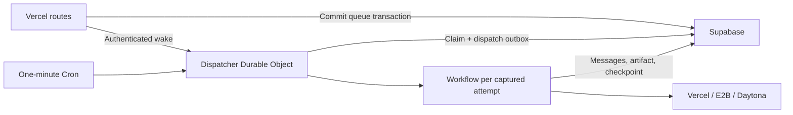

# Native Cloudflare worker

Wallie's production worker runs on Workers Paid, using Workflows and a singleton
Durable Object dispatcher. Vercel hosts the web app; Supabase owns durable state.



## Release scope

| Agent       | Vercel Sandbox | E2B      | Daytona  |
| ----------- | -------------- | -------- | -------- |
| Codex       | In scope       | In scope | In scope |
| Claude Code | In scope       | In scope | In scope |
| Cursor      | In scope       | In scope | In scope |
| OpenCode    | In scope       | In scope | In scope |

- Existing workspace selections, model settings, capability checks, and connection revisions apply.
- Agent CLIs run in provider sandboxes. Workers handle orchestration and persist live events.
- Codex credential refresh, Cursor sign-in/reconnect, and OpenCode custom credentials retain their existing storage contracts.
- Git delivery uses a short-lived utility sandbox on the workspace's selected provider. Helpers receive repository credentials only, preserve non-force recovery branches, and retain cleanup reservations until confirmed stopped.
- The fake sandbox remains a Node/local testing facility.

## Configuration

Apply the forward dispatch migration before enabling the worker. Generate types
from the migrated database; never edit `database.types.ts` manually.

| Where                  | Setting                                                                  | Value                                                               |
| ---------------------- | ------------------------------------------------------------------------ | ------------------------------------------------------------------- |
| Cloudflare variables   | `NEXT_PUBLIC_APP_URL`                                                    | Existing Vercel origin                                              |
| Cloudflare variables   | `NEXT_PUBLIC_SUPABASE_URL`, `NEXT_PUBLIC_SUPABASE_PUBLISHABLE_KEY`       | Existing Supabase project                                           |
| Cloudflare variables   | `GITHUB_APP_ID`                                                          | Existing GitHub App                                                 |
| Cloudflare secrets     | `SUPABASE_SECRET_KEY`, `WALLIE_ENCRYPTION_KEY`, `GITHUB_APP_PRIVATE_KEY` | Current rotated backend values                                      |
| Both platforms, secret | `WALLIE_WORKER_WAKE_SECRET`                                              | Same random value, at least 32 characters                           |
| Vercel server variable | `WALLIE_WORKER_WAKE_URL`                                                 | Deployed Worker URL ending in `/internal/wake`                      |
| Cloudflare variable    | `WALLIE_WORKER_DISPATCH_ENABLED`                                         | Defaults to `false`; enable after live qualification                |
| Cloudflare variable    | `WALLIE_WORKER_AUTH_ENABLED`                                             | Defaults to `false`; enable Cursor sign-in while jobs remain paused |
| Cloudflare variables   | `WORKER_MAX_CONCURRENT_JOBS`, `WORKER_JOB_TIMEOUT_MS`                    | Defaults: `10`, `1800000`                                           |
| Cloudflare variables   | `WALLIE_ENABLED_SANDBOX_PROVIDERS`, `WALLIE_DAYTONA_API_URL_ALLOWLIST`   | Match the web deployment's enablement and endpoint policy           |

Workspace sandbox and personal agent credentials stay encrypted in Supabase.
Use the web deployment's **current** encryption key. Reconnect credentials that
no longer decrypt after rotation; do not restore revoked keys.

Vercel masks hidden Secret values as `[SENSITIVE]` in environment exports. Never
upload those placeholders to Cloudflare or use them to audit saved credentials.
Set the original encryption key and GitHub App private key from your secret store
through Wrangler's secret prompts. Do not rotate the encryption key during setup.

```bash
pnpm check:cloudflare
pnpm worker:deploy
pnpm exec wrangler secret put SUPABASE_SECRET_KEY
pnpm exec wrangler secret put WALLIE_ENCRYPTION_KEY
pnpm exec wrangler secret put GITHUB_APP_PRIVATE_KEY
pnpm exec wrangler secret put WALLIE_WORKER_WAKE_SECRET
```

Set nonsecret connection variables in `wrangler.jsonc` or deployment `--var`
arguments. Never put secrets in that file or pass secret values on command lines.
`keep_vars` preserves operator-supplied connection variables on later deployments.
The checked-in configuration always deploys with dispatch disabled. Preview and
test Workers must use separate binding names and isolated database credentials.

For local native development, put local Supabase values and a test wake secret in
an ignored `.dev.vars` file, then run `pnpm worker:dev`. Set
`WALLIE_WORKER_DISPATCH_ENABLED=true` there to exercise dispatch. The Node daemon
remains available through `pnpm worker`.

## Delivery and recovery

- Vercel wakes the dispatcher after successful creation, approval, rejection, retry, and Cursor sign-in commits. The request has no job payload and times out after two seconds; a failed wake does not undo accepted work.
- Database claims enforce workspace and global capacity. Each claim and its dispatch record commit in one transaction.
- Dispatch retries reuse the same Workflow ID. Execution has a separate one-shot database fence; a replay cannot launch a duplicate agent.
- The absolute attempt deadline starts at claim and is at most 30 minutes. The bounded supervisor stops advertising the attempt on expiry; publication still checks ownership and deadline in the database.
- Each executing Workflow sends ten-second heartbeats. Dispatcher and maintenance activity never advertise job ownership.
- Scheduled maintenance recovers stalls, delivers durable source, reconciles Linear, reaps sandboxes, cleans attachments, and resumes workspace deletion. One maintenance Workflow runs at a time.
- Cursor flows retain a fifteen-second renewable lease and a four-flow concurrency cap. Superseded or canceled claims cannot publish credentials.
- During credential reconnection, enable only `WALLIE_WORKER_AUTH_ENABLED`. Agent claims and maintenance remain paused until `WALLIE_WORKER_DISPATCH_ENABLED` is enabled. Normal processing also enables sign-in dispatch.
- Cloudflare-specific HTTP pooling and WebSocket adapters keep Node socket implementations out of provider request paths. Native tests exercise every provider's HTTP validation path and all twelve runner/setup combinations.

## Qualification and cutover

Offline checks establish packaging and simulated behavior. **They do not establish
live provider parity.** Keep dispatch disabled on production until these pass:

1. Run `pnpm check`, database regressions, generated-type verification, the production build, and route-budget checks.
2. Deploy an isolated qualification Worker with separate binding names and test database credentials. Connect a test repository and all three sandbox providers.
3. Run one source-changing stage for each of the twelve combinations. Record Worker deployment ID, agent/model, sandbox/revision, session/run URL, artifact version, source delivery result, PR URL, and cleanup result. Do not record credentials.
4. Exercise approval, rejection/retry, cancellation, an interrupted Workflow, expired delivery leases, Codex refresh, Cursor login/cancel/reconnect, and OpenCode custom credentials.
5. Verify source checkpoints survive sandbox loss and that delivery retries reuse the existing PR or recovery branch. Confirm helper reservations clear after cleanup.
6. Configure the production Worker secrets and Vercel wake URL, recover old Railway work through cancellation/stall recovery, then enable dispatch for a limited production canary.

Enable explicitly after qualification:

```bash
pnpm worker:deploy --var WALLIE_WORKER_DISPATCH_ENABLED:true
```

Watch Cloudflare logs for dispatch failures, queue age, failed attempts, auth flow
failures, and pending source delivery. Inspect `worker_dispatches`,
`worker_auth_dispatches`, `worker_heartbeats`, and `session_source_deliveries`
through privileged tooling. Never log source bundles, tokens, or login verifiers.

## Rollback

- Deploy with `WALLIE_WORKER_DISPATCH_ENABLED=false` to stop new claims. Existing attempts finish or recover through their captured ownership guards.
- Select the previous Cloudflare revision for subsequent attempts. Preserve the dispatcher binding, Workflow classes, database records, checkpoints, and delivery outbox.
- For schema changes, retain compatibility with in-flight Workflow versions. Never delete Workflow definitions or Durable Object namespaces as part of rollback.
- Railway is retired. Generic Node/container operations remain documented in [Worker operations](WORKER-OPERATIONS.md) and [Worker container](WORKER-CONTAINER.md).
