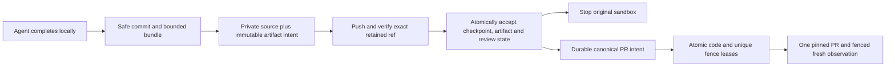
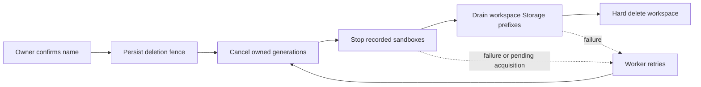

# Worker Operations

Production orchestration runs on Cloudflare Workers and Workflows; see [Native Cloudflare worker](CLOUDFLARE-WORKER.md). The local/container worker is an always-on Node process. It claims durable jobs, executes
pipeline stages, publishes heartbeats, detects stalls, reconciles Linear state,
and reaps orphaned sandboxes. It cannot run as a Vercel serverless callback.

Deployment setup lives in [Self-hosting](SELF_HOSTING.md). Session transition
semantics live in
[Pipeline and worker lifecycle](PIPELINE-WORKER-LIFECYCLE.md).

## Runtime entry

Node/container deployments start Node directly so the worker receives the host's `SIGTERM`
signal. The command preloads process crash handlers and the `server-only`
registration shim before importing [`src/worker/index.ts`](../src/worker/index.ts):

```bash
node --env-file-if-exists=.env.local --import ./scripts/install-crash-handlers.mjs --import ./scripts/register-server-only.mjs --import tsx src/worker/index.ts
```

`pnpm worker` remains a local development convenience with the same startup
flags. Keep any Node/container host command aligned with those flags.
Package-manager wrappers can intercept shutdown signals, preventing the worker
from entering its graceful drain.

Startup performs:

1. Parse worker configuration.
2. Create the service-role Supabase client.
3. Register a heartbeat row.
4. Create the bounded scheduler.
5. Start heartbeat, stall, Linear reconciliation, and sandbox-reaper timers.
6. Enter the claim loop.

The code is authoritative for defaults:

| Setting                        | Current default | Owner                        |
| ------------------------------ | --------------- | ---------------------------- |
| Poll interval                  | 2 seconds       | `src/worker/config.ts`       |
| Heartbeat interval             | 10 seconds      | `src/worker/config.ts`       |
| Stall sweep interval           | 30 seconds      | `src/worker/config.ts`       |
| Linear reconciliation interval | 60 seconds      | `src/worker/config.ts`       |
| Sandbox reaper interval        | 60 seconds      | `src/worker/config.ts`       |
| Default stall timeout          | 15 minutes      | `src/worker/config.ts`       |
| Hard attempt deadline          | 30 minutes      | `WORKER_JOB_TIMEOUT_MS`      |
| Default workspace concurrency  | 2               | Claim RPC/config fallback    |
| Process concurrency            | 10              | `WORKER_MAX_CONCURRENT_JOBS` |

Workspace `concurrency_limit`, `stall_timeout_ms`, and `max_retries` live in
database configuration. Runtime workspace concurrency is enforced by the
`claim_next_agent_job` SQL.

## Claim and scheduling loop

The scheduler fills free process slots through `claim_next_agent_job`. The RPC:

- Selects the oldest ready queued job with row locking.
- Skips future `scheduled_at` values.
- Avoids a workspace whose active sandbox connection is being mutated.
- Checks current running jobs against the workspace limit.
- Atomically moves one queued job to running.
- Increments its attempt count.

After claim, the scheduler advertises the job immediately in its heartbeat and
starts processing it. A claim error backs off to twice the normal poll interval.
At capacity, the scheduler wakes when a job finishes or the poll interval
expires.

Each attempt has a wall-clock deadline covering configuration reads, sandbox
setup, agent execution, publication, and cleanup. `WORKER_JOB_TIMEOUT_MS` accepts
a positive integer up to 30 minutes; unset means 30 minutes. This portable limit
fits every supported sandbox driver. Longer attempts need a provider lifetime
contract before this limit can be raised. Heartbeats cannot extend
this deadline. On expiry, the worker aborts execution, starts sandbox cleanup,
and uses `fail_session_job_attempt` to retire only the captured job and attempt.
If a start races a runless failure, recovery re-reads the same attempt once.
Recovery itself is limited to 10 seconds, after which the scheduler releases its
slot and stops advertising the job; the stall sweeper handles a database outage.
Late setup and iterator results check cancellation before starting or publishing
work, while the database ownership guards protect replacement attempts.

Do not manually set a queued job to running. That bypasses row locks, workspace
capacity, mutation locks, attempt accounting, and heartbeat ownership.

## Controlled checkpoint continuity release

Checkpoint continuity starts **paused** after the OP-499 migration. The database
control is shared by Node and Cloudflare workers; changing a process environment
variable cannot override it. No migration, deployment hook, or production worker
automatically enables this release.

Use trusted service-role RPCs to inspect `get_git_continuity_release_state()` and
call `set_git_continuity_release(p_enabled, p_expected_revision, p_reason)` with
the observed revision and an operational reason. A stale expected revision returns
no row: reload and review the newer decision. Each actual toggle advances an
audited revision; do not edit the private control or audit tables.

```sql
-- These are service-role RPC calls; run through an authorized operator client.
select * from public.get_git_continuity_release_state();
-- Replace N with the returned revision, after completing the release proof.
select * from public.set_git_continuity_release(true, N, 'Qualified checkpoint continuity release');
-- Pause with the CURRENT revision, not a revision saved before enablement.
select * from public.set_git_continuity_release(false, N, 'Pause checkpoint execution and PR promotion');
```

Before enablement: apply migrations and regenerate/verify types; deploy compatible
workers; run `pnpm check`, `pnpm check:db-tests` and `pnpm check:continuity` against
an isolated local project; complete the Vercel/GitHub smoke below; inspect recovery
and cleanup backlogs; then explicitly enable the reviewed cohort. Provider/auth
qualification and normal worker dispatch controls remain separate requirements.

Pausing blocks new pipeline claims, new execution starts and canonical PR
promotion. A claim caught between admission and start is deferred under its same
job generation, retaining fixed Git inputs and the queued run. A previous release
revision cannot revive across disable/re-enable. Claim attempt IDs remain
monotonic for fencing, while release-only deferrals do not consume the execution
retry budget or increase execution retry backoff. Already-started runs and durable
checkpoint publication/recovery can finish, including retained-ref pushes needed
to preserve completed source. Cleanup and auth dispatch remain available. A pause
cannot revoke an already-authorized or already-issued GitHub request: wait for claims/provider resources
to become quiescent, inspect receipts, and let the same immutable operation
reconcile after resume. Never use pause as a substitute for cancellation.

Only sessions created after this migration are enrolled. Existing sessions retain
artifacts/history and can recover already-produced output, but require an explicit
fresh start for further execution or canonical promotion. Inspect
`get_session_git_continuity_state(session_id)` for `fresh_start_required`,
`release_paused`, or `enabled`; it is tenant-scoped for signed-in viewers. Do not
insert enrollment rows or infer code from the latest timestamp, PR, artifact or
workspace default. Recover legacy work in a human-reviewed repository branch/new
commit and create a new session against the intended repository. If provenance is
unknown, keep the old session for investigation and start fresh; no automatic
legacy-head adoption is offered.

## Submitted artifact feedback

Request changes can include selected open inline threads and an optional
whole-stage note. The submission checks the displayed artifact, version and
review revision, saves the selected comment revisions, and queues one job from
the reviewed artifact's exact checkpoint in the same transaction. Later comment
edits and replies remain unsent; they do not change that job's prompt.

An uncertain response should be retried with the same request ID and content.
The saved receipt returns the same feedback batch and job generation even after
the session advances. Reusing that ID for different content conflicts. If the
transaction commits but the session refresh fails, the API returns an accepted
receipt and the UI refreshes state; it must not roll back or submit another job.

Each batch permits 20 threads, 100 comments, 4,000 code points of whole-stage
feedback and 40,000 code points of rendered feedback, including quoted text.
Oversized submissions fail without truncation or enqueueing. Select fewer
threads or shorten the note before retrying. A stale review requires an explicit
refresh so the reviewer can inspect the changed comments.

Existing whole-stage integrations continue to use their established rejection
path. Feedback batches do not enable continuity or bypass legacy fresh-start
requirements.

## Source durability and delivery



A bundle is at most 4 MiB, stored privately under
`session-source-checkpoints/<workspace>/<run>.bundle`, with a bounded database
fallback during a Storage outage. The artifact is not accepted until the exact
retained ref is verified. Interrupted publication retries the immutable intent
within the original attempt deadline; it never reruns the agent from partial
output. A text-only result preserves its producing input SHA/ref.

Canonical PR synchronization is independent of artifact acceptance. It preserves
external commits, uses an operation fence as well as a code SHA lease, and cannot
report a stale PR observation as synchronized. Closed/merged epochs require an
explicit human successor. An uncertain creation POST is reconciled by all-state
reads, never a blind POST retry. See [checkpoint lineage](GIT-CHECKPOINT-LINEAGE.md)
for receipt, successor and conflict-recovery details.

Inspect `session_checkpoint_publications`, `session_pr_sync`,
`session_pr_operations` and their safe error/claim metadata. Never log bundle,
artifact draft, provider credential or installation-token bytes. Trusted recovery
uses utility sandboxes and Git plumbing only; it never executes repository source.

### Retained-ref policy and cleanup

| Ref or payload                                                                   | Policy                                                                                                                                                                                                    |
| -------------------------------------------------------------------------------- | --------------------------------------------------------------------------------------------------------------------------------------------------------------------------------------------------------- |
| Accepted checkpoint, live/pinned input, artifact lineage, recoverable revision   | Retain the required ref. Accepted lineage is conservatively retained while its session exists.                                                                                                            |
| Canonical PR, operation-fence, attempt, human or arbitrary ref                   | Never deleted by checkpoint candidate cleanup.                                                                                                                                                            |
| Unadopted owned retained candidate                                               | Eligible seven days after its immutable original publication deadline, only after irreversible stale retirement and reference/lease checks.                                                               |
| Candidate ref changed externally                                                 | Preserve it, record a conflict, require operator reconciliation.                                                                                                                                          |
| Missing candidate after a lost delete response                                   | Exact absent-ref receipt is idempotent recovery.                                                                                                                                                          |
| Disconnected repository, deleting/deleted workspace, unavailable GitHub/provider | Cleanup is blocked or retried; seven days is eligibility, not a promise during outages or after identity/credentials are removed.                                                                         |
| Private bundles and original draft payloads                                      | Retained for forensic/source recovery until workspace deletion; remote-ref cleanup does not fake delivery or clear payloads. Storage-only failed-prepare orphans share this explicit retention exception. |

Candidate cleanup is a durable lease/receipt protocol. Workspace admission and
session → job → run → publication locks precede cleanup state; a repository/SHA
advisory boundary serializes new consumers with retirement. Once a delete claim
has existed, its tombstone also fences late consumers after an uncertain delete
or expired lease. A separately verified accepted ref for the same SHA remains a
valid restore source. The conservative tombstone also blocks a new raw-SHA root
from ordinary `main` when that SHA was retired, even if `main` now contains it;
use a new reachable commit or an explicitly verified retained source, rather than
expecting a new session alone to bypass retirement. The worker derives only
`refs/heads/wallie/checkpoints/<run>/<recorded-sha>`, compares the exact remote SHA,
uses an explicit delete lease and confirms absence. No broad branch scan or
ancestry-based garbage collection is used.

Monitor `session_checkpoint_cleanup` for due, claimed, deleted and blocked intents.
Restore the exact repository/installation connection before retrying a disconnected
candidate. Do not manufacture an absence receipt, clear a tombstone, alter a
publication deadline, or delete refs directly from guessed naming patterns. After
workspace deletion, retained remote history belongs to the repository owner and
requires explicit owner review; tenant cleanup does not guess what to remove.

### Isolated release proof

`pnpm check:db-tests` temporarily enables admission only on the loopback Supabase
project identified by the local CLI, runs the SQL suite, then restores its prior
state. `pnpm check:continuity` runs an opt-in local-DB processor fixture with a
deterministic runner and fake provider/remote transport. It exercises real
lifecycle RPCs, capture/publication, request changes, stale replacement and a fresh
worker process. Neither command enables a hosted project. Use an exclusive test
project; tests deliberately toggle the release revision.

The guarded `scripts/smoke-continuity-release.ts` runs actual lifecycle RPCs with
real Vercel utility sandboxes and the existing `anantjain-xyz/wallie-dev` GitHub
repository (exact numeric identity checked). It never creates a repository. Preview
its plan first; use `--execute` only with a loopback test DB and dedicated fixture
bindings. Each run creates its own test base/drift branches and a clearly labeled
smoke PR targeting that base, never `main`. Guarded pushes cannot delete or update
unrelated refs, and existing refs/PRs are checked afterward. Test history is
retained; do not delete repositories or refs as automatic cleanup. Fixture source
contains `vercel.json` disabling automatic deployment. Empty operation-fence commits
cannot carry that file, so the connected integration may still post checks or
attempt a preview; the test performs no deployment/promotion command and changes
no Vercel project settings. Operator credentials stay in process memory/environment. It uses
deterministic source edits and manual trusted transport orchestration, not an LLM
or the deployed daemon. Fresh child processes restore persisted inputs and a
prepared publication after the original sandbox has stopped. Retain its safe
SHA/ref/PR/digest receipts and sandbox cleanup evidence with the release review.

## Heartbeats and activity

- Registration upserts worker start time, heartbeat time, and an empty active
  job list.
- Periodic, claim, and completion paths each publish a snapshot of the
  scheduler's in-flight set. Those writes are not serialized, so an older
  snapshot can commit after a newer one and temporarily omit a live job.
- Heartbeat failure is logged but does not crash the worker.
- Before processing, the worker touches activity on linked active runs.
- Persisting an agent event refreshes the run's `last_activity_at`.
- The stall detector protects jobs advertised by a heartbeat newer than its
  freshness window.

During an out-of-order heartbeat window, freshness alone does not prove that
every live job appears in the stored snapshot. A long-running setup or runner
that emits no activity can therefore be treated as unowned and recovered once
its activity exceeds the stall timeout.

There is no public worker health endpoint. The optional [local control socket](WORKER-CONTAINER.md#drain-before-a-planned-stop) reports drain status, not application readiness. Service-role-only
`worker_heartbeats`, worker logs, and durable job/run activity are the health
evidence.

## Recovery loops

### Stall detector

The stall sweep:

1. Pages active runs.
2. Ignores a queued run until its parent job is running.
3. Calculates the workspace timeout from last activity or creation time.
4. Skips jobs owned by a fresh worker heartbeat.
5. Issues a status-filtered update that marks a stale active run as error, but
   does not request or verify an affected row.
6. Attempts to stop its sandbox.
7. Reschedules the job with exponential backoff when retries remain, otherwise
   marks it terminally errored.
8. Parks a generating session in `rejected`.

A scheduled retry returns to `in_progress` only after a worker claims it.
Because the detector does not verify that step 5 changed the run, a processor
can complete between the sweep's read and update while the detector continues
with diagnostics, sandbox stop, retry/error handling, and session parking. This
transition is not currently a successful compare-and-swap boundary.

### Linear reconciler

The reconciler pages nonarchived, Linear-linked sessions in active phases,
batches issue-state reads by workspace, and applies the workspace's routing
configuration. Pagination orders only by `created_at`, limits each page to 50
rows, and advances with `created_at > previous_cursor`. If more than 50 eligible
sessions share the boundary timestamp, the remaining tied rows are skipped;
subsequent sweeps repeat the same ordering and may never reach them. For rows
that are reached, the reconciler may:

- Ensure the current stage has work queued.
- Cancel work and reroute to a configured stage.
- Archive a session.
- Pause or ignore an unmapped status.

Linear rate limits are retried once with a bounded delay. Persistent throttling
aborts the sweep so the next interval can continue later.

### Sandbox reaper

The reaper is independent of stall detection so it can recover resources whose
IDs were recorded on run or capability-check rows and later lost their active
owner. It gives new resources a creation grace period and only attempts to stop
provider resources that are known to Wallie and are not protected by an active
run, job, or recent capability check.

A process death after provider allocation but before `onSandboxCreated` records
the ID leaves no Wallie-known row for the reaper to match. Such an unrecorded
resource relies on provider TTL or operator cleanup.

Timer tasks are fire-and-forget. There is currently no mutex preventing a slow
sweep from overlapping its next interval or a manager-triggered maintenance
tick. Worker drain stops new maintenance ticks and waits for callbacks already running.

### Workspace deletion

Deletion retains the workspace and provider credentials until cleanup finishes.

Workspace deletion drains Wallie-owned sandboxes, private Storage, and database
state. GitHub repositories, commits, branches, and PRs remain repository artifacts.
A live setup request attempts bounded cleanup of the exact ref and PR it created
when admission fails. Process death can leave a visible setup ref or PR for the
repository owner to remove; cleanup does not guarantee rollback across services.



| State or evidence                                  | Meaning and recovery                                                                                                                                                                                                      |
| -------------------------------------------------- | ------------------------------------------------------------------------------------------------------------------------------------------------------------------------------------------------------------------------- |
| DELETE returns `202`, `deleted: false`             | Deletion was accepted; cleanup remains pending. The owner can retry, and the worker resumes it on the reconciliation interval.                                                                                            |
| `workspaces.deletion_requested_at` is set          | New session creation, generation starts/retries, probes, device authentication, and uploads are fenced in the database. Settings mutations return `409`.                                                                  |
| `workspace_resource_operations` contains a sandbox | Allocation was reserved before calling the provider. Its connection revision is fixed; credential rotation waits until ownership transfers or cleanup succeeds.                                                           |
| A recorded sandbox ID cannot be stopped            | Keep its ownership and credentials. Provider errors, missing credentials, or revision mismatches prevent hard deletion, even after the recovery deadline.                                                                 |
| An exact sandbox cleanup receipt exists            | Rotation/disconnect verified the stop before discarding credentials. Deletion accepts only the receipt for the same workspace, provider, credential revision, and sandbox ID; audit IDs remain intact.                    |
| An acquisition has no recorded ID                  | Wait through the provider acquisition deadline, requested sandbox lifetime, and a ten-minute allowance. Recovery relies on provider-enforced expiry for this crash window; it cannot discover an arbitrary unreturned ID. |
| An upload has an ambiguous outcome                 | Retain its exact bucket/path for five minutes before retry cleanup. Storage metadata writes also honor the deletion fence.                                                                                                |

- Both avatar and attachment prefixes are drained in pages, including nested paths, before the database cascade. A failed list/remove keeps deletion pending.
- Inspect `[workspace-delete] cleanup will retry` and `resource recovery will retry` logs together with the reservation rows. Restore provider access when cleanup cannot proceed; do not delete reservations or credential rows to force completion.
- Legacy sandbox IDs without matching credentials or receipts remain pending. An operator must verify the original provider account and restore its matching encrypted credentials and recorded revision under controlled database maintenance before retrying cleanup. The deletion fence intentionally prevents ordinary settings edits; never fabricate receipts or erase ownership to bypass it.
- During rollout, apply the migration and deploy compatible web/worker versions, then drain older processes before requesting deletion. Older in-flight acquisitions have no reservation record.

## Cancellation and shutdown

User and reconciler cancellation must call the shared cancellation service.
Direct status updates do not close sandbox-attachment and late-write races.

Worker drain and process termination are separate steps:

| State      | Behavior                                                                                                                   |
| ---------- | -------------------------------------------------------------------------------------------------------------------------- |
| `running`  | Claims jobs, handles Cursor sign-ins, and schedules maintenance.                                                           |
| `draining` | Stops new intake; waits for pending claims, owned jobs, Cursor flow release, and running maintenance. Heartbeats continue. |
| `drained`  | No new work; stays alive and heartbeating until stopped.                                                                   |
| `stopping` | `SIGINT`/`SIGTERM` requested; completes the same drain, settles heartbeat writes, deregisters, and exits.                  |

- Use the [local drain command](WORKER-CONTAINER.md#drain-before-a-planned-stop) before planned termination on hosts with a short stop deadline.
- A pending claim can return another owned job after drain begins; an empty active-job list alone does **not** prove drain completion.
- Cursor sign-in flows are aborted and released for another worker; pipeline jobs finish normally.
- Direct `SIGINT`/`SIGTERM` still drains gracefully, including when local control is disabled.

The worker does not impose a separate drain deadline. Sandbox provider timeouts
bound normal execution, while a shorter application deadline would recreate the
orphaned-command window that graceful draining is intended to close.

Crash handlers log a stack and exit nonzero; the host restart policy is
responsible for starting a replacement.

Hard kills, OOM termination, and hosts that do not deliver a graceful signal
still rely on stale-heartbeat detection, retries, provider TTLs, and the reaper.

## Deployment and scaling

- Deploy the web app and worker from compatible code and schema versions.
- Give both runtimes the required shared environment; keep service-role and
  encryption values server-side.
- For the Node daemon, use an always-on host with restart-on-exit.
- Multiple worker processes are safe at the queue-claim layer because the
  database claim uses locks and workspace capacity checks.
- Process concurrency and per-workspace concurrency are independent limits.
- Apply expand/contract database changes so old and new worker versions can
  coexist during a rollout.
- Confirm the deployment system watches every transitive worker owner, not only
  `src/worker/**`.

Cloudflare dispatch and recovery use Workflows rather than process signals.
For native deployment, qualification, and rollback, follow the
[Cloudflare worker guide](CLOUDFLARE-WORKER.md). For a generic Node/container host,
configure direct `SIGTERM` delivery and a 45-minute drain, or explicitly drain and
verify the exact worker before asking a host with a shorter stop budget to replace it.

## Safe troubleshooting

| Symptom                                         | Read-only evidence                                                                                                                               | Safe action                                                                                                                                                    |
| ----------------------------------------------- | ------------------------------------------------------------------------------------------------------------------------------------------------ | -------------------------------------------------------------------------------------------------------------------------------------------------------------- |
| Jobs remain queued                              | `get_session_git_continuity_state`, release revision/enrollment, worker startup/fatal logs, heartbeat, `scheduled_at`, connection-mutation state | Inspect pause/fresh-start reason first; explicitly enable the qualified release or create a fresh session; otherwise restore worker/schema or wait for backoff |
| Job remains running                             | Fresh heartbeat ownership, run status, `last_activity_at`, messages                                                                              | Fresh ownership means wait; stale ownership is handled by the stall timeout                                                                                    |
| Session remains `in_progress`                   | Latest job/run status and error, provider connection, capability readiness                                                                       | Fix readiness; cancel active work through the session action when needed                                                                                       |
| Session is `rejected` without reviewer feedback | Latest run error/cancel message and queued retry                                                                                                 | Distinguish recovery parking from human rejection before rerunning                                                                                             |
| Orphan sandbox suspected                        | Recorded provider/revision/ID and reaper/provider logs                                                                                           | Use cancellation or the maintenance path; preserve ownership rows until cleanup                                                                                |
| Linear state is stale                           | Reconciler errors/rate-limit messages                                                                                                            | Run one manager maintenance tick or wait for the next sweep                                                                                                    |
| Connection cannot rotate                        | Active jobs/runs/checks/device-auth or mutation-lock evidence                                                                                    | Finish or cancel related work; do not delete the lock or credential row                                                                                        |

The manager maintenance endpoint runs workspace-scoped stall cleanup and Linear
reconciliation, but its sandbox-reaper call is currently global. A manager can
therefore trigger reaping of eligible Wallie-known resources belonging to other
workspaces. It does not process queued jobs. Treat this cross-workspace reaper
scope as an implementation gap, and do not use the endpoint as a replacement
worker loop.

## Unsafe manual repairs

Avoid:

- Setting jobs to running or success by hand.
- Flipping session phase without its transition owner.
- Deleting active runs, capability checks, provider connections, or ownership
  rows before sandbox cleanup.
- Clearing connection-mutation locks while work may still be active.
- Requeueing canceled jobs outside the guarded retry owner.
- Running destructive database reset or migration commands against a shared or
  hosted project.

Those actions bypass CAS, authorization, retry, cancellation, and resource
ownership invariants.

## Operational proof

A healthy deployment should provide:

1. Successful worker startup and registration.
2. A fresh heartbeat containing the expected in-flight set.
3. A queued test job claimed within the poll interval.
4. Run activity and normalized messages.
5. A reviewable artifact or an actionable terminal error.
6. No surviving sandbox after completion/cancellation beyond provider cleanup
   latency.
7. Recovery of a deliberately interrupted job through stale heartbeat and retry
   in a safe test environment.

## Known operational gaps

- No public worker readiness/health endpoint or code/schema compatibility
  marker exists.
- Periodic recovery sweeps can overlap.
- Heartbeat writes are not serialized, so a stale snapshot can overwrite a
  newer in-flight job set.
- The stall detector does not verify that its status-filtered run update won
  before performing the remaining recovery actions.
- Linear reconciliation uses a `created_at`-only cursor and can skip sessions
  tied at a 50-row page boundary.
- Manager-triggered maintenance invokes the sandbox reaper without a workspace
  filter.
- The reaper cannot discover a sandbox whose provider ID was never recorded on
  a run or capability-check row.
- `WORKER_MAX_CONCURRENT_JOBS` is consumed directly by worker config but is not
  represented in the shared environment schema.
- Native Cloudflare SDK transports and all twelve combinations still require
  live qualification before production dispatch is enabled.

Keep these visible during deployment work; do not silently describe the desired
future state as current behavior.

The worker passes its absolute attempt deadline into the publication RPC. PostgreSQL checks wall-clock time after ownership locks and after writes, rolling back the artifact and success transition if a lock wait crosses the deadline. Aborting the HTTP request alone is insufficient. Timed-out runs retain the controlled deadline reason in their visible run history. Deploy the forward deadline migration before updated workers; the optional RPC argument permits older workers during rollout.
