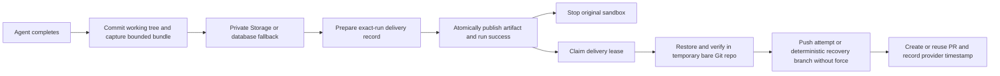
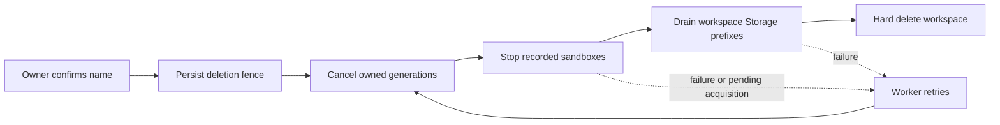

# Worker Operations

Production orchestration runs on Cloudflare Workers and Workflows; see [Native Cloudflare worker](CLOUDFLARE-WORKER.md). The local/container worker is an always-on Node process. It claims durable jobs, executes
pipeline stages, publishes heartbeats, detects stalls, reconciles Linear state,
and reaps orphaned sandboxes. It cannot run as a Vercel serverless callback.

Deployment setup lives in [Self-hosting](SELF_HOSTING.md). Session transition
semantics live in
[Pipeline and worker lifecycle](PIPELINE-WORKER-LIFECYCLE.md).

## Runtime entry

Node/container deployments start Node directly so the worker receives the host's `SIGTERM`
signal. The command preloads process crash handlers and the `server-only`
registration shim before importing [`src/worker/index.ts`](../src/worker/index.ts):

```bash
node --env-file-if-exists=.env.local --import ./scripts/install-crash-handlers.mjs --import ./scripts/register-server-only.mjs --import tsx src/worker/index.ts
```

`pnpm worker` remains a local development convenience with the same startup
flags. Keep any Node/container host command aligned with those flags.
Package-manager wrappers can intercept shutdown signals, preventing the worker
from entering its graceful drain.

Startup performs:

1. Parse worker configuration.
2. Create the service-role Supabase client.
3. Register a heartbeat row.
4. Create the bounded scheduler.
5. Start heartbeat, stall, Linear reconciliation, and sandbox-reaper timers.
6. Enter the claim loop.

The code is authoritative for defaults:

| Setting                        | Current default | Owner                        |
| ------------------------------ | --------------- | ---------------------------- |
| Poll interval                  | 2 seconds       | `src/worker/config.ts`       |
| Heartbeat interval             | 10 seconds      | `src/worker/config.ts`       |
| Stall sweep interval           | 30 seconds      | `src/worker/config.ts`       |
| Linear reconciliation interval | 60 seconds      | `src/worker/config.ts`       |
| Sandbox reaper interval        | 60 seconds      | `src/worker/config.ts`       |
| Default stall timeout          | 15 minutes      | `src/worker/config.ts`       |
| Hard attempt deadline          | 30 minutes      | `WORKER_JOB_TIMEOUT_MS`      |
| Default workspace concurrency  | 2               | Claim RPC/config fallback    |
| Process concurrency            | 10              | `WORKER_MAX_CONCURRENT_JOBS` |

Workspace `concurrency_limit`, `stall_timeout_ms`, and `max_retries` live in
database configuration. Runtime workspace concurrency is enforced by the
`claim_next_agent_job` SQL.

## Claim and scheduling loop

The scheduler fills free process slots through `claim_next_agent_job`. The RPC:

- Selects the oldest ready queued job with row locking.
- Skips future `scheduled_at` values.
- Avoids a workspace whose active sandbox connection is being mutated.
- Checks current running jobs against the workspace limit.
- Atomically moves one queued job to running.
- Increments its attempt count.

After claim, the scheduler advertises the job immediately in its heartbeat and
starts processing it. A claim error backs off to twice the normal poll interval.
At capacity, the scheduler wakes when a job finishes or the poll interval
expires.

Each attempt has a wall-clock deadline covering configuration reads, sandbox
setup, agent execution, publication, and cleanup. `WORKER_JOB_TIMEOUT_MS` accepts
a positive integer up to 30 minutes; unset means 30 minutes. This portable limit
fits every supported sandbox driver. Longer attempts need a provider lifetime
contract before this limit can be raised. Heartbeats cannot extend
this deadline. On expiry, the worker aborts execution, starts sandbox cleanup,
and uses `fail_session_job_attempt` to retire only the captured job and attempt.
If a start races a runless failure, recovery re-reads the same attempt once.
Recovery itself is limited to 10 seconds, after which the scheduler releases its
slot and stops advertising the job; the stall sweeper handles a database outage.
Late setup and iterator results check cancellation before starting or publishing
work, while the database ownership guards protect replacement attempts.

Do not manually set a queued job to running. That bypasses row locks, workspace
capacity, mutation locks, attempt accounting, and heartbeat ownership.

## Source durability and delivery



| Condition                        | Behavior                                                                                                                                                                                                        |
| -------------------------------- | --------------------------------------------------------------------------------------------------------------------------------------------------------------------------------------------------------------- |
| Normal checkpoint                | Incremental bundle, maximum 4 MiB; deterministic workspace/run key in the private `session-source-checkpoints` bucket.                                                                                          |
| Storage outage                   | Bounded service-only DB fallback (up to about 5.6 MiB base64), cleared only after GitHub delivery succeeds.                                                                                                     |
| Checkpoint or outbox write fails | No artifact publication. An uploaded deterministic checkpoint survives an outbox failure. If neither store is durable, preserve the sandbox until provider expiry; inspect `source_recovery_required` promptly. |
| Push, PR, or PR metadata fails   | Keep the outbox record; retry with exponential backoff up to one hour. Token usage/history errors do not block delivery.                                                                                        |
| Worker crashes                   | An unpublished record remains private recovery data. Published work can be reclaimed after its two-minute lease expires. Stale lease IDs cannot acknowledge replacement claims.                                 |
| Maintenance hangs                | One-minute delivery deadline and 30-second Git subprocess limits; the lease expires for another worker.                                                                                                         |
| Workspace deletion               | Fence claims/uploads; wait for active delivery leases, remove checkpoint objects, and cascade private fallback rows.                                                                                            |

The reconciliation timer drains up to three ready deliveries per sweep. Source
recovery requires Git in the worker image. Apply the deletion, publication-deadline,
PR-freshness, and source-delivery migrations before deploying updated workers.
Inspect `session_source_deliveries.status`, `next_attempt_at`, and `last_error_code`
for pending delivery; never put bundle bytes or installation tokens into logs.

If the attempt branch already contains the checkpoint, delivery preserves its
newer commits. If the histories diverge, delivery uses a bounded recovery branch
derived from the attempt branch and checkpoint commit. Retries keep that recovery
identity for the PR and its metadata. Neither path force-pushes over remote work.

## Heartbeats and activity

- Registration upserts worker start time, heartbeat time, and an empty active
  job list.
- Periodic, claim, and completion paths each publish a snapshot of the
  scheduler's in-flight set. Those writes are not serialized, so an older
  snapshot can commit after a newer one and temporarily omit a live job.
- Heartbeat failure is logged but does not crash the worker.
- Before processing, the worker touches activity on linked active runs.
- Persisting an agent event refreshes the run's `last_activity_at`.
- The stall detector protects jobs advertised by a heartbeat newer than its
  freshness window.

During an out-of-order heartbeat window, freshness alone does not prove that
every live job appears in the stored snapshot. A long-running setup or runner
that emits no activity can therefore be treated as unowned and recovered once
its activity exceeds the stall timeout.

There is no public worker health endpoint. The optional [local control socket](WORKER-CONTAINER.md#drain-before-a-planned-stop) reports drain status, not application readiness. Service-role-only
`worker_heartbeats`, worker logs, and durable job/run activity are the health
evidence.

## Recovery loops

### Stall detector

The stall sweep:

1. Pages active runs.
2. Ignores a queued run until its parent job is running.
3. Calculates the workspace timeout from last activity or creation time.
4. Skips jobs owned by a fresh worker heartbeat.
5. Issues a status-filtered update that marks a stale active run as error, but
   does not request or verify an affected row.
6. Attempts to stop its sandbox.
7. Reschedules the job with exponential backoff when retries remain, otherwise
   marks it terminally errored.
8. Parks a generating session in `rejected`.

A scheduled retry returns to `in_progress` only after a worker claims it.
Because the detector does not verify that step 5 changed the run, a processor
can complete between the sweep's read and update while the detector continues
with diagnostics, sandbox stop, retry/error handling, and session parking. This
transition is not currently a successful compare-and-swap boundary.

### Linear reconciler

The reconciler pages nonarchived, Linear-linked sessions in active phases,
batches issue-state reads by workspace, and applies the workspace's routing
configuration. Pagination orders only by `created_at`, limits each page to 50
rows, and advances with `created_at > previous_cursor`. If more than 50 eligible
sessions share the boundary timestamp, the remaining tied rows are skipped;
subsequent sweeps repeat the same ordering and may never reach them. For rows
that are reached, the reconciler may:

- Ensure the current stage has work queued.
- Cancel work and reroute to a configured stage.
- Archive a session.
- Pause or ignore an unmapped status.

Linear rate limits are retried once with a bounded delay. Persistent throttling
aborts the sweep so the next interval can continue later.

### Sandbox reaper

The reaper is independent of stall detection so it can recover resources whose
IDs were recorded on run or capability-check rows and later lost their active
owner. It gives new resources a creation grace period and only attempts to stop
provider resources that are known to Wallie and are not protected by an active
run, job, or recent capability check.

A process death after provider allocation but before `onSandboxCreated` records
the ID leaves no Wallie-known row for the reaper to match. Such an unrecorded
resource relies on provider TTL or operator cleanup.

Timer tasks are fire-and-forget. There is currently no mutex preventing a slow
sweep from overlapping its next interval or a manager-triggered maintenance
tick. Worker drain stops new maintenance ticks and waits for callbacks already running.

### Workspace deletion

Deletion retains the workspace and provider credentials until cleanup finishes.

Workspace deletion drains Wallie-owned sandboxes, private Storage, and database
state. GitHub repositories, commits, branches, and PRs remain repository artifacts.
A live setup request attempts bounded cleanup of the exact ref and PR it created
when admission fails. Process death can leave a visible setup ref or PR for the
repository owner to remove; cleanup does not guarantee rollback across services.



| State or evidence                                  | Meaning and recovery                                                                                                                                                                                                      |
| -------------------------------------------------- | ------------------------------------------------------------------------------------------------------------------------------------------------------------------------------------------------------------------------- |
| DELETE returns `202`, `deleted: false`             | Deletion was accepted; cleanup remains pending. The owner can retry, and the worker resumes it on the reconciliation interval.                                                                                            |
| `workspaces.deletion_requested_at` is set          | New session creation, generation starts/retries, probes, device authentication, and uploads are fenced in the database. Settings mutations return `409`.                                                                  |
| `workspace_resource_operations` contains a sandbox | Allocation was reserved before calling the provider. Its connection revision is fixed; credential rotation waits until ownership transfers or cleanup succeeds.                                                           |
| A recorded sandbox ID cannot be stopped            | Keep its ownership and credentials. Provider errors, missing credentials, or revision mismatches prevent hard deletion, even after the recovery deadline.                                                                 |
| An exact sandbox cleanup receipt exists            | Rotation/disconnect verified the stop before discarding credentials. Deletion accepts only the receipt for the same workspace, provider, credential revision, and sandbox ID; audit IDs remain intact.                    |
| An acquisition has no recorded ID                  | Wait through the provider acquisition deadline, requested sandbox lifetime, and a ten-minute allowance. Recovery relies on provider-enforced expiry for this crash window; it cannot discover an arbitrary unreturned ID. |
| An upload has an ambiguous outcome                 | Retain its exact bucket/path for five minutes before retry cleanup. Storage metadata writes also honor the deletion fence.                                                                                                |

- Both avatar and attachment prefixes are drained in pages, including nested paths, before the database cascade. A failed list/remove keeps deletion pending.
- Inspect `[workspace-delete] cleanup will retry` and `resource recovery will retry` logs together with the reservation rows. Restore provider access when cleanup cannot proceed; do not delete reservations or credential rows to force completion.
- Legacy sandbox IDs without matching credentials or receipts remain pending. An operator must verify the original provider account and restore its matching encrypted credentials and recorded revision under controlled database maintenance before retrying cleanup. The deletion fence intentionally prevents ordinary settings edits; never fabricate receipts or erase ownership to bypass it.
- During rollout, apply the migration and deploy compatible web/worker versions, then drain older processes before requesting deletion. Older in-flight acquisitions have no reservation record.

## Cancellation and shutdown

User and reconciler cancellation must call the shared cancellation service.
Direct status updates do not close sandbox-attachment and late-write races.

Worker drain and process termination are separate steps:

| State      | Behavior                                                                                                                   |
| ---------- | -------------------------------------------------------------------------------------------------------------------------- |
| `running`  | Claims jobs, handles Cursor sign-ins, and schedules maintenance.                                                           |
| `draining` | Stops new intake; waits for pending claims, owned jobs, Cursor flow release, and running maintenance. Heartbeats continue. |
| `drained`  | No new work; stays alive and heartbeating until stopped.                                                                   |
| `stopping` | `SIGINT`/`SIGTERM` requested; completes the same drain, settles heartbeat writes, deregisters, and exits.                  |

- Use the [local drain command](WORKER-CONTAINER.md#drain-before-a-planned-stop) before planned termination on hosts with a short stop deadline.
- A pending claim can return another owned job after drain begins; an empty active-job list alone does **not** prove drain completion.
- Cursor sign-in flows are aborted and released for another worker; pipeline jobs finish normally.
- Direct `SIGINT`/`SIGTERM` still drains gracefully, including when local control is disabled.

The worker does not impose a separate drain deadline. Sandbox provider timeouts
bound normal execution, while a shorter application deadline would recreate the
orphaned-command window that graceful draining is intended to close.

Crash handlers log a stack and exit nonzero; the host restart policy is
responsible for starting a replacement.

Hard kills, OOM termination, and hosts that do not deliver a graceful signal
still rely on stale-heartbeat detection, retries, provider TTLs, and the reaper.

## Deployment and scaling

- Deploy the web app and worker from compatible code and schema versions.
- Give both runtimes the required shared environment; keep service-role and
  encryption values server-side.
- For the Node daemon, use an always-on host with restart-on-exit.
- Multiple worker processes are safe at the queue-claim layer because the
  database claim uses locks and workspace capacity checks.
- Process concurrency and per-workspace concurrency are independent limits.
- Apply expand/contract database changes so old and new worker versions can
  coexist during a rollout.
- Confirm the deployment system watches every transitive worker owner, not only
  `src/worker/**`.

Cloudflare dispatch and recovery use Workflows rather than process signals.
For native deployment, qualification, and rollback, follow the
[Cloudflare worker guide](CLOUDFLARE-WORKER.md). For a generic Node/container host,
configure direct `SIGTERM` delivery and a 45-minute drain, or explicitly drain and
verify the exact worker before asking a host with a shorter stop budget to replace it.

## Safe troubleshooting

| Symptom                                         | Read-only evidence                                                                                    | Safe action                                                                     |
| ----------------------------------------------- | ----------------------------------------------------------------------------------------------------- | ------------------------------------------------------------------------------- |
| Jobs remain queued                              | Worker startup/fatal logs, latest heartbeat, `scheduled_at`, running count, connection-mutation state | Restore worker/environment/schema; wait if backoff is scheduled                 |
| Job remains running                             | Fresh heartbeat ownership, run status, `last_activity_at`, messages                                   | Fresh ownership means wait; stale ownership is handled by the stall timeout     |
| Session remains `in_progress`                   | Latest job/run status and error, provider connection, capability readiness                            | Fix readiness; cancel active work through the session action when needed        |
| Session is `rejected` without reviewer feedback | Latest run error/cancel message and queued retry                                                      | Distinguish recovery parking from human rejection before rerunning              |
| Orphan sandbox suspected                        | Recorded provider/revision/ID and reaper/provider logs                                                | Use cancellation or the maintenance path; preserve ownership rows until cleanup |
| Linear state is stale                           | Reconciler errors/rate-limit messages                                                                 | Run one manager maintenance tick or wait for the next sweep                     |
| Connection cannot rotate                        | Active jobs/runs/checks/device-auth or mutation-lock evidence                                         | Finish or cancel related work; do not delete the lock or credential row         |

The manager maintenance endpoint runs workspace-scoped stall cleanup and Linear
reconciliation, but its sandbox-reaper call is currently global. A manager can
therefore trigger reaping of eligible Wallie-known resources belonging to other
workspaces. It does not process queued jobs. Treat this cross-workspace reaper
scope as an implementation gap, and do not use the endpoint as a replacement
worker loop.

## Unsafe manual repairs

Avoid:

- Setting jobs to running or success by hand.
- Flipping session phase without its transition owner.
- Deleting active runs, capability checks, provider connections, or ownership
  rows before sandbox cleanup.
- Clearing connection-mutation locks while work may still be active.
- Requeueing canceled jobs outside the guarded retry owner.
- Running destructive database reset or migration commands against a shared or
  hosted project.

Those actions bypass CAS, authorization, retry, cancellation, and resource
ownership invariants.

## Operational proof

A healthy deployment should provide:

1. Successful worker startup and registration.
2. A fresh heartbeat containing the expected in-flight set.
3. A queued test job claimed within the poll interval.
4. Run activity and normalized messages.
5. A reviewable artifact or an actionable terminal error.
6. No surviving sandbox after completion/cancellation beyond provider cleanup
   latency.
7. Recovery of a deliberately interrupted job through stale heartbeat and retry
   in a safe test environment.

## Known operational gaps

- No public worker readiness/health endpoint or code/schema compatibility
  marker exists.
- Periodic recovery sweeps can overlap.
- Heartbeat writes are not serialized, so a stale snapshot can overwrite a
  newer in-flight job set.
- The stall detector does not verify that its status-filtered run update won
  before performing the remaining recovery actions.
- Linear reconciliation uses a `created_at`-only cursor and can skip sessions
  tied at a 50-row page boundary.
- Manager-triggered maintenance invokes the sandbox reaper without a workspace
  filter.
- The reaper cannot discover a sandbox whose provider ID was never recorded on
  a run or capability-check row.
- `WORKER_MAX_CONCURRENT_JOBS` is consumed directly by worker config but is not
  represented in the shared environment schema.
- Native Cloudflare SDK transports and all twelve combinations still require
  live qualification before production dispatch is enabled.

Keep these visible during deployment work; do not silently describe the desired
future state as current behavior.

The worker passes its absolute attempt deadline into the publication RPC. PostgreSQL checks wall-clock time after ownership locks and after writes, rolling back the artifact and success transition if a lock wait crosses the deadline. Aborting the HTTP request alone is insufficient. Timed-out runs retain the controlled deadline reason in their visible run history. Deploy the forward deadline migration before updated workers; the optional RPC argument permits older workers during rollout.
