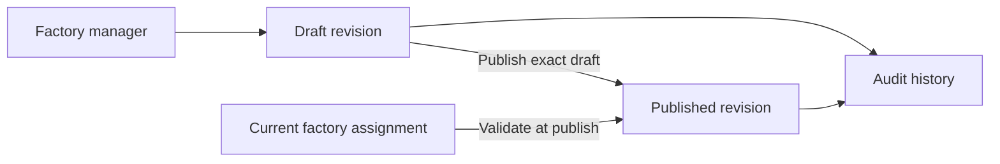
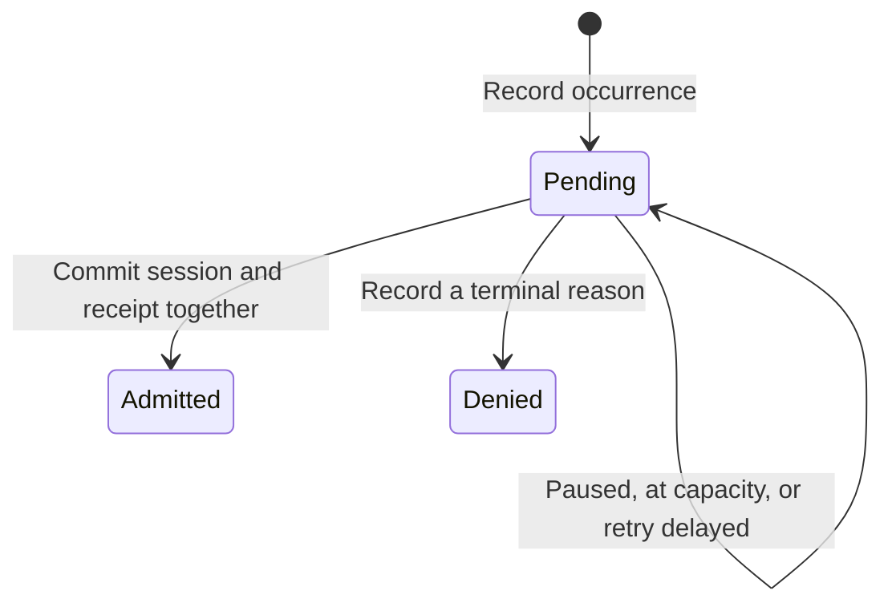
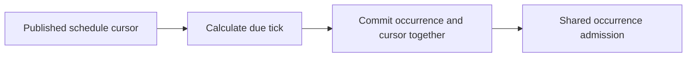

# Factory automation definitions

An automation belongs to one factory. An edit creates an immutable draft revision. Publishing makes the selected draft the published revision. The draft and published pointers can identify different revisions while a manager prepares changes.

## Definition

| Field group | Stored values                                                                                                                                          |
| ----------- | ------------------------------------------------------------------------------------------------------------------------------------------------------ |
| Trigger     | A cron expression with a timezone, a GitHub pull request repository, or an issue state trigger.                                                        |
| Filters     | Pull request actions and base branches, or issue state, team, and project IDs. Schedules have an empty filter object.                                  |
| Target      | The active factory definition revision and its named implementation agent. A workflow target also names the workflow and its exact activation.         |
| Authority   | The execution grant ID and version, service principal ID, budget payer member ID, and credential binding ID. Credentials stay in the credential store. |

Cron expressions use five numeric fields in minute, hour, day-of-month, month, and day-of-week order. Fields accept wildcards, lists, and ascending ranges. Wildcards and ranges support positive steps. Use `0` or `7` for Sunday.

## Commands and audit

| Command    | Guard                                                                                                                                                             |
| ---------- | ----------------------------------------------------------------------------------------------------------------------------------------------------------------- |
| Create     | The actor can manage the factory. The first draft records that actor's member ID.                                                                                 |
| Save draft | The expected draft ID matches the current draft. A successful save advances the draft and retains the previous revision.                                          |
| Publish    | The expected draft ID matches the current draft. The target, repository, grant, principal, budget payer, and credential binding must pass current factory checks. |
| Archive    | The expected draft and published IDs match the current pointers. The archive retains both pointers and their history.                                             |

The database checks the expected IDs while it holds the automation row lock. A stale command returns a conflict. Reload the automation and review the current revision before retrying. The audit records the manager and revision associated with each change.

## HTTP API

Use `/api/workspaces/{workspaceId}/factories/{factoryId}/automations` with a factory manager's session.

| Request                | Input                                                                                                                                                 |
| ---------------------- | ----------------------------------------------------------------------------------------------------------------------------------------------------- |
| `GET`                  | Optional `afterId` from the previous response's `nextCursor`.                                                                                         |
| `POST`                 | `automationId` and `definition`.                                                                                                                      |
| `GET /{automationId}`  | Optional `revisionId`. The response includes the requested revision and the current pointers.                                                         |
| `POST /{automationId}` | `action` and `expectedRevisionId`. `save` also takes `definition`. `archive` also takes `expectedPublication` with a `revisionId` that can be `null`. |

## Manage rules and history

Open **Configure → Automations** and select an active factory you manage. Use **New rule** to pick a trigger, set its filters, and choose an eligible agent or published workflow. Save a draft to preview it before publishing.

Publishing changes the revision that admits work. **Pause automation** parks pending occurrences, and **Resume automation** lets the worker try them again. If a stale draft conflicts with another edit, the editor keeps your field values while you load the current revision.

**Occurrence history** shows when each event was received, its revision, admission status, reason, attempts, and retry time when available. An admitted occurrence links to its session when you can access it. Active factory managers can still read the history of an archived rule.

## Preview a rule

Select a factory, rule, and revision in **Automations**. Enter a sample event and run the preview. The result shows each filter decision alongside the current target and budget prerequisites.

| Event        | Match checks                                                             |
| ------------ | ------------------------------------------------------------------------ |
| Schedule     | Trigger kind. A schedule sample represents a tick for the selected rule. |
| Pull request | Trigger kind, repository, action, and base branch.                       |
| Issue state  | Trigger kind, state, team, and project.                                  |

An empty filter list accepts every value for that field. The same revision and normalized event return the same filter decisions. The assignment check reads current factory authority and can change after a grant or credential is revoked. A preview returns both results without creating work or contacting an event provider.

Send `POST /{automationId}/dry-run` with `revisionId` and `event` to preview through the API. The revision ID in the response identifies the exact stored rule that the request evaluated.

## Occurrence admission

Within a factory rule, the source namespace and source key identify one occurrence across revisions. The first receipt pins the event and revision. A replay of that event returns the original receipt, including any session already linked to it.

| Guard             | Admission behavior                                                                                                        |
| ----------------- | ------------------------------------------------------------------------------------------------------------------------- |
| Current rule      | Claim the exact published revision and apply its event filters.                                                           |
| Current authority | Recheck the grant, credential binding, budget payer, and execution policy before creating the root session.               |
| Capacity          | Count active sessions for the rule while holding its lock. The default is one active session.                             |
| Pause             | Park pending occurrences until the rule is eligible again. Keep prior receipts available.                                 |
| Recursion         | Reject causal work that would start another automatic chain from an automation-owned session.                             |
| Transient failure | Preserve the occurrence key across up to five attempts. Retry delays start at five seconds and double after each failure. |

An approved root still occupies a slot while its workflow has pending nodes, dispatches, or repository delivery.

Factory managers can read `GET /{automationId}/admission-control` and send `POST` to the same path with `expectedGeneration`, `paused`, and `maxConcurrentSessions`. A stale generation returns a conflict. The occurrence worker and control change use the same rule lock.

## Scheduled occurrences

A schedule interprets its cron fields in the revision's timezone. It skips a
wall time that does not exist. If a wall time occurs twice, it uses the earlier
instant. When the day-of-month and day-of-week fields are both restricted,
either field can match. A leading wildcard in either field requires both
fields to match.

| Situation                                            | Scheduling behavior                                                                                                     |
| ---------------------------------------------------- | ----------------------------------------------------------------------------------------------------------------------- |
| First publication or a timezone change               | Start at the exact revision's publication time.                                                                         |
| Worker downtime                                      | Queue the latest unscanned occurrence in the preceding 24 hours. Earlier missed ticks expire.                           |
| Pause and resume                                     | Keep the cursor fixed while paused. Freeze the catch-up cutoff when the manager resumes. Apply the same 24-hour policy. |
| An earlier session still uses the available capacity | Retain the scheduled occurrence. The admission worker retries when capacity is available.                               |

In **Configure → Automations**, a scheduled revision
shows its next calendar matches. The published rule also shows the missed
occurrence eligible for catch-up with its cutoff, then the occurrence actually
queued at resume. A dry-run sample still represents one normalized event.

Node and Cloudflare read the same due cursors. The database checks the exact
published revision, cursor version, and admission generation before recording
the UTC minute and advancing the cursor in one transaction. The UTC minute
identifies the occurrence across retries. A worker that loses the response or
restarts cannot enqueue that occurrence again.
