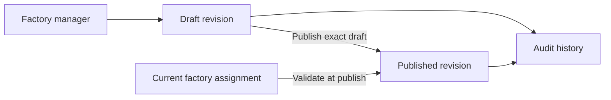

# Factory automation definitions

An automation belongs to one factory. An edit creates an immutable draft revision. Publishing makes the selected draft the published revision. The draft and published pointers can identify different revisions while a manager prepares changes.

## Definition

| Field group | Stored values                                                                                                                                          |
| ----------- | ------------------------------------------------------------------------------------------------------------------------------------------------------ |
| Trigger     | A cron expression with a timezone, a GitHub pull request repository, or an issue state trigger.                                                        |
| Filters     | Pull request actions and base branches, or issue state, team, and project IDs. Schedules have an empty filter object.                                  |
| Target      | The active factory definition revision and its named implementation agent. A workflow target also names the workflow and its exact activation.         |
| Authority   | The execution grant ID and version, service principal ID, budget payer member ID, and credential binding ID. Credentials stay in the credential store. |

## Commands and audit

| Command    | Guard                                                                                                                                                             |
| ---------- | ----------------------------------------------------------------------------------------------------------------------------------------------------------------- |
| Create     | The actor can manage the factory. The first draft records that actor's member ID.                                                                                 |
| Save draft | The expected draft ID matches the current draft. A successful save advances the draft and retains the previous revision.                                          |
| Publish    | The expected draft ID matches the current draft. The target, repository, grant, principal, budget payer, and credential binding must pass current factory checks. |
| Archive    | The expected draft and published IDs match the current pointers. The archive retains both pointers and their history.                                             |

The database checks the expected IDs while it holds the automation row lock. A stale command returns a conflict. Reload the automation and review the current revision before retrying. The audit records the manager and revision associated with each change.

## HTTP API

Use `/api/workspaces/{workspaceId}/factories/{factoryId}/automations` with a factory manager's session.

| Request                | Input                                                                                                                                                 |
| ---------------------- | ----------------------------------------------------------------------------------------------------------------------------------------------------- |
| `GET`                  | Optional `afterId` from the previous response's `nextCursor`.                                                                                         |
| `POST`                 | `automationId` and `definition`.                                                                                                                      |
| `GET /{automationId}`  | Optional `revisionId`. The response includes the requested revision and the current pointers.                                                         |
| `POST /{automationId}` | `action` and `expectedRevisionId`. `save` also takes `definition`. `archive` also takes `expectedPublication` with a `revisionId` that can be `null`. |
