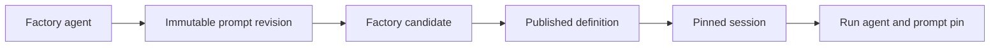

# Factory definition records

Each workspace gets one default factory during workspace creation. The migration provisions a default factory for each existing workspace. A default factory can exist before any definition is active.

Factories now carry a workspace-unique name/slug, explicit membership and an archived lifecycle. Existing sessions, pipelines and repositories are backfilled into the default factory; see [Factory scope and membership](factory-scope-and-membership.md) for access resolution, lifecycle and audited commands.

| Record     | What it records                                                                                                                                                            |
| ---------- | -------------------------------------------------------------------------------------------------------------------------------------------------------------------------- |
| Factory    | Stable factory UUID and workspace ownership.                                                                                                                               |
| Draft      | One saved definition with an author UUID, creation time, and optional base activation number.                                                                              |
| Revision   | Published definition, author UUID, creation time, and optional source draft.                                                                                               |
| Activation | Selected revision, author UUID, and creation time. Activation numbers start at 1 and increase by 1 within each factory. The highest number identifies the active revision. |

Drafts and revisions each store a schema version and a lowercase SHA-256 digest of the exact UTF-8 bytes in `definition_json`. Database checks bind the digest to those bytes. Workspace and factory keys keep draft, revision, and activation references inside the owning factory. See the [serial factory definition compiler](serial-factory-compiler.md) for canonical serialization.

Activation history is append-only. An activation at number `N + 1` expects `N` as the current activation. A rollback records a new activation that points to a previous revision, so every activation remains distinct even when it reuses a revision.

Active workspace members can read factories, revisions, and activations through row-level security. Drafts are visible to workspace managers. Drafts, revisions, and activations remain immutable while the owning workspace exists.

## Existing session history

Sessions created before enrollment or without an active definition report `legacy` and have a null factory definition revision. [Session admission](factory-session-inputs.md) marks a session `pinned` when it captures an active revision in the session's workspace. The database preserves that provenance for the life of the session.

`execute_pinned_definition` distinguishes sessions admitted with compiled execution from older sessions that recorded the active revision for provenance. Both fields remain immutable for the session's lifetime.

A legacy session retains its existing session ID, workspace number, pipeline, stage links, artifacts, and run history. Its legacy marker records that the session predates definition enrollment. The current factory definition supplies no evidence about the configuration that produced that history.

See [Factory definition activation](factory-definition-activation.md) for draft, publish, and rollback commands.

## Named agents and prompt revisions

Each factory owns stable named agents. The `implementation` agent starts with
an empty prompt so existing stage templates retain their behavior. Every agent
has implementation authority. Agent identity, authority, and prompt revisions
are immutable.

- Creating an agent or editing its prompt records a new candidate revision.
- A definition's optional `implementationAgent` input selects a prompt revision
  UUID. Compilation embeds the agent ID, revision ID, prompt bytes, and SHA-256.
- Activation uses the existing candidate smoke and publish flow. Running
  sessions and retries retain their selected prompt revision.
- Definitions that omit the reference use the default agent's initial empty
  prompt. Saving a newer agent prompt leaves that binding intact.
- Agent instructions are static trusted text. Template-like text inside them
  remains literal. Session requests, artifacts, and feedback retain their typed
  untrusted boundaries.

## Configure an agent

1. Open **Agents** and choose a factory. Factory managers can create named agents
   and save prompt revisions. Concurrent prompt writes check the displayed
   revision number.
2. Open a prompt revision and select **Configure bindings**. Workspace
   operators can save the selected revision in the factory’s shared draft and
   configure skill, repository, tool, and execution bindings there.
3. Validate the draft, review its resolved references, and run the candidate
   checks. Publish after the candidate passes. **Agents** shows the pinned
   prompt and bindings from the published definition.

People with read access can inspect permitted agent revisions and published
bindings. Credential controls show reference IDs, ownership, and readiness.
An archived factory preserves its history and rejects new definition writes.
