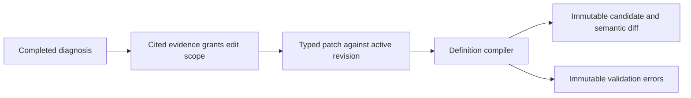

# Factory improvement proposals

An improvement proposal pins a completed diagnosis and an exact factory definition. Compilation records an inactive candidate and a semantic diff, or records validation errors. The factory's active definition changes through the activation lifecycle.

## Edit scope

| Edit            | Required evidence and binding                                                           |
| --------------- | --------------------------------------------------------------------------------------- |
| Stage prompt    | Cited producing stage and the base prompt's SHA-256 digest                              |
| Agent prompt    | Cited producing agent, old pinned prompt revision, and new revision of that agent       |
| Skill revision  | Skill revision on the cited attempt and replacement from the same skill                 |
| Workflow order  | The same stable stages, with a citation for every stage that moves                      |
| Scorer revision | Cited scorer revision in a version 2 definition and replacement from the same scorer    |
| Routing target  | Cited primary rule and a currently qualified replacement that preserves execution scope |

Each patch preserves repositories, approval authority, credentials, grants, tools, and execution and delivery policies.

## Revision identity

- A factory manager submits the base activation number, revision ID, digest, and a request ID. The database compares the active base under the factory lock.
- Each revision records rationale, expected benefit, risks, and the typed edits. A request retry returns the saved revision when the author and intent match.
- An edit or rebase identifies the latest proposal revision and the current active base. The compiler validates the patch against the selected base. Earlier revisions retain their original base and result.
- A valid revision has an inactive `factory_definition_revisions` row. Downstream comparisons and publication can pin the proposal revision, base digest, and candidate revision and digest.

## Review workbench

- Improvements shows the latest proposal revision. The revision history opens the exact stored diff, cited diagnosis, and discussion.
- Review events identify the proposal revision, review version, author, and request. A new proposal revision opens its own discussion. Exact retries return the original event.
- Factory managers can comment, investigate, request revision, or dismiss. Dismissal closes review of that revision and preserves its discussion. Production activation requires its own authorization and evidence.
