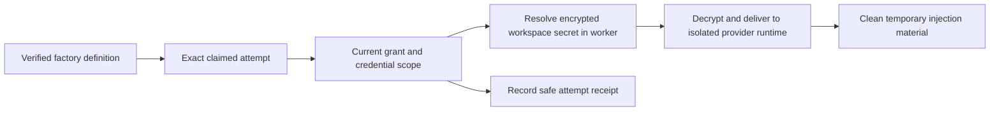

# Factory secret bindings

A workspace administrator can approve an encrypted workspace secret for a specific factory, execution grant, implementation agent, and provider. OpenCode bindings also identify the model's upstream provider. The factory definition stores the binding ID. The existing Workspace Secrets settings own credential storage and rotation.

| Record                 | What it identifies                                                                            |
| ---------------------- | --------------------------------------------------------------------------------------------- |
| Workspace secret       | The encrypted value and its current material revision.                                        |
| Factory binding        | The stable reference, approved source, and scope.                                             |
| Run credential receipt | The exact binding version, material revision, and service principal resolved for one attempt. |

## Manage a binding

1. Save a provider API key through the existing Workspace Secrets settings.
2. In **Factory Definition**, set the approved `executionGrant` in the JSON source and select a versioned implementation agent. Save the draft, authorize the secret in **Service credentials**, then add that binding to the working definition.
3. Rotate the value under the same workspace secret key. The binding ID stays stable and new attempts use the new material revision.
4. Revoke a binding to prevent further resolution. The Run inspector keeps its historical receipt. Deleting a source makes the binding unavailable. Recreating the key creates a new source identity that requires fresh approval.

**Ready** means the current binding can resolve its saved source. Provider authentication takes place when a run starts.

## Runtime

The worker resolves the credential only for the current attempt and provider. The receipt records metadata for the version it actually resolved. The sandbox launch handles scoped credential injection and cleanup, and output safety redacts credential material before events or artifacts are persisted. Factory Definition and Run inspector responses contain binding and readiness metadata.
