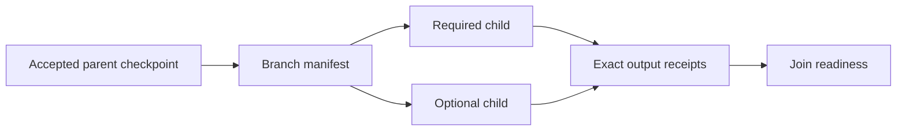

# Parallel workflow branches

A branch occurrence freezes the exact accepted checkpoint from its graph input or delegated parent, and a named slot for each declared child. Every child receives its own pinned profile, session, sandbox, and private output ref. All slots use the frozen parent source. A later accepted run blocks a still-unopened fork, even when both runs produced the same commit.

Node and Workerd maintenance advance due branch groups. Each scheduler transaction locks one root and observes terminal child attempts. Required slots get first use of capacity. Within each tier, slots that have waited longer get the next attempt. A group waiting on capacity yields to other roots. Child admission and attempts share the root’s existing grant and budget checks.

An unstarted reservation or estimated usage can leave another slot pending. Once exact attempts or measured usage exhaust the pinned budget, the remaining slots record a terminal admission blocker.

| Join readiness     | Evidence                                                                                                      |
| ------------------ | ------------------------------------------------------------------------------------------------------------- |
| Pending            | A declared slot still needs admission, execution, or review.                                                  |
| Ready              | Every slot retained an approved child checkpoint.                                                             |
| Required blocked   | A required child failed, was canceled, or cannot be admitted under a lifetime limit.                          |
| Optional failure   | Required children succeeded and at least one optional slot failed, was canceled, or reached a lifetime limit. |
| Paused or canceled | The root lifecycle controls further work.                                                                     |

A successful receipt identifies the named slot, exact child job and run, frozen input commit, adopted checkpoint, and retained output ref. Approval stays tied to the exact child artifact. An unstarted failure or cancellation has a terminal job receipt without a checkpoint. Pause retires the old attempt, and a valid resume can start a fresh attempt on the same job. Root branches of a triage workflow use the approved task and retain its acceptance criteria.
