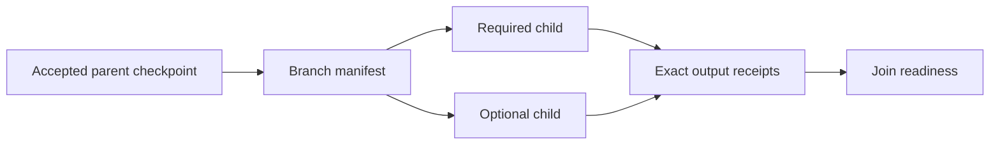
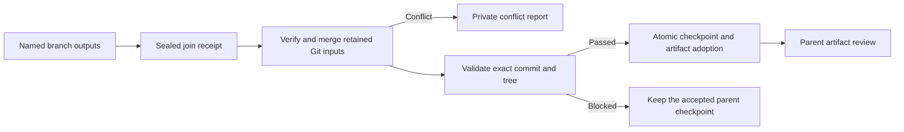

# Parallel workflow branches

A branch occurrence freezes the exact accepted checkpoint from its graph input or delegated parent, and a named slot for each declared child. Every child receives its own pinned profile, session, sandbox, and private output ref. All slots use the frozen parent source. A later accepted run blocks a still-unopened fork, even when both runs produced the same commit.

Node and Workerd maintenance advance due branch groups. Each scheduler transaction locks one root and observes terminal child attempts. Required slots get first use of capacity. Within each tier, slots that have waited longer get the next attempt. A group waiting on capacity yields to other roots. Child admission and attempts share the root’s existing grant and budget checks.

An unstarted reservation or estimated usage can leave another slot pending. Once exact attempts or measured usage exhaust the pinned budget, the remaining slots record a terminal admission blocker.

| Join readiness     | Evidence                                                                                                      |
| ------------------ | ------------------------------------------------------------------------------------------------------------- |
| Pending            | A declared slot still needs admission, execution, or review.                                                  |
| Ready              | Every slot retained an approved child checkpoint.                                                             |
| Required blocked   | A required child failed, was canceled, or cannot be admitted under a lifetime limit.                          |
| Optional failure   | Required children succeeded and at least one optional slot failed, was canceled, or reached a lifetime limit. |
| Paused or canceled | The root lifecycle controls further work.                                                                     |

A successful receipt identifies the named slot, exact child job and run, frozen input commit, adopted checkpoint, and retained output ref. Approval stays tied to the exact child artifact. An unstarted failure or cancellation has a terminal job receipt without a checkpoint. Pause retires the old attempt, and a valid resume can start a fresh attempt on the same job. Root branches of a triage workflow use the approved task and retain its acceptance criteria.

## Join branch outputs

A factory manager submits the branch group, workflow generation, exact parent checkpoint run, and selected outcome IDs. Every required slot must supply a successful output. Optional slots must be terminal and can be omitted. Within the same workflow generation, replaying the request returns its original join, job, and run.

- **Source.** The worker fetches each frozen Git input and verifies its commit before merging. The parent generation and checkpoint run are checked again at adoption, including when a newer checkpoint has the same commit.
- **Validation.** The pinned parent delivery policy defines which evidence must pass. The worker preserves the parent’s frozen validation order. For a specification checkpoint, compatible plans from the selected branches supply the required checks in their original relative order. Validation runs against the joined commit and tree in a separate sandbox without GitHub or model credentials. The worker prepares Node tooling and installs dependencies from supported repository lockfiles before replaying the plan. Other toolchains can include their setup in the frozen plan. The branch selection response exposes the 48 MiB packed-source limit before submission.
- **Publication.** The existing checkpoint publisher records the exact integrated commit and tree, advances the parent checkpoint, and creates the parent review artifact in one transaction. Downstream nodes can read that accepted checkpoint after adoption.
- **Blocked joins.** Conflicts retain a private, immutable report for the exact join attempt. Missing inputs, stale ownership, and failed validation keep the current parent checkpoint. Each child approval applies to its own artifact. The joined artifact requires its own parent approval.

## Drafts and published workflows

Open **Workflows** under **Configure** to edit the graph. The graph and ordered list use the same steps, transitions, and policies. **Pipeline** opens the operational board, and **Serial pipeline settings** opens the stage editor.

- **Save draft** compiles the graph and checks the displayed draft, published activation, and factory definition. A conflict keeps the editor’s local changes.
- **Publish draft** activates the exact saved revision. When the factory definition changes, **Rebase and save draft** compiles the graph against the new definition.
- Choose a published workflow in **New session**. Session creation pins that activation with its admission receipt. The final preparation checkpoint schedules the first workflow occurrence. Later publications affect future selections.
