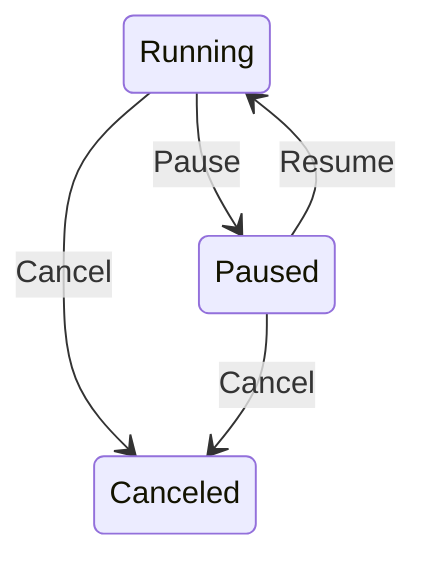

# Workflow lifecycle

Factory managers can pause, resume, or cancel an enrolled workflow. Each command names the root, the displayed generation, and a unique request ID. Wallie rotates ownership and commits descendant retirements in the same transaction as the new state.

| State    | Descendant work                                                                     |
| -------- | ----------------------------------------------------------------------------------- |
| Running  | The root can admit and claim work under the current grants and budget.              |
| Paused   | Queued work stays parked. Running attempts retire with their exact job and run IDs. |
| Canceled | Queued and running work retire. Accepted checkpoints and receipts stay available.   |

Resume rechecks the pinned policies, grants, source, and stage. It reuses parked jobs and starts one new attempt for each eligible retired stage. An old worker cannot adopt new output or restart a retired attempt. An exact replay returns the recorded command receipt.

## Cleanup

- Workflow retirement records the exact sandbox obligation before returning. Node and Workerd maintenance lease and retry each pending stop.
- A provider-confirmed stop or an exact already-gone response settles a known handle. The receipt names the workspace, provider, connection revision, and handle.
- If cancellation wins before the provider address arrives, a late callback records the handle against the retired run. If no callback arrives, maintenance looks up the existing provisioning reservation under the original connection.
- An unresolved provider request keeps its credentials and obligation through the acquisition and lifetime window. An empty exact lookup after that window records expiry. A stop confirmation requires provider evidence.

## Operator commands

- Read `GET /api/sessions/:sessionId/workflow-lifecycle` for the current state and generation of a visible root.
- Send `POST` to the same route with `action`, `expectedGeneration`, and `requestId`. Use the same request ID for a retry of identical intent.
