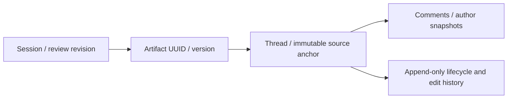

# Artifact review contract

Review threads bind to an exact persisted Markdown artifact. Comments do not start agent work or resolve requests automatically.

| Contract         | Rule                                                                                                                                                                                           |
| ---------------- | ---------------------------------------------------------------------------------------------------------------------------------------------------------------------------------------------- |
| Identity         | Workspace + session + artifact UUID + stage UUID + artifact version are validated together. Stage slug is a historical label.                                                                  |
| Coordinates      | Zero-based Unicode code points, `[start,end)`, into the exact stored Markdown string. No newline or Unicode normalization. Rendered HTML and UTF-16 offsets are not coordinates.               |
| Quote/context    | Nonempty exact quote, at most 10,000 code points. Immediate prefix/suffix contain at least `min(32, available)` and at most 128 code points. Repeated text stays tied to its source range.     |
| Mutability       | Anchors, artifact identity/content, kind and author snapshots cannot be edited through the review API. Comment edits retain previous text in events and require the expected comment revision. |
| Discussion       | The thread author or an authorized stage reviewer may resolve, supersede or reopen it.                                                                                                         |
| Blocking request | Only an active human authorized by the stage approval policy may resolve, supersede or reopen it. An agent/service role alone has no write path.                                               |
| Reviewer policy  | Anyone-can-approve, otherwise an explicit approver list, otherwise owner/admin. A missing stage fails closed for blocking requests.                                                            |
| Authorship       | Member UUID and display label are snapshots, independent of membership deletion. Every new write still requires live active membership.                                                        |
| Concurrency      | Writes lock session → member → thread/comment as needed. Every write increments `sessions.artifact_review_revision`; thread/comment revisions reject stale edits and transitions.              |
| Reads            | Thread, comment and event histories load separately through capped keyset pages ordered by `(created_at,id)`.                                                                                  |

## Persistence API

Use an authenticated user client with the typed repository in `src/features/sessions/review/repository.ts`. Write RPCs derive the human actor from `auth.uid()`; they accept no caller-supplied actor. Table DML is revoked for authenticated and service roles. RLS restricts reads to active workspace members.

- `create_artifact_review_thread_once`: validate source and identity, create thread and initial comment atomically.
- `write_artifact_review_comment_once`: reply or edit an owned comment using its expected revision.
- `transition_artifact_review_thread_once`: change lifecycle state using the expected thread revision and an explicit reason.
- `list_artifact_review_{threads,comments,events}`: separate bounded pages; no eager nested history.

Every write requires a caller-generated request UUID. Keep the same UUID and payload while retrying an uncertain save. Private transaction receipts return the original result without duplicate comments, events, or revision increments. Reusing a UUID with different content fails with a conflict. Current membership, archive state, and lifecycle authority are checked on recovery too.

## Inline review

- Open **Comments** in the artifact reader. Select text and choose **Comment on selection**, or use the keyboard-accessible **Comment on a block** picker.
- Threads, replies, own-comment edits and lifecycle changes persist through authenticated session review APIs. Comment bodies render as escaped plain text.
- Realtime thread events refresh bounded thread/comment pages without a route reload. Drafts stay separate from fetched snapshots and survive failed saves and closing the panel.
- Thread links include the artifact UUID/version. Older versions and prior stages show a historical label; archived sessions allow reading only.
- Saves and lifecycle changes do not enqueue an agent execution.

## Revision review and feedback history

- **Request changes** explicitly selects up to 20 open threads from the inspected artifact or earlier versions of the same stage, with an optional whole-stage note. **Preview feedback** displays the exact selected source identities, quotes and comment revisions. A concurrent review edit invalidates the submission token; drafts survive errors.
- Submission pins the currently inspected artifact/checkpoint while each immutable thread snapshot retains its original source artifact. Retry receipts remain scoped to the submitting human. Later comments, edits and replies never alter an earlier batch.
- **Compare** lazily loads exact artifact UUIDs, an exact Markdown source diff, and bounded unresolved feedback/history pages. Repeated or changed selections remain visible under **Outdated selections**. Mapping uses the artifact renderer’s Markdown grammar and requires a unique quote plus an unchanged source and target enclosing block; it is derived presentation and never rewrites an anchor or status. Large split blocks fail closed.
- **Submitted feedback** shows immutable comments and the exact saved agent input, the reviewed artifact, the initial run status and capped pages of every accepted output linked by checkpoint provenance, including new jobs created by manual retries. Producing-run and received-feedback identities come from exact run/job/checkpoint associations. Missing legacy provenance stays unavailable.
- Failed/canceled attempts retain their batch. **Retry Run** may create a new job; its owned attempt binds once to the exact session/stage/rejection generation, then consumes the original immutable batch. Queued manual jobs can still be adopted by a newer explicit submission before starting. Existing associations cannot be rewritten; ambiguous generation matches fail closed. Historical manual retries without recorded provenance remain unavailable. A later review may explicitly resubmit unresolved threads against its new checkpoint, including outdated original selections. Original author snapshots, source version and selection remain inspectable.
- Automatic retries retain the job’s consumed feedback generation. Neither retry path loads later live comment edits as submitted feedback.
- New artifacts, agent responses, previews and submissions never resolve or supersede a request. Human status transitions retain their existing authorization and revision checks. Blocking approval serialization remains OP-504.

Review/history APIs use the authenticated RLS client, scoped by workspace/session/stage. History uses capped keyset pages; snapshots load on demand and render as escaped text. No new service-role read path is exposed to the browser.

## Verification

- `pnpm test src/features/sessions/review`
- `supabase test db --local supabase/tests/artifact_review_threads.sql`
- `pnpm db:types:check`
- `pnpm check`
