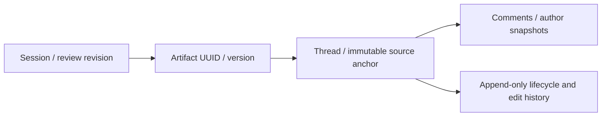

# Artifact review contract

Review threads bind to an exact persisted Markdown artifact. Comments do not start agent work or resolve requests automatically.

| Contract         | Rule                                                                                                                                                                                           |
| ---------------- | ---------------------------------------------------------------------------------------------------------------------------------------------------------------------------------------------- |
| Identity         | Workspace + session + artifact UUID + stage UUID + artifact version are validated together. Stage slug is a historical label.                                                                  |
| Coordinates      | Zero-based Unicode code points, `[start,end)`, into the exact stored Markdown string. No newline or Unicode normalization. Rendered HTML and UTF-16 offsets are not coordinates.               |
| Quote/context    | Nonempty exact quote, at most 10,000 code points. Immediate prefix/suffix contain at least `min(32, available)` and at most 128 code points. Repeated text stays tied to its source range.     |
| Mutability       | Anchors, artifact identity/content, kind and author snapshots cannot be edited through the review API. Comment edits retain previous text in events and require the expected comment revision. |
| Discussion       | The thread author or an authorized stage reviewer may resolve, supersede or reopen it.                                                                                                         |
| Blocking request | Only an active human authorized by the stage approval policy may resolve, supersede or reopen it. An agent/service role alone has no write path.                                               |
| Reviewer policy  | Anyone-can-approve, otherwise an explicit approver list, otherwise owner/admin. A missing stage fails closed for blocking requests.                                                            |
| Authorship       | Member UUID and display label are snapshots, independent of membership deletion. Every new write still requires live active membership.                                                        |
| Concurrency      | Writes lock session → member → thread/comment as needed. Every write increments `sessions.artifact_review_revision`; thread/comment revisions reject stale edits and transitions.              |
| Reads            | Thread, comment and event histories load separately through capped keyset pages ordered by `(created_at,id)`.                                                                                  |

## Persistence API

Use an authenticated user client with the typed repository in `src/features/sessions/review/repository.ts`. Write RPCs derive the human actor from `auth.uid()`; they accept no caller-supplied actor. Table DML is revoked for authenticated and service roles. RLS restricts reads to active workspace members.

- `create_artifact_review_thread_once`: validate source and identity, create thread and initial comment atomically.
- `write_artifact_review_comment_once`: reply or edit an owned comment using its expected revision.
- `transition_artifact_review_thread_once`: change lifecycle state using the expected thread revision and an explicit reason.
- `list_artifact_review_{threads,comments,events}`: separate bounded pages; no eager nested history.

Every write requires a caller-generated request UUID. Keep the same UUID and payload while retrying an uncertain save. Private transaction receipts return the original result without duplicate comments, events, or revision increments. Reusing a UUID with different content fails with a conflict. Current membership, archive state, and lifecycle authority are checked on recovery too.

## Inline review

- Open **Comments** in the artifact reader. Select text and choose **Comment on selection**, or use the keyboard-accessible **Comment on a block** picker.
- Threads, replies, own-comment edits and lifecycle changes persist through authenticated session review APIs. Comment bodies render as escaped plain text.
- Realtime thread events refresh bounded thread/comment pages without a route reload. Drafts stay separate from fetched snapshots and survive failed saves and closing the panel.
- Thread links include the artifact UUID/version. Older versions and prior stages show a historical label; archived sessions allow reading only.
- Saves and lifecycle changes do not enqueue an agent execution.

This foundation does not yet gate artifact approval on blocking threads. Feedback batches, revision comparison, and approval serialization are separate milestones in OP-502 through OP-504. OP-501 adds the commenting controls; feedback submission remains separate.

## Verification

- `pnpm test src/features/sessions/review`
- `supabase test db --local supabase/tests/artifact_review_threads.sql`
- `pnpm db:types:check`
- `pnpm check`
