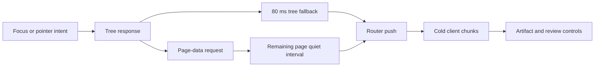

# Immediate and touch session opening

**Next experiment: defer the Supabase browser SDK from initial session review rendering.** The constrained traces and a controlled chunk hold establish that this dependency blocks the artifact after session data has arrived. Investigate the tree-only prefetch fallback separately; extending or deleting its timer has no demonstrated latency benefit yet.

This is a diagnosis on main `90d820a96427e6d94be19cd6a2d5b863f020e795`, after #587. Application code is unchanged. The deliverables are benchmark instrumentation, the baseline, and causal evidence.

## Baseline

Native click to the expected latest v1 artifact, enabled review controls, and a painted frame. Five untraced samples per cell, interleaved across input and browser conditions.

| Browser conditions | Input           | Median | Range in ms  |
| ------------------ | --------------- | -----: | ------------ |
| Default            | Immediate mouse |  156.0 | 145.0–437.3  |
| Default            | Touch           |  132.5 | 129.1–137.8  |
| Constrained        | Immediate mouse |  993.3 | 979.8–1012.9 |
| Constrained        | Touch           |  995.0 | 991.0–1004.4 |

- All 20 samples pass the correct artifact and working Request changes checks. Zero failed requests, excluding separately recorded browser-aborted RSC streams.
- Production build `SYlI4CAWDh1_sWl61mJVJ`, Chromium `149.0.7827.55`, local isolated Supabase fixture plus 160 additional sessions. Fresh browser contexts keep destination scripts cold while the sessions list is warmed.
- Constrained means 4× browser CPU slowdown, 80 ms configured HTTP latency, 1600 kbps download, and 750 kbps upload. Server-to-database traffic remains local. These are lab conditions, not physical phone or production-field measurements.
- The 10-core host retained other desktop processes. Samples were interleaved; per-sample load averages are retained in the evidence.
- This harness revision moves Playwright selector assertions after the browser ready mark in session-only mode. These numbers are a new baseline. They do not establish an improvement over the previous report's immediate-click numbers.

[Samples, diagnostic timelines, controlled probes, and artifact hashes](../evidence/session-opening-investigation.json).

## Confirmed mechanisms

| Finding                                                                                                    | Live evidence                                                                                                                                                                                                                                                     | Source owner                                                                                                                                                                                                                                                             |
| ---------------------------------------------------------------------------------------------------------- | ----------------------------------------------------------------------------------------------------------------------------------------------------------------------------------------------------------------------------------------------------------------- | ------------------------------------------------------------------------------------------------------------------------------------------------------------------------------------------------------------------------------------------------------------------------ |
| A cold shared chunk containing the Supabase SDK gates initial review.                                      | In all three constrained diagnostics it finishes at click +842–865 ms, about 145–150 ms before ready. Holding only this chunk keeps the artifact absent after both destination RSC responses have completed. Releasing it allows the artifact to appear.          | [Detail browser client import](../../src/features/sessions/detail/session-detail-page-client.tsx), [activity import](../../src/features/sessions/detail/session-activity-client.tsx), [Wallie panel browser client](../../src/features/wallie/session-wallie-panel.tsx). |
| The tree-only fallback can push before page data is available and trigger another destination RSC request. | With page data held until click +257.5 ms, push occurs at +112.2 ms and another page request starts at +114.3 ms. With release at +70.8 ms, push follows response completion by 81.5 ms and no third destination request occurs.                                  | `waitForSessionDetailPrefetch()` in [session-detail-link.tsx](../../src/features/sessions/components/session-detail-link.tsx).                                                                                                                                           |
| Touch still starts a prefetch.                                                                             | Every untraced tap focuses the link, then calls prefetch before click. Default focus lead time is 5.6–6.4 ms; constrained lead time is 30.7–36.8 ms.                                                                                                              | The link's `onFocus` handler has no pointer-type restriction.                                                                                                                                                                                                            |
| The default wait changes branch according to response order.                                               | One diagnostic's tree timer fires at +104.4 ms and push follows at +106.7 ms. In two others, page-data observation cancels the tree timer and installs the remaining quiet interval; push is +180.0/+188.8 ms. Route-to-page cache-busting digest takes 0–0.1 ms. | The same wait helper. Browser response completion is not Next cache-write completion.                                                                                                                                                                                    |



The two paths to push race. In the constrained traces the fallback wins before the first page-data response completes. Client loading then dominates the remaining wait.

### Chunk hold proof

Times below are relative to click and include diagnostic overhead.

| Event                                                   | Time in ms |
| ------------------------------------------------------- | ---------: |
| Both destination RSC entries complete                   |   By −26.7 |
| Router push                                             |       55.8 |
| Loading status visible                                  |       64.0 |
| Held snapshot, destination URL correct, artifact absent |      309.0 |
| Release the held chunk                                  |      310.4 |
| Loading status hidden                                   |      378.9 |
| Correct artifact observed                               |      387.8 |

The held chunk is `27otmw7e6hxhz.js`, 60,104 encoded transfer bytes and 224,618 decoded bytes in the traced build. Four cold scripts together transfer 107,628 encoded bytes and contain 373,893 decoded bytes. Without client source maps, the whole shared chunk cannot be attributed exclusively to the SDK. Holding it proves a dependency; it does not predict the speedup from changing import boundaries.

### React commit delay in a reproduced tail

- Two of five default immediate samples take 430.1/437.3 ms, with only two destination RSC responses. Their page-data responses finish at click +118.4/+124.9 ms respectively.
- A wider timer probe reproduces a 331.7 ms push-to-artifact gap. React schedules a commit timer at click +305.0 ms with 106.1 ms remaining, it fires at +412.8 ms, and the artifact appears at +437.0 ms. The stack exactly matches the `"Throttled"` commit branch in Next's vendored `react-dom-client.production.js`, lines 12095–12125.
- That branch uses a deadline of 300 ms after React's most recent fallback time. It is not a new 300 ms timer. A narrow probe that only captured delays of 200–350 ms missed the computed remaining delay.
- A diagnostic-only bypass of this exact compiled timer stack schedules its callback immediately. The correct artifact appears at +299.2 ms, before that run's original +408.8 ms timer deadline. This establishes the timer as a gate in the reproduced case; it is not a production change or benchmark speedup claim.
- The two untraced baseline tails have consistent timing, but their exact scheduler cause remains an inference. No visible Loading session status is recorded in the reproduced page-hold tail. Fixing duplicate RSC requests has not been shown to remove the delay.
- The separate 200 ms timer maps to `requestRefresh()` in [realtime-recovery.ts](../../src/features/wallie/realtime-recovery.ts). It starts after the artifact and schedules the normal recovery reads.

## Next bounded change

1. Defer browser client loading from initial review rendering, following [the pipeline subscription pattern](../../src/features/pipeline/pipeline-page-client.tsx). Cover the detail client's direct import and the activity module's static Wallie panel import. Extracting only the archived-at context leaves the direct dependency intact.
2. Repeat the same untraced matrix on alternating baseline/candidate builds. Confirm that the chunk leaves the critical path and that the expected artifact, review action, realtime updates, reconnect recovery, and cleanup still work.
3. Preserve the post-join recovery reads. They cover the gap between the server snapshot and subscription establishment. They are separate from the extra destination RSC request.
4. Give the prefetch race its own delayed-page regression above 80 ms. Require evidence of usable cached page data before changing the fallback contract. Next's public prefetch API supplies no completion callback, and a resource timing entry does not prove React/Next consumption has finished.

No numerical gain is claimed until an actual candidate passes this comparison.

## Reproduce and inspect

Use the [navigation benchmark setup](navigation-bench.md) with the same production build and seeded local database. Run five samples for each intent and condition, alternating their order. Keep profiling separate.

```bash
pnpm bench:navigation --session-only --session-intent immediate --skip-build --skip-seed --runs 1 --out bench-results/immediate.json
pnpm bench:navigation --session-only --session-intent touch --cpu-rate 4 --latency-ms 80 --download-kbps 1600 --upload-kbps 750 --skip-build --skip-seed --runs 1 --out bench-results/touch-constrained.json
pnpm bench:navigation --session-only --session-intent immediate --profile --runs 3 --skip-build --skip-seed --trace-out bench-results/immediate.trace.json
```

Local raw artifacts are under `bench-results/immediate-investigation/`. The linked evidence identifies and hashes every trace and sidecar. Seven diagnostic profiles include native marks, actual observer delivery, timer scheduling/firing, destination stream reads, and network bytes. Diagnostic-only hold scripts remain under `.wallie/session-investigation/` in the investigation workspace. They buffer the first page response or the named chunk, click a real link, record the release, and check the expected artifact. The wide timer probe records delays up to 500 ms; the bypass targets only the observed React commit stack. The recorded observed release time takes precedence over the requested hold setting.

CPU samples are approximate. Injected hooks add cost; negative V8 sample deltas require reconstruction, and Chrome thread-clock counters sometimes exceed wall intervals. Constrained post-push main-task intervals occupy 354–375 ms while sampled idle occupies 415–434 ms. These overlapping diagnostics are not an additive time budget. Source-matched secondary work includes timeline centering, navigation measurement, and list timer cleanup; none earns priority over the proven cold chunk dependency.

Pstack's Explain the Number principle required separate untraced samples, source attribution, and causal holds before selecting the next experiment. Its runtime-forensics playbook keeps this change at diagnosis rather than shipping an unmeasured optimization.

## Validation

- `pnpm check:fast` passes.
- `pnpm test --maxWorkers=4` passes, with 4,882 tests passed and two existing skips.
- `pnpm check:cloudflare` passes, with 35 tests passed and the Wrangler dry run complete.
- The production build, all 20 baseline samples, seven diagnostic profiles, six controlled probes, and the five-flow browser smoke pass. Smoke durations are not used as performance evidence.

throughput checkpoint: n/a, read-only forensics
