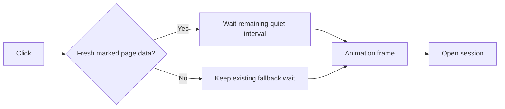

# Session opening after hover prefetch

Completed hover prefetches open a reviewable session in **143.6 → 98.2 ms**, a **31.6% reduction** in the local production-build comparison. Immediate clicks remain inconclusive.

## Measurement

Five alternating runs per build and intent, fresh browser contexts, the same isolated Supabase fixture, and 160 additional sessions. Baseline is main at `9f002fb9`. Diagnostic traces are excluded from these numbers.

| Actual click to review ready | Before median, range in ms | After median, range in ms | Verdict                       |
| ---------------------------- | -------------------------: | ------------------------: | ----------------------------- |
| Completed hover prefetch     |         143.6, 135.2–162.2 |          98.2, 94.6–103.7 | Faster, ranges do not overlap |
| Immediate mouse click        |         219.2, 146.5–256.0 |        236.9, 144.1–243.9 | Inconclusive, ranges overlap  |

- The clock starts at the native browser click. Playwright actionability and hover preparation are excluded.
- Readiness requires the expected rendered latest v1 artifact and enabled review controls across a painted frame. Request changes must load a review successfully after timing ends.
- Settled hover waits until the dynamic page-data response has completed in browser resource timing, then dwells at least 150 ms before clicking.
- All 20 samples pass. Both builds make two recovery reads during a request window that extends 250 ms after the benchmark observes readiness. This change does not establish a refetch reduction.
- Playwright reports some completed RSC streams as aborted. Counts remain in the evidence. Controlled delayed-response tests have zero destination aborts on both builds.
- The host has 10 cores and other desktop processes remain active. Per-run load averages are recorded. Alternating runs limit drift.
- Localhost excludes wide-area latency. These results do not establish a mobile or production-field speedup.

[Samples, ranges, request diagnostics, build IDs, and parsed trace events](../evidence/session-opening-performance.json).

## Limiter and change

The baseline diagnostic records the page response ending about 175 ms before the click. Nevertheless, the click starts a fresh 80 ms quiet timer, and buffered performance observations restart it. Navigation starts 114 ms after the click. The artifact and controls appear about 35 ms after navigation.

The candidate marks dynamic session page-data responses with `Server-Timing`. The link uses only successful, same-origin response bodies from the current prefetch intent. It charges the existing 80 ms interval from that response's completion time.



- Tree responses cannot skip the wait. Delayed page data retains the guard.
- The marker classifies a response. It does not expose Next's scheduler completion. The 80 ms consumption allowance and final animation frame remain.
- Next strips Flight headers before middleware. The marker therefore uses Next's header rules, which match raw request headers. Auth middleware remains unchanged.
- Missing browser timing support, old responses, failed responses, and unmarked responses retain the fallback and two-second deadline.
- Pstack's Explain the Number principle required the diagnostic trace before the change. Sequence Work into Verifiable Units kept the measurement, one wait optimization, and browser checks separate. The Laziness Protocol ruled out a persistent readiness-promise lifecycle.

## Verification and reproduction

The browser suite checks untouched-row prefetching, visible timing signals, delayed tree and page responses, failed prefetch, and back navigation. Separate keyboard and 390px touch samples pass. The controlled page-data case clicks after the tree has been quiet for over 120 ms, then releases the held page response 50 ms later.

Use the [navigation benchmark instructions](navigation-bench.md). For each frozen build, alternate this command with the other build at least five times:

```bash
pnpm bench:navigation --session-only --session-intent settled --skip-build --skip-seed --runs 1 --out bench-results/session-sample.json
```

Use `--session-intent immediate` for the immediate-click comparison. Use `--profile --trace-out bench-results/session-open.trace.json` for a separate diagnostic run. An isolated local database can be selected with `--supabase-workdir`.

Full diagnostic traces remain local at `bench-results/session-before.trace.json` and `bench-results/session-after.trace.json`. The linked JSON contains the relevant marks and timer events without raw trace payloads.

The final change passes `pnpm check:fast`, `pnpm test --maxWorkers=4` with 4,846 passed and two existing skipped cases, `pnpm check:cloudflare` with 35 passed, `pnpm check:route-budgets`, and `pnpm analyze:authenticated-bundle`. The production build and five prefetch browser regressions pass.
