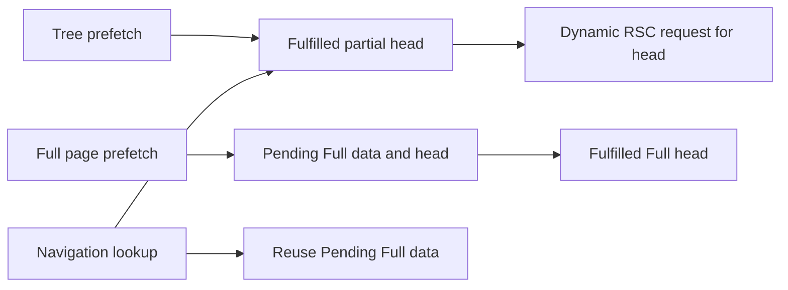

# Remaining session prefetch wait

**Next candidate: remove only the marked-page quiet allowance, retaining the final animation frame, generic fallback, and deadline.** The traces isolate roughly 79 ms of remaining allowance in that branch. A production before/after comparison is still required.

This investigation uses main `2d9c33d4`, after SDK deferral. Application code and the navigation harness are unchanged.

## Baseline

Five untraced samples per input and condition, interleaved. All 20 pass the expected latest v1 artifact and working review action, with zero failed requests under the harness's separate aborted-stream accounting.

| Native click to review ready | Median ms | Range ms    |
| ---------------------------- | --------: | ----------- |
| Default, immediate mouse     |     223.5 | 203.2–528.1 |
| Default, touch               |     277.0 | 189.3–525.2 |
| Constrained, immediate mouse |     722.7 | 718.9–738.5 |
| Constrained, touch           |     722.6 | 718.1–741.4 |

- Same production fixture with 160 additional sessions and fresh browser contexts after sessions-list warmup. Build, browser, source, and harness hashes are in the archived sample record.
- Constrained means 4× browser CPU slowdown, 80 ms configured HTTP latency, 1600 kbps down, and 750 kbps up. Server/database traffic remains local. These are desktop lab conditions.
- The 10-core host retains other desktop processes. Input and condition order alternate to limit drift.
- Four separate profiles and 21 controlled diagnostics establish mechanisms. Their timings include instrumentation overhead and do not establish a speedup.

Samples, reduced profiles, cache observations, interventions, and artifact hashes stay in Git history at [`a567807d`](https://github.com/anantjain-xyz/wallie-dev/blob/a567807db7a2b3e5d2781fda071130b2407e0622/docs/evidence/session-prefetch-wait-investigation.json).

## Two different waits

| Branch                      | Observed behavior                                                                                                                                                                              | Implication                                                   |
| --------------------------- | ---------------------------------------------------------------------------------------------------------------------------------------------------------------------------------------------- | ------------------------------------------------------------- |
| Successful marked page data | In two local profiles, page reader EOF is 83.6/86.4 ms and initial client downloads finish by 83.7/87.2 ms. The remaining 79 ms timer fires at 163.1/165.6 ms; push follows at 170.4/171.1 ms. | The allowance delays navigation after those downloads finish. |
| Tree or unmarked response   | In the constrained profile, the tree timer fires at 168.6 ms and push follows at 175.5 ms. Page headers arrive at 183.1 ms; a third destination RSC request starts at 180.5 ms.                | The fallback can finish before the Full head is fulfilled.    |

The first profile also demonstrates a boundary case. Its tree timer fires before page EOF, but the page completes before the final frame/push, and no third request occurs. Timer expiration alone does not prove a cache miss.

Network completion, observer delivery, consumption, and cache writes are distinct. In the constrained profile, resource timing records response end at 208.9 ms while the reader EOF callback runs at 286.8 ms. A main-thread task occupies 197–281 ms between those observations. A resource timestamp is not a supported Next cache-readiness contract.

## Why the extra RSC request occurs

Seven conditional browser logpoints inspect the installed Next 16.3.4 cache without pausing execution. They reveal a metadata selection issue.

In the held-page control, navigation reads Pending Full data entries #4/#5 at about click +115 ms. It selects fulfilled partial head #2 ahead of the exact Pending Full head #3. The partial head requires a dynamic request, which starts at +116 ms. The original page response remains held until about +260 ms.

This is fulfilled-first fallback selection. The observed Full data entries are reusable, and the head entry is in a normal exact-search slot.

The causal intervention changes only navigation's selected head entry in browser memory. It substitutes the matching Pending Full head for the partial fallback, while leaving the app's wait unchanged. Exactly one substitution removes the third RSC request; the correct artifact and Request changes action still pass. This proves the request's cause, not a latency gain from changing Next internals.

Installed-source mapping:

- [The app wait](../../src/features/sessions/components/session-detail-link.tsx), `waitForSessionDetailPrefetch()`, owns the observer, quiet timers, and final frame. [The timing helper](../../src/lib/performance/session-prefetch.ts) validates current-intent, same-origin, successful marked page data.
- `next/dist/client/components/segment-cache/cache.js:308–327` prefers a fulfilled fallback before trying a more specific pending entry.
- `next/dist/client/components/router-reducer/ppr-navigations.js:743–806` propagates the chosen head's partial state into a dynamic request. Pending Full data reuse is handled at lines 654–671.
- `segment-cache/cache.js:2031–2038,2155` writes Full responses after Flight decoding and stale-time resolution.
- The installed `router.prefetch()` returns `void`; its public `onInvalidate` callback reports staleness. It provides no supported completion callback. See the [router API](https://nextjs.org/docs/app/api-reference/functions/use-router).

## Controlled policy checks

These are targeted diagnostic interventions, not competing production builds.

| Intervention                                                               | Result                                                                                                                                                                        |
| -------------------------------------------------------------------------- | ----------------------------------------------------------------------------------------------------------------------------------------------------------------------------- |
| Shorten only the marked-page allowance to 0, 16, or 32 ms                  | Prepared page-release cases exercise the changed timer, retain two destination RSCs, and pass artifact/review checks. The natural marked-zero case also passes with two RSCs. |
| Marked-zero under constrained touch or a 60 ms reader stall                | The tree fallback wins first. Zero timers change, so these cases do not validate the shortened marked-page path.                                                              |
| Suppress tree timers until marked page data arrives                        | The constrained case and held-page cache probe use two RSCs. Navigation begins later; fewer requests alone do not establish lower review latency.                             |
| Gate on marked data when the marker is absent or the page prefetch fails   | The click reaches the 2,000 ms deadline. This policy is unsuitable without an explicit compatibility/error path.                                                              |
| Gate until marked data after a 60 ms reader stall, then use zero allowance | The marked branch is exercised; navigation reads fulfilled Full data/head and uses two RSCs. Gating remains a separate intervention.                                          |

All 21 diagnostics reach the correct artifact and a successful review action. The missing-marker/failure probes deliberately alter the response. Route interception holds headers and body and changes normal browser caching; those request shapes and timings must not become an ordinary before/after claim.

Two untraced local samples take about 525 ms, with a roughly 320 ms push-to-artifact gap and only two RSC responses. Script downloads finish earlier, and approval HTTP starts around artifact commit. These timings fit the previously identified React commit deadline. A current controlled case records that timer firing before artifact appearance, but the exact cause of the two untraced tails remains an inference.

## Next bounded experiment

1. Prototype a zero marked-page allowance with the existing successful-response validation and final frame. Keep the generic 80 ms fallback and 2,000 ms deadline.
2. Preserve old/unmarked/failed-response handling, intent matching, keyboard/touch behavior, and back navigation. Require correct artifact/action checks and destination-request accounting.
3. Alternate baseline/candidate builds with the unchanged harness, five samples per input and condition. Capture separate profiles to confirm the intended branch changed. The current local spread exceeds 80 ms, so the end-to-end result may remain inconclusive.
4. Address the partial-head fallback separately. An unconditional page gate causes compatibility delays, and private cache objects are diagnostic tools rather than an application API.

Use the [navigation benchmark instructions](navigation-bench.md). Original traces and probe outputs remain in `bench-results/prefetch-wait-investigation/`. The diagnostic runner is `.wallie/prefetch-wait-investigation/probe.mjs`; its options and hashes, along with the cache logpoint specifications, are retained in the archived sample record.

Pstack's Explain the Number kept untraced samples separate from diagnostics. Runtime Forensics required the head-selection counterfactual before accepting the cache diagnosis. Guard the Context Window delegated bulk trace reduction.

## Validation

- Latest-main production build and all 20 baseline samples pass.
- Four diagnostic profiles and 21 controlled artifact/review checks pass. Injected failures are recorded separately from baseline request errors.
- `pnpm check:fast` and documentation formatting checks pass.
- `pnpm test --maxWorkers=4` passes with 4,908 tests passed and two existing skips.
- `pnpm check:cloudflare` passes with 35 tests passed and the Wrangler dry run complete.
- Application, Next configuration, and harness files exactly match the recorded main baseline.

throughput checkpoint: n/a, read-only forensics
