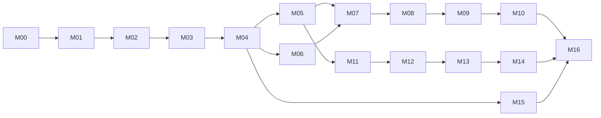

# Wallie factory — full implementation plan

**Evolve the existing Wallie into the complete 100-capability factory, through useful incremental releases, while preserving today's design language and execution guarantees.**

Status: implementation plan. The inventory records repository baseline `3ea0c14be7ac7695d3fa2999433130a4d0e44a20`. M00 checked the design and compatibility contract against `main` at `b41819b81fd7b8680a874fdcc2225b22fc7554f9` on November 14, 2026.

## Scope and navigation

| Read                                                                               | Purpose                                                                                                                                                                                       |
| ---------------------------------------------------------------------------------- | --------------------------------------------------------------------------------------------------------------------------------------------------------------------------------------------- |
| This plan                                                                          | Architecture decisions, reuse, dependency graph, incremental milestones, rollout and final acceptance.                                                                                        |
| [100-capability matrix](FACTORY-CAPABILITY-MATRIX.md)                              | Every F001–F100 item, implementation work, reusable owners, prerequisites and completion proof.                                                                                               |
| [Machine-readable register](factory-capabilities.json)                             | Original source inventory and timestamps plus implementation fields; suitable for creating tracked work later.                                                                                |
| [Interactive end-state mock](https://wallie-factory-vision.anantjain.chatgpt.site) | Interaction and capability reference; its grouped sidebar informs the end-state navigation. Production styling uses current Wallie tokens/components, and sample metrics remain illustrative. |
| [Current architecture](../ARCHITECTURE.md)                                         | Existing ownership and invariants to extend.                                                                                                                                                  |

- **All 100 capabilities remain committed scope.** F001–F097 come from the recording's spoken or demonstrated features. F098–F100 complete the requested open-source distribution.
- M00 establishes the compatibility/design baseline; M01–M16 deliver the full outcome. Milestones contain smaller independently shippable slices. No milestone is an excuse to remove later scope.
- A capability's milestone owns its **full end-state completion**. Existing foundations remain usable earlier: three sandbox drivers and four agent harnesses do not wait until M15.
- Every slice includes usable UI, durable behavior, permission/error states and proof. A stub page or a database-only change does not complete a capability.
- The plan is transferred to the existing Wallie Linear project: [206 one-PR issues across 17 milestones, with 283 blocking relationships](https://linear.app/optimism-llc/document/factory-delivery-map-206-prs-100-capabilities-9853c51dac5c). [The local delivery map](linear-delivery-map.json) preserves every issue, capability and dependency reference. Product implementation remains planned.
- The issue-level graph refines milestone sequencing: M12 delivery observations require M06; complete M15 data-lifecycle qualification requires the context/evaluation domains through M10; full M16 portability waits for M14/M15 schemas. M10 diagnosis and M16 release-manifest preparation can start before their final qualification gates.

## Target outcome

A team can submit work from Wallie, chat, issues, API, MCP or automation; collaborate on a specification; let configured agents coordinate execution; inspect exact code and demonstrated behavior; authorize delivery; and use recorded outcomes to improve the factory.

An operator can choose repositories, harnesses, models, compute, storage and inference ownership. Another organization can install and operate the same complete product from its MIT-licensed source.

```mermaid
flowchart LR
    IN["Wallie · Slack · Teams · Linear · Jira<br/>GitHub · GitLab · API · MCP · schedules"] --> CMD["Authorized intake and conversation"]
    CMD --> WORK["Factory revision + session"]
    DEF["Versioned definition<br/>agents · workflows · grants · context"] --> WORK
    WORK --> ORCH["Foreman / workflow orchestration"]
    ORCH --> EXEC["Isolated agent runs and child sessions"]
    EXEC --> REVIEW["Artifacts · code · evidence<br/>human decisions"]
    REVIEW --> SHIP["Verified source delivery<br/>CI/CD · monitoring"]
    EXEC --> DATA["Retained traces · inputs · usage"]
    SHIP --> DATA
    DATA --> MET["Analytics and scorers"]
    MET --> IMP["Failure groups and candidate changes"]
    DATA --> BENCH["Frozen replay benchmarks"]
    IMP --> BENCH
    BENCH --> ADOPT["Reviewed definition / routing change"]
    ADOPT --> DEF
    SHIP --> CMD
```

The database remains authoritative for state and atomic transitions. Next.js route handlers and feature loaders remain the edge; workers coordinate asynchronous work; harness/compute/source adapters stay behind typed contracts. Keep Supabase Auth/Postgres/RLS/Realtime/Storage and supported Vercel, native Cloudflare orchestration and Node/container deployments. This is an extension of the current architecture, not a platform replacement.

## Reuse register

These are source-backed foundations, not claims of end-state completeness. Paths below are relative to the repository; proposed new entities later in this plan are design decisions.

| ID  | Existing owner                                                                                                                                                                                                   | Reuse                                                                                                                            | Extension boundary                                                                                                                                                |
| --- | ---------------------------------------------------------------------------------------------------------------------------------------------------------------------------------------------------------------- | -------------------------------------------------------------------------------------------------------------------------------- | ----------------------------------------------------------------------------------------------------------------------------------------------------------------- |
| R01 | [Database/RLS](../DATABASE-AND-RLS.md), [migrations](../../supabase/migrations/), [Supabase clients](../../src/lib/supabase/)                                                                                    | Workspace tenancy, membership, guarded RPCs, generated schema types.                                                             | Add factory/resource grants and scoped service principals; include new tables, assets and subscriptions in isolation tests.                                       |
| R02 | [Pipeline](../../src/lib/pipeline/), [job/run service](../../src/lib/wallie/service.ts), [session creation](../../src/features/sessions/create.ts), [lifecycle](../PIPELINE-WORKER-LIFECYCLE.md)                 | Generic stages, one active job per session, atomic creation/start/review, retry/cancel and recovery.                             | Definition pins, source-neutral commands, child sessions and graph transition receipts. Do not loosen the existing active-job index to obtain parallel agents.    |
| R03 | [Agent runner](../../src/lib/agent-runner/), [agent configuration](../../src/lib/agent-config/), [harness contract](../AGENT-HARNESS.md)                                                                         | Codex, Claude Code, Cursor and OpenCode adapters; normalized events; authoritative final output.                                 | Per-agent immutable config, explicit tools, richer traces, compatibility/extension contract and gateway profiles.                                                 |
| R04 | [Workspace access](../../src/lib/workspaces/access.ts), [agent credentials](../../src/lib/agent-credentials/), [secrets](../../src/lib/secrets/), [rate limiter](../../src/lib/rate-limit.ts)                    | Human membership checks, encrypted credentials, permission-aware settings and redaction.                                         | Browser authorization currently requires a human member; machine authorization is new. The in-memory limiter is not a distributed quota system.                   |
| R05 | [Typed prompts](../../src/lib/prompt-templates/), [stages/prior artifacts](../../src/lib/pipeline/stages.ts), [onboarding skills](../../src/lib/repo-onboarding/skills.ts)                                       | Classified trusted control/untrusted input, stable stage identities, completed-stage artifact projections and repository skills. | Pin exact predecessor artifact IDs/digests and prompt/skill/tool/context revisions; add retrieval/memory without weakening trust classification.                  |
| R06 | [Checkpoint lineage](../GIT-CHECKPOINT-LINEAGE.md), [Git inputs](../../src/lib/pipeline/git-input.ts), [publication](../../src/lib/pipeline/checkpoint-publication.ts)                                           | Exact starting refs, retained checkpoints, publication intent, remote SHA proof and atomic adoption.                             | Complete replay manifests, per-repository output sets, child joins and source-host-neutral publication.                                                           |
| R07 | [Validation evidence](../VALIDATION-EVIDENCE.md), [collector/services](../../src/lib/validation-evidence/), [review evidence](../REVIEW-EVIDENCE.md)                                                             | Attempt-owned plans outside checkout, exact commit/tree receipts, private bounded text reports and readiness.                    | New trusted binary/media capture; scoring is a new quality domain, not a substitute for deterministic validation.                                                 |
| R08 | [Execution budgets](../EXECUTION-BUDGETS.md), [execution policy](../../src/lib/execution-policy/), [delivery policy](../../src/lib/delivery-policy/), [usage normalization](../../src/lib/agent-runner/usage.ts) | Immutable policy revisions, measured/estimated/unavailable usage, repair reservations and exact-attempt accounting.              | Root/experiment reservations, evaluator usage, versioned routing and outcome cohorts. Preserve unavailable values.                                                |
| R09 | [Sessions](../../src/features/sessions/), [review components](../../src/features/sessions/review/), [Workbench](../../src/features/sessions/detail/)                                                             | Ledger, versioned artifacts, anchored feedback, exact review actions, diff/evidence, Realtime activity.                          | Runs/Inbox projections, conversations, richer evidence and improvement reviews; reuse one decision domain.                                                        |
| R10 | [GitHub integration](../../src/features/github/), [webhooks](../../src/app/api/github/webhooks/route.ts), [verification](../GITHUB-PR-VERIFICATION.md)                                                           | Verified installation ownership, webhook receipts, repository onboarding, purpose-scoped tokens, PR/readiness reconciliation.    | General issue/PR intake, delivery observations and config PRs. GitLab needs an equivalent repository/publication/verification adapter, not renamed fields.        |
| R11 | [Linear client](../../src/lib/linear/client.ts), [routing](../../src/lib/linear-routing/), [reconciler](../../src/worker/reconciler.ts)                                                                          | Optional issue linkage and pull-based state-span reconciliation for linked sessions.                                             | Discovery/admission of new work, general rules, source replies and durable shared event receipts.                                                                 |
| R12 | [Sandbox drivers](../../src/lib/sandbox/), [connections](../../src/lib/sandbox-connections/), [capabilities](../../src/lib/sandbox-capabilities/), [contract](../SANDBOX-PROVIDER-CONTRACTS.md)                  | Vercel, E2B and Daytona; isolation, connection revisions, acquisition/cleanup and capability checks.                             | Owned fleets, native OS bootstraps, egress profiles and explicit conformance matrix. Current setup is Linux/POSIX-oriented.                                       |
| R13 | [Storage](../../src/lib/storage/), [session attachments](../../src/lib/pipeline/session-attachments.ts), [workspace deletion](../../src/lib/workspaces/deletion.ts)                                              | Private assets, input images, signed access and deletion/cleanup patterns.                                                       | Artifact catalog, ACL-aware context snapshots, retained screenshot/video capture, memory and complete export/deletion coverage.                                   |
| R14 | [Design tokens](../../src/app/globals.css), [page primitives](../../src/components/ui/page-shell.tsx), [app shell](../../src/components/app-shell/), [routes](../../src/lib/routes.ts)                           | Precision Console appearance, top navigation, semantic typography/statuses, accessible controls, responsive layouts.             | Grouped desktop sidebar with a compact utility header, plus theme-aware charts, comparison matrices, graph/list editor and media viewers using these conventions. |
| R15 | [Settings](../../src/features/settings/), [onboarding](../../src/features/onboarding/), [usage loader](../../src/features/settings/data.ts)                                                                      | Streamed section islands, pipeline/agent/provider/secret/member/policy forms and setup readiness.                                | Promote existing sections to dedicated destinations with one semantic editor and preserved bookmarks.                                                             |
| R16 | [Telemetry](../telemetry.md), [verification](../VERIFICATION.md), [route budgets](../../config/route-budgets.json), [E2E](../../e2e/)                                                                            | Performance/privacy contracts, navigation tests, production builds, browser fixtures and budget checks.                          | Product outcome analytics are a separate tenant-owned data product, not prompts/events sent to UI telemetry.                                                      |
| R17 | [Worker](../../src/worker/), [operations](../WORKER-OPERATIONS.md), [Cloudflare](../CLOUDFLARE-WORKER.md), [self-hosting](../SELF_HOSTING.md), [Docker](../../docker/)                                           | Durable worker scheduling/recovery, native and Node deployment options, packaging and health patterns.                           | Fair production/evaluation lanes, owned-runner coordination, full restore/upgrade qualification and supported topology matrix.                                    |
| R18 | [MIT license](../../LICENSE), [contributing](../../CONTRIBUTING.md), [security](../../SECURITY.md), [self-hosted qualification](../SELF-HOSTED-SUPABASE.md)                                                      | Already-open-source repository, contribution/security process and installation foundations.                                      | Reproducible full releases, portable definitions, sample factories, extension contracts and operator evidence.                                                    |

### Reuse traps to avoid

- A pipeline ID pins identity, **not today's mutable stage prompts/order or live workspace agent configuration**. M02 must close this gap.
- Input image attachments exist; opaque screenshot/preview output is explicitly unavailable in the current validation collector. M05 needs a separate trusted capture path.
- Agent MCP is deliberately empty today. Enable only approved scoped bindings; do not inherit local harness configuration or inject all workspace secrets.
- Current normalized run messages are not proof of every provider event. Declare capture coverage and observable-event completeness per adapter.
- A completed/archived session does not prove a PR merged or an application deployed. M06/M12 need authoritative observations.
- Self-hosting documentation and historical AWS work are useful foundations, not evidence that every owned topology or HA/restore path is currently qualified.
- Reconcile stale harness documentation in M00/M01: current code requires authoritative `finalOutput`, uses durable completed-stage IDs, and separates agent source access from trusted publication.

## Architecture decisions

### Core contracts

Names are proposed; finalize migrations and contracts in the owning milestone. Avoid prematurely creating tables for all future features.

| Contract             | Durable identity and rules                                                                                                                                                                           | Owner milestone                            |
| -------------------- | ---------------------------------------------------------------------------------------------------------------------------------------------------------------------------------------------------- | ------------------------------------------ |
| Factory              | Workspace child with stable ID, default migration, repository associations and authorization. Workspace remains the tenant boundary.                                                                 | Minimal anchor M02; full product M03       |
| Definition revision  | Schema version, immutable canonical digest, component revisions, validation receipts, base revision, author and activation history. UI/file edits compile to the same meaning.                       | M02; extended in later milestones          |
| Execution manifest   | Session/attempt identity; repository starting refs; accepted predecessor; prompt/context/skills/tools; resolved model/harness/runtime; policies and grants. Secret references/version metadata only. | M02; context M05; runtime M15              |
| Work identity        | One session, originating source/thread, initiating human/service identity, budget payer, command idempotency and follow-up lineage.                                                                  | M04                                        |
| Outcome/event        | Durable causation, attempt/revision, source timestamp/observation time and coverage. Project metrics/automation from domain facts; do not replace all state with event sourcing.                     | M01 capture; M06 projections; M12 triggers |
| Context/media        | Immutable snapshot or asset digest, upstream ACL, capture provenance, source/run/commit/tree, retention and availability. Memory has reviewed versions and expiry.                                   | M05                                        |
| Evaluation           | Target run/output, scorer/judge revision, evidence digest, score/result status, explanation/adjudication, sample membership, usage and cost provenance.                                              | M07                                        |
| Experiment           | Frozen suite/tasks/candidates/scorers, repetitions/seed where supported, side-effect policy, trial identity, total reservations and attributable results.                                            | M08                                        |
| Routing/improvement  | Exact base and candidate revisions, qualification/comparison evidence, reviewed decision, canary cohort and activation/rollback receipts.                                                            | M09/M10                                    |
| Workflow execution   | Root session/generation, node transition receipts, scoped child sessions, join inputs/output and root reservations. One scheduler owns transitions.                                                  | M11                                        |
| Automation/connector | Versioned rule, actor/grant/target, signed provider event or scheduled occurrence, normalized receipt, command result and outbound delivery state.                                                   | M04 foundation; M12–M14                    |
| Execution profile    | Compute OS/architecture/isolation, harness/toolchain, endpoint/model capability, credentials, network/data policy and qualification freshness.                                                       | M03 baseline; M15 complete                 |

### Execution and review remain trustworthy

1. Keep separate fences for queue claim, eligible session/run start, source adoption, review, cancellation and cleanup. Preserve existing session → job → run lock order; document a globally consistent root-before-child extension.
2. Preserve atomic checkpoint/artifact/exact-job completion after retained remote SHA verification. PR synchronization remains a separate durable obligation.
3. A scorer, agent review, benchmark win, service principal or connector bot cannot satisfy a required **human** decision. An API/connector approval must represent a verified authorized human and the displayed artifact/version/review identity.
4. New revisions apply to future admissions. Retries preserve frozen configuration and their declared predecessor inputs; a deliberate restart/replan creates explicit new lineage. Security revocation still overrides permission to execute.
5. Validate every external payload once into typed domain data. External sources, memories, tool results and feedback remain untrusted prompt content.
6. Preserve per-session active-job uniqueness. Delegated agents use child sessions with explicit execution purpose, restricted grants, isolated source and root-budget reservations.
7. Children cannot publish the parent's canonical PR. A parent join integrates named immutable outputs, handles conflicts, revalidates the integrated commit and publishes once. Child approval is not parent approval.
8. Multi-repository tasks pin each repo and record a set of accepted outputs. Git/database/remote merge is not one distributed transaction; represent partial delivery and recovery rather than claim atomic cross-repo delivery.
9. Keep final artifacts sourced from authoritative completion output. Streaming prose, generated test claims and judge opinions do not become observed validation receipts.
10. Never reconstruct missing history as fact. Legacy configuration, unknown cost, missing media, partial context and nonreproducible model aliases remain explicitly labeled.

### Scheduling, budgets and side effects

- Retain the current execution engine. Benchmark trials use isolated internal sessions with `purpose=benchmark`; delegated product work uses child sessions; evaluation jobs have their own identity and queue lane. Hide internal trial sessions from ordinary production lists by purpose, not by weak permissions.
- Share fair admission across production, scoring, benchmarking, diagnosis and maintenance. Reserve per-workspace/factory/experiment/root limits before claims; cancellation releases unused reservations and late charges reconcile exactly once.
- Count child effort and all failed/retried/canceled attempts. A wall-clock limit for the root does not replace summed execution/token/spend limits or expansion limits.
- Provider usage may arrive only at completion. Document potential in-flight spend overrun; use conservative reservations/concurrency limits and stop-on-unknown policy when a hard limit cannot be observed. Do not promise a perfectly enforced predictive dollar ceiling.
- Evaluation and replay have restricted tools and independent publication authority. Recorded read fixtures or approved isolated test resources replace production writes. Missing required fixtures block or explicitly disqualify the trial.
- Webhooks and scheduled events use transactional receipts/outbox records. “Received,” “authorized,” “session created,” “reply pending,” “delivered” and “outcome unknown” are distinct. Recover unknown outbound outcomes before resending; do not promise transport-level exactly-once delivery.
- Admission permission, source ACL and current credential validity are checked at use. Frozen manifests retain identity, not permanent access. Forgetting/deleting protected context can make an old benchmark non-replayable.
- Keep replay variance visible: pin controllable code/toolchain inputs, record provider model revision when available, and label model aliases/nondeterminism that cannot be reproduced exactly.

### Analytics contracts

| Metric                    | Definition and edge cases                                                                                                                                                                                                                                  |
| ------------------------- | ---------------------------------------------------------------------------------------------------------------------------------------------------------------------------------------------------------------------------------------------------------- |
| Flow                      | Queue, active execution, clarification/block, human review and delivery waits from observed state intervals; unknown historical gaps excluded with coverage, not invented.                                                                                 |
| Cost per merged PR        | Primary **delivery-cohort** view: attributable lifetime run/evaluation cost for unique PRs merged in the selected period / those unique PRs. Includes their unsuccessful attempts. Show measured/estimated/unavailable coverage and the cohort explicitly. |
| Factory efficiency        | Separate **period operating cost / merges in period** includes abandoned/unlinked product work; show experiment/maintenance/compute spend separately and in an optional total. Never hide this overhead behind the delivery-cohort metric.                 |
| Time to delivery          | Request → observed merge and request → observed deployment are separate measures. Show distributions and active versus wait time; archival/approval are not delivery timestamps.                                                                           |
| Throughput                | Unique observed merges by canonical source-host/repository/PR identity. Replay, child branches and duplicate provider events cannot inflate it.                                                                                                            |
| Revert rate               | Verified revert relations / eligible merged-change cohort over an explicit observation window; label maturity, incomplete linkage and ambiguous corrections. Do not infer zero reversions from missing data.                                               |
| Source/person/agent/model | Preserve initiating human, service principal, reviewer and assignee separately. Attribute agent/model/harness/config by pinned identity; group unattributed history as unknown.                                                                            |
| Quality/frontier          | Report scorer revision, eligible/sample/usable denominators, failed and missing trials, repetitions/uncertainty and cost provenance. A low-cost recommendation requires known comparable cost and the chosen quality floor.                                |

## Milestone roadmap

Numbers identify ownership and a recommended review order; they are **not one global serial queue**. Use the prerequisite graph to start independent tracks. M16 packaging starts early, while its final acceptance depends on the whole plan.

| Milestone | Incremental user outcome                                                     | Hard prerequisites | Capability count |
| --------- | ---------------------------------------------------------------------------- | ------------------ | ---------------: |
| M00       | Preserve current visuals, routes and behavior with a reference baseline.     | Current repository | 0; cross-cutting |
| M01       | Inspect retained runs, transcripts and artifacts across sessions.            | M00                |                5 |
| M02       | Inspect, test, publish and roll back complete immutable factory definitions. | M01                |                5 |
| M03       | Organize product factories and configure agents, skills, tools and grants.   | M02                |               10 |
| M04       | Use a shared Inbox/conversation from Wallie, API or MCP.                     | M03                |                8 |
| M05       | Reuse attributable context/memory and review screenshot/video evidence.      | M04                |                6 |
| M06       | Understand flow, spend, delivery, throughput and reversions.                 | M04                |                7 |
| M07       | Score real runs against custom versioned quality criteria.                   | M05, M06           |                8 |
| M08       | Replay real tasks across models, harnesses and configurations.               | M07                |               11 |
| M09       | Adopt evidence-backed task-class routing and cost-quality policies.          | M08                |                3 |
| M10       | Review recurring failures and benchmark proposed factory improvements.       | M09                |                5 |
| M11       | Delegate through bounded custom multi-agent workflows and joins.             | M05                |                6 |
| M12       | Run scheduled/event work, deliver approved changes and monitor outcomes.     | M11                |                6 |
| M13       | Complete Slack, Linear and GitHub work journeys.                             | M12                |                5 |
| M14       | Complete Teams, Jira and GitLab journeys and source delivery.                | M13                |                3 |
| M15       | Operate owned compute, native OS profiles and inference gateways/models.     | M04                |                9 |
| M16       | Install, restore, upgrade and export the complete open-source product.       | M01–M15            |                3 |
| **Total** | **Full end state**                                                           |                    |          **100** |

The table lists minimal milestone prerequisites; earlier transitive foundations are also required. M07 requires M06 for score trends in Analytics; M09/M10 inherit M06 for observed canary/outcome comparisons. M10 also requires M09 for routing improvements. Initial editors or proposal drafts may ship earlier, but do not close the milestone until those integrations work.

### Parallel ownership

| Track                   | Work                                     | Integration boundary                                                                                                                     |
| ----------------------- | ---------------------------------------- | ---------------------------------------------------------------------------------------------------------------------------------------- |
| Shared foundations      | M00–M04; then contract stewardship       | Own migration ordering, factory/definition identity, authorization and domain commands. Other tracks consume published contracts.        |
| Measurement/improvement | M06–M10                                  | Uses immutable inputs, context/evidence, usage and production observations. Serial execution is enough to ship this track.               |
| Workflow/intake         | M11–M14                                  | Uses common commands/grants and child-session ownership; connectors share one event/outbound contract.                                   |
| Context/media           | M05, then ongoing provider qualification | Supplies snapshots, ACL-aware retrieval, memory, captured visual evidence and exact provenance to other tracks.                          |
| Infrastructure/release  | M15; M16 preparation throughout          | Qualifies execution profiles and complete deployment topology; existing provider support remains usable.                                 |
| Product/design          | Embedded in every slice                  | Shared tokens/components, route ownership, accessible states, onboarding and regressions are release criteria, not a final polish phase. |

Parallelize teams after contracts land; avoid concurrent edits to the same migration/RPC/authorization owner without one integration owner. External connector implementations may begin against M04/M12 contracts before the previous connector's complete rollout. Their milestone closes only after real end-to-end qualification.

No calendar dates are asserted without staffing and provider-account availability. Each milestone has concrete slices and proof below; estimate and staff those slices after M00, preserve the dependency graph, and carry blocked external qualification as visible unfinished scope.

## Preserve Wallie’s design language

**Extend the current product. The mock defines the destination’s capabilities and interactions; the existing application defines its visual language.**

- Use a grouped desktop sidebar for the expanded product, introduced in M03 as factory/configuration destinations grow. Keep a compact utility header with current-page context, New session, theme toggle and account controls. Preserve workspace identity, a distinct factory selector, and access to Pipeline, Sessions and Settings. Add navigation items only as their features become useful.
- Reuse `src/app/globals.css`: neutral canvas → sheet → overlay, indigo accent, semantic status colors, 6px content radius, 10px overlays, quiet decorative borders, identifiable input borders, and shadows only for floating overlays. Group related content with headings, spacing, and dividers; never nest sheets.
- Keep self-hosted Inter Variable and IBM Plex Mono, semantic typography roles, and both themes. Essential text and controls remain at least 12px; 11px annotations are nonessential. Mono remains for code, identifiers, branches, timestamps, and numbers.
- Build with `PageContainer`, `PageHeader`, `CommandBar`, `PageSection`, metadata primitives, shared statuses, filters, dialogs, selects, tooltips, toasts, and loading/error controls. Extend these owners before introducing equivalent page-specific components.
- Preserve the server-rendered Sessions ledger, small client interaction islands, and streamed Settings sections. In the [Review Workbench](../../src/features/sessions/detail/), keep the artifact and run views, stage navigation, on-demand versions, and the review action bar. Older artifacts are read-only. Inbox and improvement reviews reuse decision controls anchored to the exact current review identity.

### M00 — Establish the visual and compatibility baseline

Ship these three preparation slices independently:

| Slice                                       | Deliverable                                                                                                                                                                      | Acceptance                                                                                                                                           |
| ------------------------------------------- | -------------------------------------------------------------------------------------------------------------------------------------------------------------------------------- | ---------------------------------------------------------------------------------------------------------------------------------------------------- |
| M00.1 — Design and route contract           | Record the visual rules, grouped sidebar/mobile drawer transition, canonical paths, Settings aliases, scope and route ownership.                                                 | The current shell, review flows and bookmarks have a compatibility baseline. The plan maps all 100 capabilities and 18 destinations.                 |
| M00.2 — Reference fixtures                  | Capture current Pipeline, Sessions, Review Workbench, Settings, and onboarding in light/dark themes; retain representative empty, loading, partial, blocked, and error fixtures. | Existing desktop/mobile flows pass; future milestones have an objective visual comparison baseline.                                                  |
| M00.3 — Roadmap coverage and execution docs | Validate the register and dependency graph, document PR completion evidence, and reconcile the harness documentation.                                                            | The register check catches gaps, dangling references and cycles. The harness documentation reflects the current execution and publication contracts. |

### Sidebar structure and incremental transition

| Navigation region | Destinations                                                                  |
| ----------------- | ----------------------------------------------------------------------------- |
| Work              | Overview, Inbox, Pipeline, Sessions, Runs                                     |
| Improve           | Analytics, Scorers, Benchmarks, Improvements, Model routing                   |
| Configure         | Workflows, Factory definition, Agents & skills, Automations, Context & memory |
| Platform          | Infrastructure, Integrations & API                                            |
| Footer            | Settings, Help / Feature map                                                  |

The existing operational Pipeline remains available alongside all 18 destination screens from the mock. It is distinct from the Workflows configuration editor; this preserves current behavior without adding or removing capability scope.

- **M00:** Define sidebar grouping, utility-header responsibilities and responsive states against the existing design tokens; retain reference captures of the current shell.
- **M01–M02:** Keep current navigation while introducing the first working destinations. Centralize route labels/active matching so the later shell change does not fork navigation logic.
- **M03:** Introduce the desktop sidebar with the factory selector and a compact utility header. Keep Settings and all existing routes/anchors accessible. Qualify the shell transition independently from configuration behavior.
- **M04 onward:** Add each working screen in its planned group. Introduce Improve when Analytics ships in M06; leave future scorer/benchmark/improvement links absent until those features work.
- **Desktop:** Support expanded labels and an optional remembered compact rail with accessible names and focusable tooltips. Active state must remain clear in both themes. Long navigation scrolls independently; the main page retains document scrolling and sufficient review/editor width.
- **Compact screens:** Use a labelled navigation button and drawer built on shared dialog primitives, with grouped links, current-route indication, Escape, focus trapping/restoration and route-change dismissal. Keep New session and scope selection reachable; avoid a permanent narrow sidebar consuming content width.

### All 18 destination screens

Paths below are relative to `/w/[workspaceSlug]`. Aggregate screens use `?factory=<stableId>`, defaulting to the workspace’s default factory. Overview, Sessions, Runs and Analytics also accept `?factory=all` for an explicitly selected **All authorized factories** view; results and counts include only currently permitted factories. Revocation removes those results and clears inaccessible saved filters; it never falls back to broader access. Factory-specific resources resolve by ID with factory authorization. Session URLs and numbering remain unchanged.

| Screen             | Destination                                                                                                           | Reuse and evolution                                                                          |
| ------------------ | --------------------------------------------------------------------------------------------------------------------- | -------------------------------------------------------------------------------------------- |
| Overview           | `/overview?factory=…`                                                                                                 | Shared page shell, usage summaries, status, and Pipeline summaries.                          |
| Inbox              | `/inbox?factory=…`                                                                                                    | Ledger and filters; opens the existing review identity and workbench.                        |
| Sessions           | `/sessions?factory=…`; `/sessions/[sessionNumber]`                                                                    | Existing ledger, preferences, pagination, intent prefetch, and detail screen.                |
| Runs               | `/runs?factory=…`; `/runs/[runId]`                                                                                    | Activity, metadata, bounded transcripts, artifacts, and evidence viewers.                    |
| Workflows          | `/workflows?factory=…`; `/workflows/[workflowId]`                                                                     | Pipeline editor/primitives and stage timeline; retain the operational Pipeline board at `/`. |
| Analytics          | `/analytics?factory=…`                                                                                                | Usage provenance, command bar, drilldown tables, accessible charts.                          |
| Scorers            | `/scorers?factory=…`; `/scorers/[scorerId]`                                                                           | Settings forms, rubric/version editor, and run evidence.                                     |
| Improvements       | `/improvements?factory=…`; `/improvements/[proposalId]`                                                               | Ledger, source-linked failures, diff, and review controls.                                   |
| Benchmarks         | `/benchmarks?factory=…`; `/benchmarks/[suiteId]`; `/benchmarks/[suiteId]/comparisons/[comparisonId]/trials/[trialId]` | Task ledger, configuration matrix, comparison/trial evidence.                                |
| Model routing      | `/factories/[factoryId]/routing`                                                                                      | Configuration forms, version/diff review, benchmark justification.                           |
| Factory definition | `/factories/[factoryId]/definition`                                                                                   | Draft editor, validation, revisions, publish, and rollback.                                  |
| Agents & skills    | `/agents?factory=…`; `/agents/[agentId]`                                                                              | Existing agent, repository, secret, and credential controls.                                 |
| Automations        | `/automations?factory=…`; `/automations/[automationId]`                                                               | Trigger ledger, forms, dry run, status, and execution history.                               |
| Context & memory   | `/context?factory=…`                                                                                                  | Artifact/media viewers, source and memory provenance.                                        |
| Infrastructure     | `/infrastructure?factory=…`                                                                                           | Sandbox connections/capabilities, budgets, maintenance, readiness.                           |
| Integrations & API | `/integrations?factory=…`                                                                                             | Existing GitHub/Linear integration and onboarding sections; new connector/access surfaces.   |
| Settings           | `/settings`                                                                                                           | Existing workspace identity, members, governance, account, and release controls.             |
| Feature map        | `/capabilities` with linked developer documentation                                                                   | Read-only 100-capability coverage, reached through Help/Settings.                            |

### Navigation and compatibility

- Show a distinct factory selector while keeping the workspace as the tenant. Changing the aggregate filter preserves an open session’s factory and a configuration draft’s owner. `factory=all` is an explicit, read-only aggregate scope. Creation and configuration edits require an authorized concrete factory. For an explicit unknown or unauthorized factory ID, show an unavailable scope and let the user choose another authorized scope. Omit the filter to resolve the authorized default.
- Add destinations only with usable vertical slices. The sidebar organizes Work, Improve, Configure and Platform; contextual tabs handle detail views. Keep unshipped items out of navigation and create each group when its first usable destination lands.
- Preserve the workspace root Pipeline, numbered session detail, workspace onboarding and Settings routes. Keep the `artifactStage` and `artifactVersion` query parameters used by artifact deep links. Carry over the selected view when extending these routes.
- Extend [route helpers](../../src/lib/routes.ts), the [active navigation](../../src/components/app-shell/shell-header.tsx), preference scopes, [safe telemetry templates](../../src/lib/telemetry/privacy.ts) and navigation recovery together. Use route templates without raw identifiers, fragments or scope query values in telemetry. Clear saved filters when a scope change makes them incompatible.
- The milestone that introduces each route owns its loader, access check, route template and budget. Reuse the [committed budgets](../../config/route-budgets.json) for Pipeline, Sessions, detail, Settings, onboarding and shared root. Register new routes in the [budget checker](../../scripts/check-route-budgets.ts) as they ship.

| Route or group              | Route and loader ownership                                                                                                                                 |
| --------------------------- | ---------------------------------------------------------------------------------------------------------------------------------------------------------- |
| Pipeline and onboarding     | Current [Pipeline](../../src/features/pipeline/) and [onboarding](../../src/features/onboarding/) owners.                                                  |
| Overview, Agents & skills   | M03 factory shell and agent configuration.                                                                                                                 |
| Inbox and expanded Sessions | M04 shared work. Current [Sessions](../../src/features/sessions/) owns list and detail, including artifact review.                                         |
| Runs                        | M01 durable history and evidence.                                                                                                                          |
| Factory definition          | M02 immutable definitions.                                                                                                                                 |
| Context & memory            | M05 context, memory and evidence.                                                                                                                          |
| Analytics                   | M06 outcomes and analytics.                                                                                                                                |
| Scorers                     | M07 scorer configuration and results.                                                                                                                      |
| Benchmarks                  | M08 replay and benchmarks, including comparison and trial detail.                                                                                          |
| Model routing               | M09 routing configuration.                                                                                                                                 |
| Improvements                | M10 reviewed improvement proposals.                                                                                                                        |
| Workflows                   | M11 workflow configuration and detail. The operational Pipeline retains its own route.                                                                     |
| Automations                 | M12 rules and execution history.                                                                                                                           |
| Integrations & API          | M04 API access. M13 and M14 own connector additions.                                                                                                       |
| Infrastructure              | M15 execution profiles, inference and ownership controls.                                                                                                  |
| Settings                    | Current [Settings](../../src/features/settings/) owns workspace and account controls. M03 owns factory scope integration and M16 owns release information. |
| Feature map                 | M16 release and contribution information, with the capability register as the source.                                                                      |

#### Settings bookmarks

The [Settings hash router](../../src/features/settings/settings-category-nav.tsx) resolves these existing bookmarks. Destinations are relative to `/w/[workspaceSlug]`. Keep the query values used by callbacks, including `github` and `codex_connect`, when normalizing a hash. Maintenance remains restricted to users who can manage the workspace.

| Current hashes                                                                      | Current destination                                  |
| ----------------------------------------------------------------------------------- | ---------------------------------------------------- |
| `#github`, `#repository`, `#pipeline`, `#linear`, `#sandbox`, `#runtime`, `#verify` | `/settings?category=integrations` with the same hash |
| `#cloud-execution`                                                                  | `/settings?category=integrations#verify`             |
| `#coding-agent`, `#secrets`                                                         | `/settings?category=integrations#runtime`            |
| `#linear-routing`                                                                   | `/settings?category=integrations#linear`             |
| `#vercel`                                                                           | `/settings?category=integrations#sandbox`            |
| `#workspace`, `#members`, `#danger-zone`                                            | `/settings?category=workspace` with the same hash    |
| `#usage`, `#maintenance`, `#rate-limits`                                            | `/settings?category=advanced` with the same hash     |

Keep the category and anchor reachable until its editor moves. When an editor moves, route the old bookmark to the equivalent authorized view and keep the original fragment working from external links. Workflow editing moves toward Workflows, agent configuration toward Agents & skills, sandbox configuration toward Infrastructure, connector setup toward Integrations & API, and outcome views toward Analytics. Reuse the existing editors in the destination.

### Gates for every milestone

- Compare new screens with the M00 references in both themes; shared tokens, readable labels, and consistent status meanings are required.
- Extend the existing responsive matrix at 320/390/768/1024/1440px, including expanded/collapsed sidebar and open/closed mobile drawer. Preserve main-content document scrolling, keyboard/touch usability, focus restoration, reduced motion, and no page-level horizontal overflow.
- Include empty/loading/error/partial/stale/permission states. Graphs need a semantic list alternative; charts need underlying data; media needs accessible controls and explicit unavailable evidence.
- Preserve exact artifact/version/commit identity around review decisions. Distinguish measured, estimated, partial, and unavailable usage everywhere.
- Keep existing route ceilings and navigation/recovery checks. Defer heavy editors, charts, media, and SDKs; fetch bounded history and measure readiness at usable content, not skeletons.

## Detailed milestone slices

### M01 — Durable run history and evidence foundations

**Outcome:** Every session remains inspectable after execution ends, with a trustworthy history of what ran, what it produced, and why it stopped.

**Scope:** F002, F040, F042, F044, F046.

**Dependencies:** M00; existing cloud workers, checkpoint publication, and workspace authorization.

**Independently shippable slices**

1. Establish one typed run-event contract for text, progress, tool calls/results, completion, error, cancellation, and usage. Record ordering, producing attempt, timestamps, truncation, and source-provider capability; sanitize before persistence.
2. Ship bounded run-history APIs and the Runs view using existing run/activity components. Add search/filtering, existing Linear/GitHub source links, stable deep links, keyset pages, reconnect recovery, and explicit unavailable historical details.
3. Unify artifact/evidence navigation around exact artifact → run → accepted checkpoint → validation receipt associations. Preserve private downloads after sandbox teardown; distinguish agent claims from independently observed execution.
4. Add retention and export controls with deletion lifecycle coverage. Record capture gaps, removed/redacted content and unavailable media explicitly; an “export complete” status requires all eligible retained pages/assets.
5. Qualify browser-independent progression and operational recovery on the supported workers: claim, stream, restart, resume publication, cancellation, cleanup, and terminal history.

**Reuse:** `src/lib/agent-runner/`, `src/features/wallie/`, `src/lib/pipeline/checkpoint-publication.ts`, `src/lib/validation-evidence/`, `src/worker/`.

**Domain additions:** Versioned event envelope, trace segments/cursors, retention policy, export job/manifest, event capture coverage. Extend existing run/artifact identities instead of creating another execution record.

**Exit proof**

- Closing the browser does not stop work; reopening shows the exact terminal run, artifact and verified checkpoint.
- Reconnects and worker restarts produce no duplicated/misattributed events or late success after cancellation.
- Revoked or cross-workspace access fails for both metadata and assets; exports retain coverage and redaction labels.

**Rollout/rollback:** Dual-read historical messages and new events; enable new capture per worker version, keep existing history readable, and disable new capture without deleting records.

### M02 — Immutable factory definitions and reproducible inputs

**Outcome:** Every new session runs an explicit published factory version that can be tested, inspected, and rolled back without changing work already in progress.

**Scope:** F004, F007, F008, F009, F010.

**Dependencies:** M01.

**Independently shippable slices**

1. Create the minimal default-factory identity that anchors revisions (multi-factory configuration ships in M03). Define a versioned factory schema and compiler for the existing serial pipeline, agent execution settings, operating rules, skills/tools, repository bindings, execution policy, and delivery policy. Preserve stable stage IDs; show unsupported or unresolved references.
2. Introduce draft, validate, diff and publish flows with expected-revision checks. Execution-affecting factory configuration edited in Settings updates a draft through the same compiler; declarative and UI configuration have one semantic owner. Membership changes, credential rotation/revocation and connector operations remain immediate operational actions.
3. Pin each new session to a published revision and each attempt to a resolved input manifest: source checkpoint, exact predecessor artifact IDs/digests, rendered prompt and renderer identity, context versions, actual model/harness/runtime versions, policy and capability references. Snapshot secret identifiers/grants, never secret values; execution still checks current authorization.
4. Ship isolated configuration tests for schema/reference validity, prompt rendering, permission resolution, workflow reachability and representative serial execution. Persist test evidence against the candidate digest; comparative benchmarks extend this in M08.
5. Add history and rollback by activating a prior compatible revision for new sessions. Running sessions and retries retain their original revision; explicit restart creates a new lineage.

**Reuse:** Pipeline editor/loaders, typed prompt renderer, immutable execution/delivery-policy revisions, job Git inputs, version-specific feedback, validation plans, `start_session_job_attempt`.

**Domain additions:** Minimal default factories, definition drafts/revisions, compiled configuration, activation history, configuration-test runs/results, session revision pin and attempt input manifest.

**Exit proof**

- Changing model, prompt, stage order or skills during execution cannot change its pinned attempt or retry.
- Invalid references, unbounded graphs and unsupported runtime combinations fail validation with actionable errors.
- Rollback restores future behavior while historical sessions, test evidence and provenance remain unchanged.

**Rollout/rollback:** Enroll new sessions behind a compatibility gate; mark older sessions legacy/partially captured, never fabricate past configuration, and retain the serial runtime during cutover.

### M03 — Factories, agents, and scoped configuration

**Outcome:** Teams organize independent product factories and configure their agents using Wallie’s existing settings and pipeline conventions.

**Scope:** F001, F011–F016, F020, F039, F093. Product factories, agent prompts/skills/tools/repositories/secrets/execution profiles, implementation agents, cross-factory visibility, and central governance.

**Dependencies:** M02’s immutable definition and execution-manifest identities. Workspace remains the tenant boundary; factory is a child resource.

**Independently shippable slices:**

1. Complete the M02 default-factory associations for existing repositories, pipelines, sessions and settings; add creation of additional factories without changing active work; introduce the grouped desktop sidebar and compact utility header with workspace/factory selectors, mobile navigation drawer and shared activity filtering.
2. Add agent definitions with prompt/skill revisions and repository-set assignments; select one explicit writable repository per execution and allow separately granted read context. Map existing stage behavior to the first implementation agent. Coordinated multi-repository execution/delivery lands in M11.
3. Add scoped tool and secret grants, manager review, revocation and audit. Register named service principals, credential authority and budget payer as part of this grant model; external token/OAuth authentication lands in M04. Preserve empty MCP configuration until an explicit approved binding exists.
4. Resolve each agent’s harness, model, runtime and credential authority into the pinned execution manifest; expose readiness and unavailable combinations.
5. Add factory-level governance views and operator controls using existing permission-aware settings patterns.

**Reuse:** `src/lib/pipeline/`, `src/lib/agent-runner/`, `src/lib/agent-config/`, `src/lib/agent-credentials/`, `src/lib/repo-onboarding/skills.ts`, `src/lib/secrets/`, `src/lib/workspaces/access.ts`, and `src/features/settings/`.

**Conceptual schema additions:** Factories, factory repository bindings, agent/skill revisions, approved tool definitions, scoped grants, named service-principal records, execution-profile references and configuration audit records.

**Exit proofs:**

- Existing workspaces and sessions retain behavior and canonical links after default-factory migration; sidebar/mobile navigation preserves active-route indication, focus, usable content width and theme/accessibility behavior.
- Two factories cannot consume each other’s restricted context, tools or secrets; revocation blocks new execution.
- Every run resolves the displayed agent/configuration revision; personal credentials remain attributable to their authorized owner.

**Rollout / rollback:** Enable per workspace after backfill verification; disabling new configuration restores the prior UI entry points without rewriting pinned runs or deleting historical definitions.

### M04 — Shared work, Inbox, and programmable access

**Outcome:** A session can start and continue through Wallie, API or MCP, with one shared conversation and one authoritative human decision.

**Scope:** F003, F019, F024, F028, F035, F036, F041, F043. Human-agent collaboration, collaborative specifications, checkpoints, direct requests, API/MCP/custom clients, source links and cross-surface continuity.

**Dependencies:** M01’s inspectable history; M02’s pinned configuration; M03’s factory/agent permissions and credential bindings.

**Independently shippable slices:**

1. Define the source-neutral create/follow-up/cancel/read commands; preserve current creation idempotency and all review compare-and-swap guards.
2. Add shared conversation records, origin/thread links and an Inbox derived from existing review, clarification and artifact states; keep the current Review Workbench as the decision surface.
3. Add scoped token/OAuth authentication and access management for the service-principal/grant records introduced in M03, with actor attribution, revocation, credential ownership, durable global quotas and audit; retain human-only browser authorization separately.
4. Publish a versioned API with pagination, stable errors, idempotency and event subscriptions; release CLI/SDK examples and custom-interface documentation.
5. Implement MCP over the same commands, including exact-artifact review context and explicit human approval requirements.

**Reuse:** `src/app/api/sessions/route.ts`, `src/lib/sessions/creation-request.ts`, `src/lib/wallie/service.ts`, `src/lib/workspaces/access.ts`, `src/features/sessions/review/`, existing phase-action routes, Realtime recovery and run inspection.

**Conceptual schema additions:** Session source/thread associations, conversation messages, machine access tokens/OAuth grants and scoped credential references, command receipts, subscriptions and outbound delivery receipts.

**Exit proofs:**

- Duplicate UI/API/MCP requests create one logical session; follow-ups converge on that session.
- Stale or unauthorized approvals fail consistently across every access path.
- Revoked clients lose access, and API/MCP never receive service-role secrets or another user’s personal credentials.

**Rollout / rollback:** Release read APIs before mutating scopes; disable individual client scopes while existing browser sessions and queued work remain operable.

### M05 — Context, memory, and demonstrated evidence

**Outcome:** Agents share attributable knowledge, and reviewers inspect the application behavior produced by an exact run and commit.

**Scope:** F022, F045, F047–F050. Computer-use verification, external context, screenshots, video, factory memory and cross-stage continuity.

**Dependencies:** M01’s retained runs/evidence; M02’s execution manifest; M03’s approved tools/data grants; M04’s shared work and source identities.

**Independently shippable slices:**

1. Add external context connections, sync status, source revisions and permission-aware retrieval; show the inputs selected for a run.
2. Freeze retrieved context and conversation references in the run manifest; implement bounded prompt packing with explicit missing/stale-source states.
3. Add factory memory with provenance, review/correction, expiry and forgetting; distinguish approved knowledge from agent-proposed memories.
4. Add trusted browser capture and retained screenshot evidence, preserving commit/tree identity and private asset integrity; show it beside the existing artifact viewer.
5. Add bounded video capture/playback, time-linked findings and browser-verification workflows; capture failures remain visible and cannot satisfy required evidence.

**Reuse:** `src/lib/validation-evidence/`, `src/lib/storage/session-attachment.ts`, `src/lib/pipeline/session-attachments.ts`, `src/lib/prompt-templates/`, prior-artifact/feedback handling, private Storage and `src/lib/workspaces/deletion.ts`.

**Conceptual schema additions:** Context sources/documents/revisions, immutable context snapshots, retrieval receipts, memory revisions/review events, media asset identities and capture manifests.

**Exit proofs:**

- Revoked upstream access and factory boundaries constrain retrieval; replay uses the original frozen context.
- Correcting or deleting memory affects future runs while historical provenance remains explainable.
- Screenshots/videos survive sandbox teardown, are privately authorized and sanitized, and cannot validate a different commit/tree.

**Rollout / rollback:** Enable context and each media type separately; preserve current text evidence and input-image behavior, and mark unsupported visual evidence unavailable rather than weakening validation.

### M06 — Factory outcomes and trustworthy analytics

**Outcome:** Teams can explain delivery flow, cost, throughput and reversions, with drilldowns to the work and observations behind every number.

**Scope:** F059–F065.

**Dependencies:** M04 and its M01–M03 foundations. This track can run alongside M05; richer media/context is not required to report existing flow and spend.

**Independently shippable slices**

1. Add transactional lifecycle observation/outbox records, authoritative merge observations and a read-only authenticated deployment-observation ingestion contract, preserving source time, observation time and source/deployment identity. M12 later adds active delivery adapters using these same observations. Backfill only supported facts; record capture start and unknown history. Keep existing session/run tables authoritative.
2. Publish tenant/factory-scoped read models for queue, active, blocked/review and delivery waits. Show time distributions and linked contributing sessions, not only an average dashboard.
3. Extend existing usage accounting into the delivery-cohort and period-efficiency metrics defined above. Include retries/cancellations, distinguish judge/experiment/compute cost, and preserve measurement coverage in summaries and exports.
4. Add source, person, agent/model/harness and configuration breakdowns; deduplicate canonical PRs and retain merge timestamps. Implement verified revert relationships, corrections, observation windows and incomplete-history states.
5. Ship Overview and Analytics using current page/ledger patterns and theme-aware chart/table primitives. Add bounded filters, comparison periods, accessible data exports and freshness/coverage indicators; these become the outcome surfaces for routing and improvement canaries.

**Reuse:** R02 run/state facts, R08 usage/policy, R10 authoritative GitHub observations, R09 lists/drilldowns, R14/R15 page and usage presentations, R16 measurement/privacy conventions.

**Domain additions:** Lifecycle events/projections, merge/deployment observations, attribution links, verified revert relations, projection watermarks and revisioned metric definitions. Product analytics stays in tenant-controlled storage, separate from UI performance telemetry.

**Exit proof**

- A fixture cohort containing retries, cancellation, duplicate/late merges, partial spend and no merges reconciles to all displayed counts and totals.
- A row/point drills into exact contributing observations; historical unknowns and incomplete revert windows remain visible.
- Cross-workspace/factory reads and exports are denied; backfill/rebuild gives the same result without double counting or changing original evidence.

**Rollout/rollback:** Shadow-reconcile projections against source records, enable one factory at a time, and pause/rebuild projections independently of execution. Return explicit stale/unavailable analytics if reconciliation fails.

### M07 — Online scorers and quality trends

**Outcome:** Teams can evaluate actual runs against versioned quality criteria and inspect the evidence behind every score.

**Scope:** F066–F073.

**Dependencies:** M02, M03, M05, M06; M06 supplies the Analytics projection for score trends.

**Independently shippable slices**

1. Add scorer definitions to factory configuration: custom dimension/rubric, judge model, required evidence, pass/fail thresholds, sampling policy, budget and revision. Ship correctness, verification, scope, and redundant-test rubrics as editable presets.
2. Introduce independent evaluation jobs triggered by eligible terminal runs. Use deterministic sampling membership and idempotent target-run/scorer-revision keys; isolate judge execution from product publication and honor workspace capacity.
3. Persist typed evaluation results with target commit/run, rubric revision, judge configuration, evidence links, reason, usage, latency and status. Distinguish pass, fail, inconclusive, skipped and evaluator error; judge prose cannot create observed command evidence.
4. Build scorer configuration/detail screens, failing-run drilldowns and trends with cohort denominators, sampling coverage, revision changes and unavailable inputs. Keep historic scores immutable when a rubric changes.
5. Add calibration fixtures, human adjudication, re-evaluation by a new revision, and scorer health monitoring. Test prompt-injection resistance of external run content and prohibit judges from mutating product state.

**Reuse:** Runner adapters, trace/evidence records, immutable factory revisions, normalized usage, worker queue/lease patterns, current bounded tables/details and chart conventions.

**Domain additions:** Scorer revisions/bindings, evaluation intents/jobs/results, deterministic sample receipts, calibration sets and adjudications. Evaluation is a distinct purpose and does not consume the production session's active-job slot.

**Exit proof**

- Duplicate completion events and retries produce one logical evaluation per versioned target.
- Rubric edits do not rewrite old results; displayed trends reproduce from frozen cohorts and show missing coverage.
- Judge failure, missing evidence and unknown cost remain explicit; a score never overrides human blockers or delivery policy.

**Rollout/rollback:** Start with observable opt-in sampling, enable production sampling per scorer, and pause evaluation admission without interrupting product execution or removing historical scores.

### M08 — Historical replay and benchmark experiments

**Outcome:** Teams compare models, harnesses and factory configurations on their own frozen engineering tasks with inspectable, attributable results.

**Scope:** F079–F089.

**Dependencies:** M02, M05, M07.

**Independently shippable slices**

1. Add versioned benchmark suites and task types. “Add historical run” captures the original request, starting checkpoint, context/evidence dependencies, configuration and task-specific acceptance criteria; show replay eligibility and missing inputs before saving.
2. Build a dedicated trial execution purpose on the existing serial sandbox/runner primitives. Restore exact source and captured inputs, use explicit fixtures/read-only tool policy, isolated refs and budgets, and block production PR/chat/issue/deployment side effects.
3. Add immutable comparison requests covering models, harnesses, factory revisions, scoring dimensions, repetitions and timeouts. Freeze suite membership and candidates at start; fair scheduling prevents experiments from starving production work.
4. Persist task/configuration/trial results with artifacts, diff, trace, deterministic verification, scores, duration and measured/estimated/unavailable costs. Display failures, timeouts, cancellation and exclusions in denominators; support drilldown and reproducible exports.
5. Build comparison tables and cost-quality frontier with selectable constraints, repeated-trial spread and coverage warnings. Support targeted regression suites and separate holdout suites; investigate a cheap/strong candidate before adopting it.

**Reuse:** Exact checkpoint restore, run input manifests, sandbox/harness adapters, validation plans, evidence storage, scorer service, usage accounting and existing table/detail UI.

**Domain additions:** Task snapshots, suite revisions/membership, comparisons, candidate configurations, trial attempts/results, fixture/side-effect policies and experiment budgets.

**Exit proof**

- Editing a live suite or default configuration cannot alter an already-started comparison.
- Identical frozen tasks execute across selected candidates; every requested trial has a terminal or explicitly pending status and attributable cost coverage.
- Missing historical source/context fails visibly; replay never silently uses current main or emits production side effects.

**Rollout/rollback:** Enable isolated trial admission per workspace; cancel/stop experiments independently of sessions, retaining their evidence and comparison identities. Graph orchestration is not a prerequisite.

### M09 — Evidence-backed model and harness routing

**Outcome:** Each task class uses a deliberate model/harness policy justified by benchmark evidence and visible cost-quality preferences.

**Scope:** F090–F092.

**Dependencies:** M03, M06, M08; M06 supplies the production outcome/canary comparison contract.

**Independently shippable slices**

1. Add versioned task classes and routing rules referencing allowed agent/model/harness/runtime combinations. Configure quality floors, cost/latency preferences, eligibility and explicit fallback behavior; use stable identifiers rather than model display names.
2. Implement a resolver that records the matched class, chosen rule/revision, effective configuration and explanation at admission. Validate current authorization and capabilities, then freeze the decision into the run input manifest.
3. Add “Apply to routing” from a qualified comparison. Create a reviewable candidate revision containing the benchmark/suite/holdout evidence and claimed tradeoff; stale benchmark evidence or unknown cost cannot silently justify a cost winner.
4. Ship the routing editor, decision inspector and preview against representative tasks. Keep manual overrides explicit, permissioned and recorded; show unmatched, ambiguous and unsupported combinations as actionable states.
5. Add canary admission, observed cohort comparisons, degradation alerts and rollback. Changes affect future work; ongoing runs remain pinned. Requalification follows material model/harness/runtime or rubric revisions.

**Reuse:** Agent config validation, runtime capability readiness, factory revision publishing, benchmark results, usage provenance and Scorers/Analytics cohorts.

**Domain additions:** Task-class taxonomy revisions, routing policy revisions, eligibility constraints, decision receipts, override records and canary/qualification evidence.

**Exit proof**

- Equivalent inputs resolve predictably under one revision; ambiguity and unavailable credentials never silently change the chosen policy.
- Every routed run links its decision to the applied rule and benchmark evidence; overrides remain identifiable.
- Canary/rollback does not mutate in-flight configuration, and cost-quality comparisons include failures and unavailable telemetry.

**Rollout/rollback:** Shadow-resolve beside the current default, then canary by explicit factory/task-class cohort; restore the previous activation pointer for new admissions on regression.

### M10 — Reviewed factory improvement loop

**Outcome:** Recurring problems become evidence-backed, benchmarked factory changes that people can review, adopt and reverse.

**Scope:** F074–F078.

**Dependencies:** M03, M06, M07, M08, M09. M06 supplies observed post-adoption outcomes; M09 supplies the routing policies that the complete improvement loop can change. Diagnosis and prompt/skill proposals may ship before M09, but full M10 completion waits for it.

**Independently shippable slices**

1. Create recurring-failure cohorts from scored runs and deterministic failures. Group by task class, producing agent, definition revision and observed symptom; retain source evidence and distinguish correlation from demonstrated cause.
2. Add bounded diagnosis runs that inspect frozen cohort inputs and propose an attributed cause and scoped configuration change. Require an explanation of the responsible agent/skill/workflow setting and explicit uncertainty when attribution is insufficient.
3. Persist proposals against an exact base revision with a human-readable diff, affected agents/workflows, predicted benefit and regression risks. Ship Improvements list/detail with dismiss, investigate and revise decisions and durable discussion.
4. Test each candidate definition against its targeted regression suite and a held-out general suite. Record quality, cost, latency and coverage changes; show failed/inconclusive validation and prevent unsupported “improved” status.
5. Publish an actual authorized, reviewable configuration PR with an optional linked in-app review, then adopt the exact tested digest through expected-revision publication. Track resulting production cohorts and offer rollback to the prior accepted revision.

**Reuse:** Frozen run history, scorer evidence, benchmark executor, configuration compiler/diffs/history, authenticated review patterns, trusted GitHub publication and routing activation.

**Domain additions:** Failure cohorts, diagnosis runs, attribution records, proposals/candidate revisions, validation bindings, configuration PR identity and adoption/rollback receipts.

**Exit proof**

- Every claim links to concrete runs and configuration identity; evidence changes cannot silently rewrite a proposal.
- A real configuration PR links its source-host/PR identity to the tested digest and activation receipt; the adopted revision is exactly that reviewed candidate, and concurrent changes require rebase/revalidation.
- Diagnosis and candidate execution cannot resolve human blockers, alter production configuration, or publish product code without the corresponding authorization.

**Rollout/rollback:** Enable proposal generation first and keep human adoption mandatory; pause diagnosis independently, retain evidence, and roll back future factory admissions through normal revision activation.

### M11 — Bounded multi-agent workflows

**Outcome:** A foreman coordinates configurable triage, implementation, review and verification paths while explicit rules preserve ownership and human authority.

**Scope:** F017, F018, F021, F025, F026, F027.

**Dependencies:** M03, M04, M05.

**Independently shippable slices**

1. Extend the workflow compiler with typed agent, deterministic, routing, human-gate and join nodes. Validate references, reachability, bounded loops, allowed grants and expansion limits; compile existing ordered pipelines without behavioral change.
2. Add a foreman and triage role that produces structured routing/delegation proposals. The orchestrator validates each choice against the published workflow and remaining budget; prompts cannot grant new tools, repositories or transitions.
3. Run delegated agents as child sessions. Preserve one active job per child and the existing attempt/retry/checkpoint machinery; pin parent/root identity, inputs and revision, inherit restricted grants, reserve root budgets atomically and show parent/child progress.
4. Add parallel isolated branches and explicit joins, including coordinated tasks spanning assigned repositories. Children write separate sandboxes/checkpoints; the parent joins named outputs, handles conflicts visibly and validates the joined commit before advancing its accepted head. Children do not independently publish canonical production PRs by default.
5. Ship workflow editing/inspection, automated review/repair paths, custom lifecycle templates, pause/resume/cancel and durable restart recovery. Human decisions remain version-bound; parent cancellation revokes descendants and prevents late adoption.

**Reuse:** Generic stage processor, atomic job/run claims, atomic session creation adapted for children, review RPCs, checkpoint handoff, sandbox isolation, budgets, worker recovery and canonical parent publisher.

**Domain additions:** Workflow execution/generation, parent-child links, node/transition/routing/join receipts, expansion grants and aggregate root-budget reservations. Deterministic nodes use durable receipts; avoid a competing general job scheduler.

**Exit proof**

- Existing serial pipelines retain review, retry, cancellation and exact publication behavior.
- Parallel branches cannot overwrite shared source; joins identify every input and require fresh validation of the integrated output.
- Duplicate completions, worker crashes, exhausted budgets and parent cancellation cannot enqueue unbounded work or allow stale child publication.

**Rollout/rollback:** Enroll new workflow executions by revision; retain serial compatibility and drain/cancel enrolled graph work before disabling its executor. Earlier scoring and benchmark milestones remain independently useful.

### M12 — Durable automations, delivery, and monitoring

**Outcome:** The factory starts useful work from schedules and events, delivers reviewed changes, and turns monitored outcomes into attributable follow-up work.

**Scope:** F023, F037, F038, F094–F096. Delivery/monitoring, automation definitions, agent assignments, schedules, pull-request triggers and issue triggers.

**Dependencies:** M04’s scoped commands and delivery receipts; M05’s source/context evidence; M11’s completed workflow behavior. Adapter qualification can proceed independently once contracts stabilize.

**Independently shippable slices:**

1. Add versioned automation definitions with factory/workflow/agent targets, conditions, budgets, dry-run previews, pause controls and execution history.
2. Add durable scheduling with timezone/DST rules, occurrence IDs, catch-up policy and restart recovery.
3. Normalize issue and PR events into the automation engine; reuse provider receipt identities and add deduplication, recursion prevention and bounded retries.
4. Add delivery steps and deployment receipts after the configured human gates; distinguish merged, deployed, failed and unknown outcomes.
5. Add monitoring integrations and incident/follow-up workflows linked to the originating delivery, with rate limits and suppression controls.

**Reuse:** `src/worker/`, `src/lib/wallie/service.ts`, `src/lib/linear-routing/`, `src/features/github/webhooks.ts`, `src/lib/delivery-policy/`, existing source publication and PR verification services.

**Conceptual schema additions:** Automation/revision records, event receipts, schedule occurrences, target bindings, delivery/deployment observations, monitor bindings and causal links.

**Exit proofs:**

- Duplicate events, worker restarts and DST transitions create the expected number of logical executions.
- Paused/revoked automations cannot start new work; concurrency and spend budgets remain enforced.
- An approved change progresses through delivery and a monitored regression creates one linked follow-up; failed/unknown deployment outcomes never appear successful.

**Rollout / rollback:** Begin with preview-only rules, then enable individual targets; pausing stops new triggers while admitted work and delivery reconciliation retain their original identity.

### M13 — Slack, Linear, and GitHub work surfaces

**Outcome:** Teams use familiar conversations and issues while Wallie remains the shared source of run, review and outcome history.

**Scope:** F006, F029, F031, F033, F097. Existing company tools, Slack conversations, expanded Linear/GitHub intake and chat-triggered work.

**Dependencies:** M12’s automation/event contracts, plus M04’s service identity, source-neutral commands and reliable outbound delivery.

**Independently shippable slices:**

1. Add connector installation/account linking, scoped resource selection, health, revocation and repair using the existing integration-settings language.
2. Extend Linear from linked-session state polling to configured issue intake and progress/review linkage; preserve source-span transition receipts.
3. Add GitHub issue/PR work triggers and source conversation continuity alongside existing installation, publication and verification handling.
4. Add Slack thread requests, follow-ups, clarification and review links; explicit action buttons submit decisions through the same authoritative review command.
5. Complete reliable outbound updates, edits, delivery retry/history and cross-surface identity resolution; expose connector diagnostics without exposing credentials.

**Reuse:** `src/lib/linear/client.ts`, `src/lib/linear-routing/`, `src/worker/reconciler.ts`, `src/features/github/`, `src/features/settings/`, `src/lib/secrets/`, M04 commands and M12 event receipts.

**Conceptual schema additions:** Connector installations/resources, linked external identities, subscription cursors, thread/session associations and provider-specific normalized event metadata; shared receipt/outbox tables remain canonical.

**Exit proofs:**

- Each connector completes intake → clarification/follow-up → Wallie review → source outcome update against a real qualified account.
- Duplicate, edited and reordered events neither duplicate work nor overwrite newer decisions.
- Disconnect, membership loss, thread deletion and unknown outbound outcomes produce recoverable, visible states with no unauthorized response.

**Rollout / rollback:** Enable by workspace and source resource; stop subscriptions independently while preserving source links and allowing already-created sessions to finish in Wallie.

### M14 — Teams, Jira, and GitLab parity

**Outcome:** The same complete factory workflow works for teams using Microsoft Teams, Jira and GitLab, including GitLab-backed source delivery.

**Scope:** F030, F032, F034. Teams conversations, Jira work intake and GitLab access/repository execution.

**Dependencies:** M12 automation contracts and M13’s qualified connector model. GitLab also depends on the existing immutable checkpoint/publication contracts and M02 definition identities.

**Independently shippable slices:**

1. Add Teams installation, identity/resource scopes and conversation mapping; support requests, follow-ups, approval links/actions and reliable replies.
2. Add Jira project/issue mappings, intake conditions, state-transition reconciliation and outcome updates with stable external IDs.
3. Extract source-host-neutral repository/checkpoint/publication contracts around current GitHub behavior; preserve GitHub routes, stored identifiers and operational recovery during migration.
4. Add GitLab connections, repository access, checkout, retained source refs, merge-request publication and exact-head verification adapters.
5. Qualify Teams/Jira/GitLab combinations, including webhook/poll recovery, credential rotation, inaccessible resources and connector disconnect.

**Reuse:** M13 connector settings and receipt/outbox machinery; `src/lib/sandbox/checkout.ts`, `src/lib/pipeline/source-checkpoint.ts`, `src/lib/pipeline/checkpoint-publication.ts`, `src/features/github/` as the existing implementation contract, and current session review controls.

**Conceptual schema additions:** Provider-neutral repository identity and source-host bindings, GitLab/MR metadata, Teams/Jira installation and conversation/issue references; preserve legacy GitHub foreign keys through an explicit migration bridge.

**Exit proofs:**

- Teams and Jira complete the same intake/follow-up/review/outcome journey as M13.
- A GitLab-only factory executes, retains source, publishes an MR, verifies its exact head and recovers after interruption.
- GitHub regression qualification passes, including cancellation, unknown publication outcomes, external commits and terminal PR behavior.

**Rollout / rollback:** Ship each connector independently; keep GitHub on its qualified adapter until GitLab parity passes, and disable new GitLab admission without discarding retained source or pending recovery.

### M15 — Owned infrastructure and open inference

**Outcome:** Operators choose qualified compute, operating-system and inference profiles while retaining the same Wallie execution and review guarantees.

**Scope:** F005, F051–F058. Data ownership, isolation, provider choice, owned compute, multiple operating platforms, harness/model choice, organization gateways and self-hosted models.

**Dependencies:** M02 pinned profiles, M03 agent/data grants and M04 scoped machine identity. The existing four harnesses and three sandbox providers remain useful throughout earlier milestones; this milestone expands and qualifies the final matrix.

**Independently shippable slices:**

1. Consolidate provider registration and capability metadata; expose qualified combinations, freshness, capacity and confirmed-versus-attempted cleanup.
2. Add an owned-runner protocol and fleet controls: registration, outbound leases, isolation, heartbeat, drain, revocation and resource ownership.
3. Implement Linux, macOS and Windows execution profiles with explicit shell/filesystem/browser/tool capabilities and platform-specific bootstraps.
4. Separate inference endpoint, model, harness and credential configuration; add organization gateways and self-hosted model profiles with compatibility probes and accounting provenance.
5. Qualify data location, retention/export, egress policy, cancellation, rotation, failover and runtime compatibility across the supported matrix.

**Reuse:** `src/lib/sandbox/`, `src/lib/sandbox-connections/`, `src/lib/sandbox-capabilities/`, `src/lib/agent-runner/`, `src/lib/opencode/tokens.ts`, existing budget enforcement, cleanup receipts and worker deployment contracts.

**Conceptual schema additions:** Runner fleets/leases, platform capabilities, execution-profile revisions, inference endpoints/model catalogs, network/data-location policies and compatibility qualification records.

**Exit proofs:**

- Each advertised OS/runner profile completes real execution, verification, cancellation and cleanup.
- Gateway and self-hosted inference runs preserve tool behavior and usage provenance; unsupported combinations fail before admission.
- Runner loss, credential rotation and worker restart preserve budgets, ownership, source recovery and tenant isolation.

**Rollout / rollback:** Qualify and enable individual profiles; drain or disable admission to a failing profile while retaining cleanup credentials and immutable historical identity. Never silently route to another endpoint.

### M16 — Complete open-source distribution and portability

**Outcome:** Another organization can install, operate, upgrade and restore the complete factory, and exchange portable factory definitions without hidden hosted dependencies.

**Scope:** F098–F100. Self-hostable release, portable factory export/import and contribution/licensing surfaces. This extends Wallie’s existing MIT product.

**Dependencies:** All earlier milestones complete for final release; packaging, operator documentation and migration rehearsal begin in M02 and continue throughout.

**Independently shippable slices:**

1. Maintain installable milestone releases and sample factories using existing web/worker packaging; document supported topology and external-service requirements accurately.
2. Add versioned factory export/import covering workflows, agents, prompts, skills, scorers, routing, tools and context references; exclude secret values and require explicit connector/credential remapping.
3. Package the full self-hosted stack and deployment blueprints, including Auth, database, Storage, Realtime, orchestration, runners and optional owned inference.
4. Complete upgrades, active-work drain/recovery, backups/restores, key durability, monitoring and disaster-recovery rehearsals.
5. Publish reproducible artifacts, provenance/SBOM, extension contracts, compatibility matrix, contributor examples and product links to source/license/release information.

**Reuse:** `LICENSE`, `CONTRIBUTING.md`, `SECURITY.md`, `docker/{web,worker}.Dockerfile`, `docs/SELF_HOSTING.md`, `docs/SELF-HOSTED-SUPABASE.md`, container checks, native Cloudflare support and existing forward migrations.

**Conceptual schema additions:** Export format/version manifests, import mapping/validation receipts, release compatibility metadata and operator recovery records; avoid a parallel runtime data model.

**Exit proofs:**

- A clean independent installation completes all 100 capability acceptance checks for its declared supported profiles.
- Export/import round trips preserve configuration meaning, require explicit missing-secret mappings and never carry secret values.
- Upgrade and restore rehearsals recover private assets, identities and active-work lineage; previous supported installations remain migratable.

**Rollout / rollback:** Publish versioned releases with forward-only schema migrations and documented compatibility windows; rollback application/runtime versions only where the schema supports them, otherwise apply a tested forward repair.

## Delivery method and migrations

### One release discipline for every milestone

Each numbered slice above should become a small reviewable change or a short stack with these responsibilities:

1. **Contract and migration:** Agree on typed domain input/output, state transitions, permissions, compatibility and failure semantics. Generate schema changes through forward-only migrations; regenerate database types from the intended local schema.
2. **Existing behavior first:** Add compatible reads/backfill and preserve old paths; test RLS and concurrent/stale transitions before enabling mutation. Use the existing semantic owner rather than a parallel controller.
3. **Complete vertical slice:** Worker/domain behavior, API, UI, loading/empty/error/permissions, operator diagnostics and documentation ship together. New navigation appears with usable behavior.
4. **Qualification and rollout:** Run claim-matched checks, compare the new UI to M00, enroll a limited factory/profile cohort, and record the release evidence.
5. **Retire compatibility deliberately:** After old work drains and upgrade proof passes, migrate callers and remove unused paths. Keep historical readers and immutable records that still have consumers.

Do not create one enormous migration for the whole plan. Each migration has an owner, before/after compatibility window and measured backfill procedure. Add indexes/constrained identities before exposing new cross-factory lists; include every new row/object type in retention/export/deletion.

### Required migrations

| Transition                                              | Migration and compatibility contract                                                                                                                                                                                                                      | Completion gate                                                                                          |
| ------------------------------------------------------- | --------------------------------------------------------------------------------------------------------------------------------------------------------------------------------------------------------------------------------------------------------- | -------------------------------------------------------------------------------------------------------- |
| Existing workspace → default factory                    | M02 introduces the minimal factory anchor used by definition revisions. M03 completes associations, creation/switching and grants. Existing sessions/repositories/pipelines keep stable IDs; inherited grants preserve existing access.                   | Existing task creation, review, source delivery and bookmarks work before and after backfill.            |
| Live pipeline/config → published revisions              | Capture the configuration observable at enrollment; freeze all new sessions. Older sessions remain explicitly legacy until drain or deliberate restart. Never fabricate the configuration used by past runs.                                              | Editing the live UI no longer changes new pinned execution; legacy readers remain valid.                 |
| Mutable settings editors → shared definition services   | Execution-configuration Settings forms write the same draft/publish domain as dedicated pages; retain anchor aliases and one owner for each value. Membership, credential rotation/revocation, connector health and operational actions remain immediate. | There is no pair of editors with divergent validation, persisted values or revision semantics.           |
| Messages → versioned transcripts/catalog                | Dual-read old bounded messages and new typed events; mark historic capture limitations. Rebuild indexes from retained facts without pretending old tool output exists.                                                                                    | Old session details remain readable and new run detail/export reconciles ordering and coverage.          |
| Human browser access → scoped API/bot access            | Add separate machine principal authorization, effective grants, credential owner and budget payer; retain human checks for browser and required review decisions.                                                                                         | Revocation, identity confusion, forged user mapping and cross-tenant enumeration tests pass.             |
| Single-repository GitHub → repository sets/other forges | Normalize source-host identity with a compatibility mapping to GitHub records; migrate callers before deleting legacy paths. Pin each repository's input/output and independent delivery state.                                                           | GitHub lineage/verification remains correct; GitLab passes the equivalent exact-ref and MR proofs.       |
| Serial stages → workflow graphs                         | Compile existing stages unchanged. New graph roots own orchestration generations; child sessions use existing execution contracts. No relaxation of legacy session active-job uniqueness.                                                                 | Serial regression suite plus branch isolation, join validation, cancellation and root-budget tests pass. |
| Text evidence → private binary capture                  | Add a trusted typed capture path with digest, sanitation/access/retention policy. Keep old text collector and untrusted input image semantics separate.                                                                                                   | Wrong-commit/oversize/unsupported/expired/private media cannot produce a passing validation claim.       |
| Managed providers → owned runners/inference             | Add explicit qualified profiles and leases; keep old provider connection revisions available for cleanup. No implicit provider/model fallback.                                                                                                            | Rotation/revocation, lost runner, late output, platform process cleanup and gateway failure are proven.  |
| Installable app → complete portable release             | Maintain versioned manifests, migration compatibility and configuration remapping; support application rollback only within a tested schema window.                                                                                                       | Clean install, upgrade, backup/restore, key recovery and full factory-loop qualification pass.           |

### Validation and rollout gates

Use [Verification](../VERIFICATION.md) as the command owner. Planned implementation changes need evidence matched to their claim:

| Gate                 | Required evidence                                                                                                                                                                                         |
| -------------------- | --------------------------------------------------------------------------------------------------------------------------------------------------------------------------------------------------------- |
| Domain behavior      | Focused contract/state tests for the changed owner; meaningful bad/stale/concurrent paths, not tests that mirror implementation.                                                                          |
| Schema/authorization | Local upgrade **and** clean reset, generated type drift, relevant pgTAP/RLS tests with at least two workspaces and restricted factories; views/RPCs/storage access follow the effective permission model. |
| Repository checks    | `pnpm check`; production build/route-budget checks separately for affected web routes; current database CI remains required for schema work.                                                              |
| Worker runtime       | Node and native Cloudflare contract checks plus runtime qualification for added worker capabilities. SDK or Node-only imports cannot leak into the native path.                                           |
| User experience      | M00 visual, light/dark, responsive, keyboard, stale/retry, loading and performance gates. Screenshots compare real populated and failure states against today's product.                                  |
| Integrations         | Signed/invalid/duplicate/out-of-order events, revoked principals, unknown outbound outcomes, reconciliation; one real end-to-end journey per supported connector.                                         |
| Compute/inference    | Real conformance checks per advertised profile. A fake proves orchestration only; it does not qualify provider/OS/model compatibility.                                                                    |
| Recovery             | Process crash after each durable boundary, lost lease, cancel during allocation/publication, late completion, queue fairness, ownership-safe cleanup and backup restoration.                              |
| Economics/evaluation | Exact trial counts; known/unknown spend; judge calibration and evidence injection; fixed holdout comparisons; no winner from missing data or excluded failures.                                           |
| Release evidence     | Capability IDs, exact source/config revision, tested profile/tenant, result, unresolved limits and rollback path attached to the milestone release.                                                       |

For GitHub qualification, use uniquely scoped refs and a test base in the existing `anantjain-xyz/wallie-dev` repository. Preserve `main`, unrelated refs/PRs, repository settings and test history. Connector/compute tests need their own authorized qualification accounts/resources; an unavailable account blocks that proof rather than converting it to “complete.”

### Rollout controls

- Feature/revision enrollment changes **new admissions**. It must not make existing definitions unreadable or strand pending publication, review, outbound delivery or cleanup.
- Prefer read-only/observe → shadow decision → scoped activation → full enrollment where the feature has consequences. Each slice still gives a useful view or working action.
- Kill switches pause admission for evaluations, benchmarks, diagnoses, automations, connectors or execution profiles independently; already-admitted records remain recoverable.
- Migrations are forward-only. Keep application/schema compatibility explicit; repair forward when an older binary cannot safely read the new schema.
- Carry unknown history/capture through the product and reports. A “healthy” card requires evidence, not a best-effort stop request or a default null-to-zero conversion.

## External dependencies and committed resolutions

These are dependencies to resolve inside the named milestone, not optional features removed from the plan.

| Dependency / risk                      | Planned resolution                                                                                                                                                                                                                                                    | Must be settled by                        |
| -------------------------------------- | --------------------------------------------------------------------------------------------------------------------------------------------------------------------------------------------------------------------------------------------------------------------- | ----------------------------------------- |
| Definition source of truth             | Database immutable revision is runtime truth; editable file/UI are draft inputs. Git PR changes must compile/validate and activate the exact tested digest. No independent Git and UI live states.                                                                    | M02                                       |
| Scope and service identity             | Workspace tenancy plus factory/resource grants. Default-factory migration preserves current human access; unattended work uses a named principal and explicit credential/budget authority.                                                                            | M03/M04                                   |
| Context ACL versus replay retention    | Retrieval and replay re-check current authority. Retain permitted snapshots by policy; revoked/forgotten data can make a historical task non-replayable. Never bypass upstream access for benchmark convenience.                                                      | M05/M08                                   |
| Media privacy and size                 | Typed trusted capture, metadata/pixel sanitation policy, private storage, duration/codec/byte budgets and visible unavailable states. Define browser session isolation and credential redaction before retention.                                                     | M05                                       |
| Reliable outcome attribution           | Preserve observed merge/deploy times, ambiguous/unlinked costs and verified revert relations. Show definition, cohort, numerator, denominator and coverage in the product.                                                                                            | M06                                       |
| Evaluation noise/overfitting           | Calibration and adjudication, repeated trials, fixed holdout suites and version/cohort separation; define minimum sample and regression policy per factory rather than promise a universal score.                                                                     | M07–M10                                   |
| Fork/join and multi-repo publication   | Isolated child refs, root budgets, explicit joins/conflicts, validation of joined outputs and parent-only canonical publication; record partial cross-repo delivery.                                                                                                  | M11                                       |
| Connector accounts and app permissions | Prepare real Slack/Teams/Jira/Linear/GitHub/GitLab qualification tenants, app registrations, callback routes and identity mapping. Review provider requirements when implementing; do not assume one account grants all scopes.                                       | M04; completed M13/M14                    |
| Monitoring/delivery adapters           | Ship a documented generic signed webhook/API contract plus a qualified CI/CD deployment path and error-monitor path; bind observations to exact source/deployment identities.                                                                                         | M12                                       |
| Source-host parity                     | Full GitLab source/ref/MR/check/permission behavior; retain GitHub behavior throughout extraction. A webhook-only implementation does not close F034.                                                                                                                 | M14                                       |
| Owned compute and OS availability      | Provide Docker, Kubernetes and direct runner backends, plus real Linux/macOS/Windows task profiles. Publish the supported harness/model/OS matrix; every required platform has a qualified native profile, not a Linux container relabelled as another OS.            | M15                                       |
| Harness/endpoint limitations           | Keep all four existing harnesses and three existing providers qualified; expose compatibility explicitly. Add gateway and self-hosted model paths with at least one complete owned coding/verification configuration. Do not claim arbitrary Cartesian compatibility. | M15                                       |
| CLI/runtime drift                      | Pin qualified toolchain/runtime versions or record resolved immutable versions/digests; requalify on material changes and label unpinable provider/model aliases.                                                                                                     | M02; ongoing                              |
| Self-hosted topology                   | Test Auth, database, private Storage, Realtime, web, orchestration, execution and inference together. Backup metadata/assets/encryption keys, rehearse upgrades/restores and document required external connector services.                                           | M16                                       |
| Upstream platform changes              | Recheck local installed versions and official guidance at implementation time. Supabase's CLI v3 changes deployment targeting/consent; self-hosted gateway changes affect unpinned upstream packaging. Pin the qualified release and rehearse upgrades.               | M00 toolchain baseline; M16 qualification |

The upstream qualification notes above are based on the [Supabase CLI v3 change](https://supabase.com/changelog/supabase-cli-v3) and [self-hosted gateway change](https://supabase.com/changelog/48048-self-hosted-supabase-envoy-becomes-the-default-api-gateway-b). They are upgrade-planning inputs, not instructions to change Wallie's installed versions now.

## Full-end-state acceptance

The release is complete only when the matrix's **100/100 capability proofs** are attached to a supported release, with no silently dropped capabilities.

| Journey                         | End-to-end proof                                                                                                                                                                                                         |
| ------------------------------- | ------------------------------------------------------------------------------------------------------------------------------------------------------------------------------------------------------------------------ |
| Existing customer compatibility | A current workspace upgrades with the same Pipeline, Sessions, Settings, bookmarks, active tasks, approvals and retained artifacts; visual language remains recognizable in both themes.                                 |
| Complete product delivery       | Request → foreman/triage → collaborative spec → bounded delegated implementation/review → captured browser verification → human decision → observed merge/deploy → monitored follow-up.                                  |
| Shared work everywhere          | Wallie, API, MCP and each named source connector create/continue the same authorized work, link to its origin and deliver outcomes; an expired/stale decision cannot be replayed.                                        |
| Explainable quality/cost        | Trace a dashboard number to source runs/observations and a scorer result to its exact evidence/rubric; unknown data stays visible.                                                                                       |
| Reproducible comparison         | Capture a past run, freeze a specialized suite, run model/harness/config matrices with repeats, inspect trial evidence and verify no production side effects.                                                            |
| Continuous improvement          | A recurring failure produces an attributed proposal/config PR, is tested on targeted and held-out suites, is human-reviewed, activates the tested digest, and can be rolled back for new work.                           |
| Independent factories           | Multiple products share a workspace while retaining distinct repositories, definitions, permissions, sources, results and routing; authorized aggregate views reconcile.                                                 |
| Owned runtime                   | Qualified managed and owned providers, required native OS profiles, organization gateway and self-hosted model paths execute with the same ownership, review, usage and cleanup semantics.                               |
| Complete open-source operation  | Independent install and upgrade; backup/restore including private assets and keys; active-work recovery; portable definition round-trip with explicit secret remapping; contribution/extension and release reproduction. |

### Milestone completion record

Use the same fields for every slice and milestone:

| Field          | Required content                                                                                                                                     |
| -------------- | ---------------------------------------------------------------------------------------------------------------------------------------------------- |
| Scope          | Milestone/slice ID and completed capability IDs; unfinished IDs remain explicitly planned/in progress/blocked.                                       |
| Dependencies   | Required contract/release revisions and external qualification resources; no implicit “assumed working.”                                             |
| Implementation | Migrations, semantic owners, UI/API/worker paths and supported profile matrix.                                                                       |
| Proof          | Checks, screenshots, real connector/runtime receipts, replay/restore evidence and known coverage limits.                                             |
| Rollout        | Enrollment state, compatibility window, observability and rollback/forward-repair instructions.                                                      |
| Completion     | An authorized reviewer can reproduce the slice's user outcome and each owned capability's matrix proof. “Foundation exists” alone is not completion. |

M00 begins the work; M16 closes it. The intervening releases are useful improvements on the way to the complete destination.

## Sources and audit boundaries

- The [recording](https://www.youtube.com/watch?v=x-PK3yx_MJg) and original 100-item inventory define scope; each recording-backed item retains its timestamp in the matrix/register.
- [Warp's benchmarks documentation](https://docs.warp.dev/factories/benchmarks/) and [measure-and-improve documentation](https://docs.warp.dev/factories/measure-and-improve/) clarify the workflow vocabulary. The architecture and acceptance decisions here are proposed Wallie designs, not claims about Warp internals.
- Current implementation assessments come from the repository owners in the reuse register and focused source inspection at the stated commit. Source behavior takes precedence over stale prose.
- No backend, schema, provider, connector, live deployment or production performance test was performed while authoring this plan. Verification of this deliverable checks coverage, dependencies, links and document consistency.
