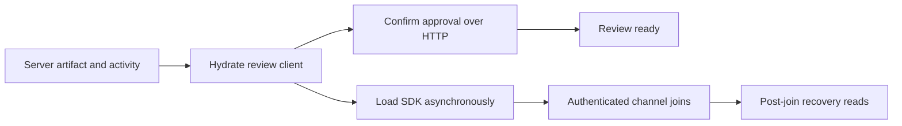

# Defer the session review SDK

Constrained touch opening reaches review readiness in **1,161.9 → 719.4 ms**, a **38.1% reduction**. Immediate mouse opening improves similarly. Default local results remain inconclusive.

## Measurement

Five alternating samples per build, input, and condition. Baseline is latest main at `a3bbb75a`, and the candidate implementation is `457399f5`. Both sides use the unchanged harness from #589 and the same isolated database with 160 additional sessions. Diagnostic profiles are separate from these 40 untraced samples.

| Native click to review ready | Before median, range in ms | After median, range in ms | Verdict                      |
| ---------------------------- | -------------------------: | ------------------------: | ---------------------------- |
| Default, immediate mouse     |         280.1, 201.9–289.3 |        263.1, 196.3–281.2 | Inconclusive, ranges overlap |
| Default, touch               |         258.1, 187.1–282.0 |        265.3, 256.6–272.9 | Inconclusive, ranges overlap |
| Constrained, immediate mouse |   1,156.5, 1,039.0–1,163.5 |        714.4, 703.5–732.4 | Faster, 38.2% lower median   |
| Constrained, touch           |   1,161.9, 1,051.9–1,166.6 |        719.4, 718.8–756.5 | Faster, 38.1% lower median   |

- Constrained means 4× browser CPU slowdown, 80 ms configured HTTP latency, 1600 kbps download, and 750 kbps upload. Server/database traffic stays local. These lab results do not establish a physical-phone or production-field speedup.
- The same Chromium version and fresh browser contexts keep destination scripts cold after warming the sessions list. The 10-core host retains other desktop processes; sample load averages are recorded and build/input order alternates.
- Readiness requires the expected latest v1 artifact and enabled review controls across a painted frame. All 40 samples pass, with zero failed requests excluding separately recorded browser-aborted RSC streams. Request changes successfully loads the displayed artifact's review after timing ends.
- The metric measures first review readiness. Realtime establishment and later revalidation remain background work. Request collection extends 250 ms after observed readiness, so counts from that window do not establish a reduction in total recovery reads.

[Samples, build IDs, source and harness hashes, request timings, and reduced profiles](evidence/session-sdk-deferral-performance.json).

## Change

Three latest-main imports brought the SDK into initial session rendering:

| Import owner                                                                    | Deferred use                                                                         |
| ------------------------------------------------------------------------------- | ------------------------------------------------------------------------------------ |
| [Detail client](../src/features/sessions/detail/session-detail-page-client.tsx) | Session subscription and recovery snapshot reads                                     |
| [Activity panel](../src/features/wallie/session-wallie-panel.tsx)               | Run/message subscriptions, message reads, and linked-run lookup                      |
| [Approval-review hook](../src/features/sessions/detail/use-approval-review.ts)  | Review-thread subscription; authoritative HTTP confirmation still starts immediately |

The activity context can retain its static panel import because the panel no longer imports the SDK eagerly. Both detail and activity render from their server snapshots.



- [The deferred adapter](../src/lib/supabase/deferred-browser.ts) checks disposal and recovery generation before creating a channel. It preserves authenticated joining, channel removal, and retries through the existing recovery controller.
- Message and provenance reads check cancellation or generation after awaiting the SDK. The browser factory retains its singleton behavior; module loading needs no additional promise cache.
- The approval hook registers an optional recovery source so a failed SDK load can retry. Its initial HTTP fetch and immediate thread-change refresh remain. Post-join refresh now uses the controller's existing 200 ms batch. Approval still fails closed while authoritative confirmation is pending or fails.
- Prefetch waits, server authorization, and database schema are unchanged by this PR.

## Explain the number

The initial detail client entries shrink from **671,798 → 447,921 raw bytes** and **200,649 → 141,187 gzip bytes**. The shared SDK-containing chunk still loads asynchronously; its 224,618 decoded bytes are absent from initial entries.

Times below are relative to click and include profiling overhead.

| Diagnostic event                     | Before, ms | After, ms |
| ------------------------------------ | ---------: | --------: |
| Router push                          |      171.7 |     168.3 |
| Last initial client script completes |      850.3 |     543.2 |
| Expected artifact observed           |      977.4 |     649.5 |
| Review ready                         |    1,064.1 |     745.4 |
| SDK-containing chunk completes       |      850.3 |   1,020.1 |

The candidate reaches readiness while the SDK is still downloading. A browser regression also holds the SDK response until it has checked the artifact, activity disclosure, authoritative approval confirmation, and working Request changes. Releasing it establishes authenticated subscriptions and the expected recovery reads.

The deferred chunk transfers 60,104 encoded bytes in these traces. At the configured 1600 kbps, that represents roughly 300 ms of transfer capacity. Moving it and its evaluation off the initial dependency path fits the diagnostic's roughly 319 ms improvement. The remaining foreground work includes the other client chunks and the authoritative approval HTTP request.

The larger untraced median improvement also includes approval revalidation timing. Every constrained baseline sample records two approval-summary HTTP reads. In seven of ten, readiness follows the second response; three become ready before it completes. The diagnostic captures this faster baseline case. Its second request's initiator maps directly to the old hook's `SUBSCRIBED` callback. Deferring the SDK moves channel establishment and its catch-up beyond first readiness in the candidate. The initial HTTP confirmation remains inside the measured path.

Default local samples still switch between the existing tree fallback and remaining page-data quiet interval. Their spread exceeds the observed change, so this report claims no default-local improvement.

Pstack's Explain the Number principle required matching untraced samples, separate profiles, and the held-SDK proof. Its Laziness Protocol favored async client getters over nullable readiness state. Sequence Work into Verifiable Units kept the frozen baseline, lifecycle verification, and final comparison separate.

## Reproduce

Use the [navigation benchmark setup](navigation-bench.md). Freeze each production build, keep the same seed and harness, and alternate these commands between builds at least five times:

```bash
pnpm bench:navigation --session-only --session-intent touch --cpu-rate 4 --latency-ms 80 --download-kbps 1600 --upload-kbps 750 --skip-build --skip-seed --runs 1 --out bench-results/touch-constrained.json
pnpm bench:navigation --session-only --session-intent immediate --skip-build --skip-seed --runs 1 --out bench-results/immediate-default.json
```

Repeat both intents with both conditions. Add `--supabase-workdir` for an isolated database. Capture separate diagnostics with `--profile --trace-out`; exclude them from the numeric comparison.

Full local artifacts remain under `bench-results/session-sdk-deferral/`. The linked evidence retains the relevant data and raw-artifact hashes without shipping trace payloads.

## Validation

- `pnpm check:fast` passes.
- `pnpm test --maxWorkers=4` passes with 4,908 tests passed and two existing skips.
- `pnpm check:cloudflare` passes with 35 tests passed and the Wrangler dry run complete.
- The production build, authenticated bundle guard, and route budgets pass.
- Held-SDK review/activity and navigation cleanup cases pass. Authenticated detail/activity live changes, Pipeline's held-SDK case, all five prefetch regressions, and the five-flow navigation smoke pass.
